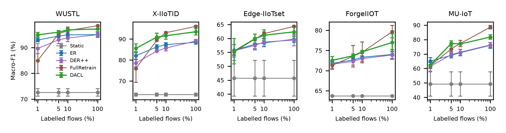

# Label scarcity (MLP, 5 seeds per cell)

Only the given fraction of flows in each batch is labelled. Learning uses labelled flows only; DACL's unsupervised drift signals (entropy, feature shift) see the whole batch, its error signal only the labelled flows.

## DACL vs baselines per label budget (macro-F1, N = 25 dataset x seed pairs)

- **1% labels**: vs ER +1.16 pts (p=0.2, wins 16/25); vs DER++ +2.55 pts (p=0.0006, wins 18/25); vs FullRetrain +2.97 pts (p=0.0009, wins 20/25)
- **5% labels**: vs ER +1.65 pts (p=6e-08, wins 25/25); vs DER++ +3.54 pts (p=6e-08, wins 25/25); vs FullRetrain +1.27 pts (p=0.01, wins 20/25)
- **10% labels**: vs ER +2.52 pts (p=1e-07, wins 24/25); vs DER++ +3.62 pts (p=6e-08, wins 25/25); vs FullRetrain -0.42 pts (p=0.3, wins 10/25)
- **100% labels**: vs ER +3.13 pts (p=6e-08, wins 25/25); vs DER++ +3.49 pts (p=6e-08, wins 25/25); vs FullRetrain -2.79 pts (p=6e-08, wins 0/25)

## WUSTL

|   Labels (%) | Method      | Macro-F1 (%)   |   Detection (%) |   FPR (%) |   MAE (flows) |   Forgetting (%) | Det. delay   | Missed drifts   |
|-------------:|:------------|:---------------|----------------:|----------:|--------------:|-----------------:|:-------------|:----------------|
|            1 | Static      | 72.62 ± 1.45   |            54   |      0.22 |          4402 |              8.7 | --           | --              |
|            1 | ER          | 92.94 ± 0.70   |            93.7 |      1.05 |           846 |             17.9 | --           | --              |
|            1 | DER++       | 89.62 ± 1.93   |            85.9 |      0.8  |          1829 |              0.7 | --           | --              |
|            1 | FullRetrain | 84.98 ± 5.04   |            75.1 |      0.83 |          3085 |              0.7 | 5.9          | 0.4             |
|            1 | DACL        | 94.98 ± 0.90   |            94.7 |      1.12 |           722 |              2.8 | 5.9          | 0.4             |
|            5 | Static      | 72.62 ± 1.45   |            54   |      0.22 |          4402 |              8.7 | --           | --              |
|            5 | ER          | 94.49 ± 0.46   |            95.2 |      0.91 |           661 |             13.7 | --           | --              |
|            5 | DER++       | 93.06 ± 1.51   |            90.9 |      0.75 |          1236 |              0.3 | --           | --              |
|            5 | FullRetrain | 95.34 ± 0.23   |            93.2 |      0.64 |           929 |              0.5 | 4.1          | 0.4             |
|            5 | DACL        | 95.98 ± 0.62   |            96.7 |      1.19 |           436 |              5.6 | 3.9          | 0.8             |
|           10 | Static      | 72.62 ± 1.45   |            54   |      0.22 |          4402 |              8.7 | --           | --              |
|           10 | ER          | 94.94 ± 0.80   |            95.6 |      0.86 |           601 |              7.3 | --           | --              |
|           10 | DER++       | 93.72 ± 1.31   |            91.7 |      0.75 |          1135 |              0.2 | --           | --              |
|           10 | FullRetrain | 96.59 ± 1.36   |            94.2 |      0.66 |           595 |              0.1 | 3.8          | 0.8             |
|           10 | DACL        | 96.89 ± 0.60   |            97.9 |      1.08 |           275 |              3.4 | 1.6          | 0.6             |
|          100 | Static      | 72.62 ± 1.45   |            54   |      0.22 |          4402 |              8.7 | --           | --              |
|          100 | ER          | 95.07 ± 1.09   |            95.5 |      0.68 |           627 |              0.8 | --           | --              |
|          100 | DER++       | 95.02 ± 0.73   |            93.9 |      0.56 |           850 |             -0   | --           | --              |
|          100 | FullRetrain | 98.52 ± 0.08   |            97.4 |      0.15 |           327 |              0.3 | 2.1          | 0.8             |
|          100 | DACL        | 97.24 ± 0.25   |            97.7 |      0.81 |           299 |              2.6 | 4.3          | 0.6             |

## X-IIoTID

|   Labels (%) | Method      | Macro-F1 (%)   |   Detection (%) |   FPR (%) |   MAE (flows) |   Forgetting (%) | Det. delay   | Missed drifts   |
|-------------:|:------------|:---------------|----------------:|----------:|--------------:|-----------------:|:-------------|:----------------|
|            1 | Static      | 63.55 ± 0.74   |            56.1 |      0.07 |          6383 |              2.6 | --           | --              |
|            1 | ER          | 82.02 ± 1.92   |            82.4 |      3.25 |          3295 |              0.1 | --           | --              |
|            1 | DER++       | 78.59 ± 1.88   |            74.4 |      0.75 |          4549 |             -0   | --           | --              |
|            1 | FullRetrain | 75.90 ± 6.50   |            69.9 |      0.31 |          5115 |             -0   | 6.7          | 0.6             |
|            1 | DACL        | 85.55 ± 2.15   |            85.9 |      2.87 |          2569 |              0   | 14.2         | 0.4             |
|            5 | Static      | 63.55 ± 0.74   |            56.1 |      0.07 |          6383 |              2.6 | --           | --              |
|            5 | ER          | 86.25 ± 0.96   |            86.9 |      2.17 |          2531 |              0.6 | --           | --              |
|            5 | DER++       | 84.26 ± 0.36   |            81.4 |      0.56 |          3432 |             -0   | --           | --              |
|            5 | FullRetrain | 89.46 ± 0.57   |            85.9 |      0.29 |          2603 |              0   | 5.3          | 0.8             |
|            5 | DACL        | 90.91 ± 1.96   |            91.3 |      2.15 |          1603 |              0.2 | 9.1          | 0.6             |
|           10 | Static      | 63.55 ± 0.74   |            56.1 |      0.07 |          6383 |              2.6 | --           | --              |
|           10 | ER          | 87.34 ± 0.96   |            89.6 |      2.9  |          1968 |              0.2 | --           | --              |
|           10 | DER++       | 85.69 ± 1.32   |            83   |      0.55 |          3182 |              0   | --           | --              |
|           10 | FullRetrain | 93.03 ± 0.47   |            90.9 |      0.25 |          1678 |              0.1 | 5.2          | 0.8             |
|           10 | DACL        | 91.57 ± 1.61   |            92   |      1.79 |          1470 |              0.2 | 10.9         | 0.8             |
|          100 | Static      | 63.55 ± 0.74   |            56.1 |      0.07 |          6383 |              2.6 | --           | --              |
|          100 | ER          | 88.46 ± 0.92   |            90.4 |      2.42 |          1825 |              0.2 | --           | --              |
|          100 | DER++       | 89.06 ± 0.71   |            87   |      0.36 |          2529 |              0.1 | --           | --              |
|          100 | FullRetrain | 96.01 ± 0.46   |            94.7 |      0.1  |           871 |              0   | 12.9         | 0.6             |
|          100 | DACL        | 93.47 ± 1.50   |            93.2 |      1.01 |          1219 |              0.1 | 7.5          | 1.0             |

## Edge-IIoTset

|   Labels (%) | Method      | Macro-F1 (%)   |   Detection (%) |   FPR (%) |   MAE (flows) |   Forgetting (%) | Det. delay   | Missed drifts   |
|-------------:|:------------|:---------------|----------------:|----------:|--------------:|-----------------:|:-------------|:----------------|
|            1 | Static      | 45.68 ± 6.43   |            67.8 |     25.17 |          4706 |             18.9 | --           | --              |
|            1 | ER          | 55.74 ± 2.00   |            59.1 |      6.15 |          5098 |             12.2 | --           | --              |
|            1 | DER++       | 55.54 ± 2.28   |            56.3 |      3.02 |          5484 |             10.8 | --           | --              |
|            1 | FullRetrain | 55.09 ± 0.89   |            57.5 |      3.89 |          5374 |              7.4 | 5.7          | 0.0             |
|            1 | DACL        | 55.40 ± 4.55   |            61.8 |      5.92 |          4729 |             11.7 | 10.0         | 0.2             |
|            5 | Static      | 45.68 ± 6.43   |            67.8 |     25.17 |          4706 |             18.9 | --           | --              |
|            5 | ER          | 57.89 ± 1.59   |            58.6 |      4.43 |          5032 |             18   | --           | --              |
|            5 | DER++       | 57.49 ± 1.63   |            57.1 |      2.05 |          5235 |              9.1 | --           | --              |
|            5 | FullRetrain | 59.79 ± 0.49   |            57.8 |      1.77 |          5106 |              7.5 | 3.6          | 0.2             |
|            5 | DACL        | 59.91 ± 1.62   |            58.5 |      3.12 |          5123 |             11.4 | 6.7          | 0.0             |
|           10 | Static      | 45.68 ± 6.43   |            67.8 |     25.17 |          4706 |             18.9 | --           | --              |
|           10 | ER          | 58.40 ± 1.39   |            58.5 |      4.34 |          5088 |             15.6 | --           | --              |
|           10 | DER++       | 58.70 ± 1.46   |            57.2 |      1.84 |          5164 |              8.7 | --           | --              |
|           10 | FullRetrain | 61.72 ± 0.59   |            58.9 |      1.47 |          4934 |              6.5 | 2.8          | 0.0             |
|           10 | DACL        | 61.13 ± 1.94   |            59.5 |      2.57 |          4906 |              9.8 | 6.1          | 0.0             |
|          100 | Static      | 45.68 ± 6.43   |            67.8 |     25.17 |          4706 |             18.9 | --           | --              |
|          100 | ER          | 59.70 ± 1.16   |            59.9 |      4.35 |          4903 |             16.3 | --           | --              |
|          100 | DER++       | 59.41 ± 2.07   |            57.7 |      1.5  |          5144 |              9   | --           | --              |
|          100 | FullRetrain | 64.33 ± 0.33   |            60.9 |      0.88 |          4455 |              2.7 | 3.6          | 0.0             |
|          100 | DACL        | 62.35 ± 1.65   |            59.1 |      1.47 |          4814 |              8.7 | 10.9         | 0.4             |

## ForgeIIOT

|   Labels (%) | Method      | Macro-F1 (%)   |   Detection (%) |   FPR (%) |   MAE (flows) |   Forgetting (%) | Det. delay   | Missed drifts   |
|-------------:|:------------|:---------------|----------------:|----------:|--------------:|-----------------:|:-------------|:----------------|
|            1 | Static      | 63.74 ± 0.08   |            97.8 |      0.03 |           303 |              0   | --           | --              |
|            1 | ER          | 71.79 ± 0.33   |            98.4 |      0.13 |           298 |              1.4 | --           | --              |
|            1 | DER++       | 71.59 ± 0.96   |            97.2 |      0.06 |           528 |              0.4 | --           | --              |
|            1 | FullRetrain | 71.29 ± 0.98   |            98.3 |      0.03 |           228 |              0.4 | 4.5          | 0.4             |
|            1 | DACL        | 72.54 ± 0.98   |            98.7 |      0.23 |           247 |              3.9 | 18.3         | 0.6             |
|            5 | Static      | 63.74 ± 0.08   |            97.8 |      0.03 |           303 |              0   | --           | --              |
|            5 | ER          | 72.64 ± 0.37   |            98.2 |      0.22 |           355 |              1.4 | --           | --              |
|            5 | DER++       | 72.29 ± 0.93   |            97.9 |      0.06 |           419 |              0.4 | --           | --              |
|            5 | FullRetrain | 73.57 ± 2.66   |            98.9 |      0.04 |           187 |              0.4 | 4.3          | 0.4             |
|            5 | DACL        | 73.69 ± 0.44   |            99.1 |      0.16 |           168 |              0.4 | 16.2         | 0.4             |
|           10 | Static      | 63.74 ± 0.08   |            97.8 |      0.03 |           303 |              0   | --           | --              |
|           10 | ER          | 73.31 ± 0.99   |            98.4 |      0.15 |           305 |              0.9 | --           | --              |
|           10 | DER++       | 72.97 ± 0.68   |            97.9 |      0.08 |           423 |              0.4 | --           | --              |
|           10 | FullRetrain | 74.54 ± 2.58   |            99   |      0.04 |           168 |              0.4 | 3.7          | 0.6             |
|           10 | DACL        | 74.65 ± 0.38   |            99.3 |      0.12 |           124 |              0.4 | 11.9         | 0.6             |
|          100 | Static      | 63.74 ± 0.08   |            97.8 |      0.03 |           303 |              0   | --           | --              |
|          100 | ER          | 74.02 ± 1.23   |            98.2 |      0.11 |           363 |              0.4 | --           | --              |
|          100 | DER++       | 73.86 ± 0.84   |            97.7 |      0.05 |           464 |              0.4 | --           | --              |
|          100 | FullRetrain | 79.66 ± 1.54   |            99.6 |      0.04 |            51 |              0   | 3.8          | 0.6             |
|          100 | DACL        | 76.97 ± 2.15   |            99.2 |      0.11 |           133 |              0.4 | 10.9         | 1.0             |

## MU-IoT

|   Labels (%) | Method      | Macro-F1 (%)   |   Detection (%) |   FPR (%) |   MAE (flows) |   Forgetting (%) | Det. delay   | Missed drifts   |
|-------------:|:------------|:---------------|----------------:|----------:|--------------:|-----------------:|:-------------|:----------------|
|            1 | Static      | 49.23 ± 8.39   |            92.3 |      0.94 |           861 |             39.3 | --           | --              |
|            1 | ER          | 65.12 ± 2.38   |            91.6 |      0.16 |          1852 |             84.4 | --           | --              |
|            1 | DER++       | 61.47 ± 3.29   |            93.6 |      0.1  |          1321 |             71.8 | --           | --              |
|            1 | FullRetrain | 61.95 ± 2.12   |            98.4 |      0.04 |           204 |              4.7 | 3.4          | 0.6             |
|            1 | DACL        | 62.35 ± 1.90   |            90.4 |      0.33 |          2241 |             87.8 | 11.0         | 0.2             |
|            5 | Static      | 49.23 ± 8.39   |            92.3 |      0.94 |           861 |             39.3 | --           | --              |
|            5 | ER          | 69.07 ± 1.76   |            95.8 |      0.13 |           911 |             86.6 | --           | --              |
|            5 | DER++       | 69.57 ± 1.14   |            96.9 |      0.05 |           630 |             39.7 | --           | --              |
|            5 | FullRetrain | 73.52 ± 1.83   |            99.3 |      0.04 |           113 |              6.3 | 6.9          | 0.4             |
|            5 | DACL        | 77.34 ± 1.79   |            97.9 |      0.09 |           416 |             52.7 | 3.7          | 0.0             |
|           10 | Static      | 49.23 ± 8.39   |            92.3 |      0.94 |           861 |             39.3 | --           | --              |
|           10 | ER          | 70.93 ± 2.17   |            95.4 |      0.15 |          1026 |             72.8 | --           | --              |
|           10 | DER++       | 71.27 ± 2.11   |            97.2 |      0.07 |           564 |             23.5 | --           | --              |
|           10 | FullRetrain | 77.29 ± 2.23   |            99.2 |      0.03 |           137 |              6   | 7.0          | 0.6             |
|           10 | DACL        | 76.96 ± 0.31   |            98.2 |      0.07 |           337 |             32.8 | 6.6          | 0.2             |
|          100 | Static      | 49.23 ± 8.39   |            92.3 |      0.94 |           861 |             39.3 | --           | --              |
|          100 | ER          | 76.02 ± 2.04   |            97.6 |      0.1  |           501 |             27   | --           | --              |
|          100 | DER++       | 76.30 ± 1.72   |            98.2 |      0.04 |           371 |             17.7 | --           | --              |
|          100 | FullRetrain | 88.55 ± 1.22   |            99.4 |      0.02 |           123 |              0.4 | 7.0          | 0.6             |
|          100 | DACL        | 81.76 ± 1.57   |            99   |      0.05 |           199 |             16.7 | 6.5          | 0.6             |

