# Per-dataset results

Injected drift: 5 datasets x 6 backbones x 9 methods x 5 seeds. Natural drift: the 3 datasets with a usable recording order. Mean ± std over 5 seeds; bold = best backbone (per column) or best method excluding the FullRetrain upper bound.

Edge costs: single x86 CPU thread (profile_edge.py); energy = CPU time x 3.0 W (power model, to be replaced by Raspberry Pi measurements); deadline = 256 ms per 256-flow batch (1,000 flows/s). Within one dataset x backbone cell only 5 seeds exist (the smallest possible two-sided Wilcoxon p for 5 pairs is 0.0625), so tests pool backbones x seeds (N = 30).

## WUSTL-IIoT-2021

### A. Injected drift (P1 initial, P2 drift, P3 new attack, P4 known attack returns)

Classes: normal, DoS, Reconn; 41 features.

#### L1 Detection (DACL, per backbone)

| Backbone       | Accuracy         | Precision        | Recall (DR)      | Macro-F1         | FPR             | FNR             | MCC (stream)      | MCC (test)        | PR-AUC (bin.)     | PR-AUC (macro)    |
|:---------------|:-----------------|:-----------------|:-----------------|:-----------------|:----------------|:----------------|:------------------|:------------------|:------------------|:------------------|
| MLP            | 98.65 ± 0.16     | 96.73 ± 0.34     | 97.67 ± 0.21     | 97.24 ± 0.25     | 0.81 ± 0.13     | 2.33 ± 0.21     | 0.955 ± 0.004     | 0.987 ± 0.003     | 0.998 ± 0.001     | 0.995 ± 0.003     |
| 1D-CNN         | 98.22 ± 0.18     | 95.98 ± 0.34     | 98.25 ± 0.44     | 96.65 ± 0.38     | 1.41 ± 0.17     | 1.75 ± 0.44     | 0.947 ± 0.005     | 0.965 ± 0.006     | 0.997 ± 0.002     | 0.994 ± 0.002     |
| LSTM           | 97.83 ± 0.51     | 95.29 ± 0.61     | 96.22 ± 0.87     | 95.92 ± 0.70     | 1.57 ± 0.52     | 3.78 ± 0.87     | 0.930 ± 0.012     | 0.968 ± 0.015     | 0.995 ± 0.001     | 0.988 ± 0.008     |
| GRU            | 98.16 ± 0.15     | 95.72 ± 0.30     | 97.40 ± 0.58     | 96.45 ± 0.23     | 1.39 ± 0.15     | 2.60 ± 0.58     | 0.941 ± 0.005     | 0.968 ± 0.013     | 0.995 ± 0.003     | 0.988 ± 0.005     |
| CNN-LSTM       | 96.92 ± 0.89     | 94.20 ± 1.29     | 96.97 ± 1.68     | 94.42 ± 1.67     | 2.25 ± 0.70     | 3.03 ± 1.68     | 0.918 ± 0.017     | 0.940 ± 0.042     | 0.997 ± 0.002     | 0.990 ± 0.004     |
| FT-Transformer | **99.06 ± 0.32** | **97.67 ± 0.69** | **98.28 ± 0.37** | **98.04 ± 0.52** | **0.56 ± 0.34** | **1.72 ± 0.37** | **0.969 ± 0.008** | **0.988 ± 0.011** | **0.998 ± 0.002** | **0.996 ± 0.005** |

#### L2 Continual (DACL, per backbone)

| Backbone       | Avg. acc.        | Forgetting      | BWT (A)          | Intransigence    | H-score           |
|:---------------|:-----------------|:----------------|:-----------------|:-----------------|:------------------|
| MLP            | 98.65 ± 0.16     | 2.64 ± 3.72     | -2.36 ± 3.70     | 0.00 ± 0.07      | 0.986 ± 0.019     |
| 1D-CNN         | 98.22 ± 0.18     | 13.48 ± 9.72    | -13.32 ± 9.52    | -0.96 ± 1.98     | 0.925 ± 0.056     |
| LSTM           | 97.83 ± 0.51     | 3.96 ± 2.89     | -3.16 ± 3.22     | -0.02 ± 0.04     | 0.979 ± 0.015     |
| GRU            | 98.16 ± 0.15     | 4.82 ± 2.31     | -4.44 ± 2.45     | 0.00 ± 0.07      | 0.975 ± 0.012     |
| CNN-LSTM       | 96.92 ± 0.89     | 18.48 ± 12.08   | -16.58 ± 13.13   | **-1.82 ± 4.01** | 0.894 ± 0.074     |
| FT-Transformer | **99.06 ± 0.32** | **1.20 ± 1.56** | **-1.04 ± 1.44** | -0.02 ± 0.08     | **0.994 ± 0.008** |

#### L3 Lifecycle (DACL, per backbone)

| Backbone       | EW (batches)      | MAE (flows)      | Lifecycle F1     | Det. delay        | False alarms      | FA / 100 batches   | Missed drifts     | dF1 / CPU-s       | dF1 / J           |
|:---------------|:------------------|:-----------------|:-----------------|:------------------|:------------------|:-------------------|:------------------|:------------------|:------------------|
| MLP            | 4.667 ± 0.850     | 299.0 ± 36.3     | 97.24 ± 0.25     | 4.267 ± 5.633     | 0.600 ± 0.894     | 0.214 ± 0.319      | 0.600 ± 0.548     | **1.196 ± 0.308** | **0.399 ± 0.103** |
| 1D-CNN         | 5.400 ± 1.382     | 237.4 ± 78.8     | 96.65 ± 0.38     | 4.033 ± 3.540     | 0.800 ± 0.447     | 0.286 ± 0.160      | **0.200 ± 0.447** | 0.029 ± 0.005     | 0.010 ± 0.002     |
| LSTM           | 7.200 ± 1.924     | 515.8 ± 128.8    | 95.92 ± 0.70     | **3.867 ± 4.142** | **0.400 ± 0.548** | **0.143 ± 0.196**  | 0.400 ± 0.548     | 0.179 ± 0.069     | 0.060 ± 0.023     |
| GRU            | 5.133 ± 1.574     | 336.0 ± 96.6     | 96.45 ± 0.23     | 4.767 ± 3.353     | 0.800 ± 0.837     | 0.286 ± 0.299      | 0.200 ± 0.447     | 0.160 ± 0.024     | 0.053 ± 0.008     |
| CNN-LSTM       | 9.400 ± 3.394     | 389.6 ± 206.2    | 94.42 ± 1.67     | 4.533 ± 2.509     | 0.400 ± 0.548     | 0.143 ± 0.196      | 0.400 ± 0.548     | 0.064 ± 0.026     | 0.021 ± 0.009     |
| FT-Transformer | **3.667 ± 0.782** | **230.0 ± 61.8** | **98.04 ± 0.52** | 6.267 ± 5.838     | 0.800 ± 0.837     | 0.286 ± 0.299      | 0.400 ± 0.548     | 0.008 ± 0.003     | 0.003 ± 0.001     |

#### L4 Edge (DACL, per backbone)

| Backbone       | Lat. mean (ms)   | Lat. p95 (ms)   | Lat. p99 (ms)   | Throughput (flows/s)   | Deadline miss (%)   | Upd. lat. mean (ms)   | Upd. lat. max (ms)   | Params     | Model (MB)   | FLOPs/flow   | Peak mem. (MB)    | Energy/update (J)   |
|:---------------|:-----------------|:----------------|:----------------|:-----------------------|:--------------------|:----------------------|:---------------------|:-----------|:-------------|:-------------|:------------------|:--------------------|
| MLP            | **0.031**        | **0.040**       | **0.047**       | **2,114,794**          | **0.000**           | **9.166 ± 0.830**     | **9.706**            | **13,827** | **0.053**    | **27,264**   | 0.811 ± 0.047     | **0.242 ± 0.028**   |
| 1D-CNN         | 0.102            | 0.160           | 0.248           | 27,070                 | 10.71 ± 2.49        | 287.8 ± 24.9          | 320.1                | 39,363     | 0.150        | 577,600      | 1.125 ± 0.164     | 8.550 ± 1.624       |
| LSTM           | 0.146            | 0.222           | 0.309           | 223,978 ± 0            | 0.000               | 60.86 ± 7.63          | 66.92 ± 6.23         | 19,139     | 0.073        | 221,568      | 1.059 ± 0.194     | 1.945 ± 0.212       |
| GRU            | 0.158            | 0.208           | 0.335           | 244,284                | 0.000               | 50.17 ± 4.37          | 58.197               | 14,403     | 0.055        | 166,272      | 0.876 ± 0.078     | 1.396 ± 0.148       |
| CNN-LSTM       | 0.181            | 0.217           | 0.355           | 42,497                 | 5.93 ± 2.76         | 237.6 ± 36.1          | 303.5                | 25,411     | 0.097        | 598,080      | 1.171 ± 0.193     | 9.420 ± 2.608       |
| FT-Transformer | 0.350            | 0.497 ± 0.000   | 0.699           | 9,388                  | 8.64 ± 2.95         | 1,480 ± 201           | 1,686                | 19,907     | 0.076        | 1,376,448    | **0.790 ± 0.011** | 35.73 ± 4.68        |

#### Macro-F1 (%) of every method on every backbone

|               | MLP              | 1D-CNN           | LSTM             | GRU              | CNN-LSTM         | FT-Transformer   |
|:--------------|:-----------------|:-----------------|:-----------------|:-----------------|:-----------------|:-----------------|
| Static        | 72.62 ± 1.45     | 69.88 ± 2.75     | 63.15 ± 17.02    | 71.77 ± 1.44     | 41.64 ± 17.46    | 71.84 ± 3.79     |
| FineTune      | 94.65 ± 0.99     | 92.35 ± 1.40     | 93.12 ± 1.51     | 95.40 ± 0.71     | 87.61 ± 3.36     | 94.55 ± 1.53     |
| EWC           | 94.72 ± 1.04     | 92.45 ± 1.62     | 93.09 ± 1.50     | 95.40 ± 0.72     | 87.73 ± 3.36     | 95.02 ± 1.26     |
| LwF           | 91.17 ± 1.50     | 90.44 ± 1.81     | 89.61 ± 1.59     | 92.12 ± 1.31     | 80.11 ± 5.03     | 93.92 ± 1.72     |
| ER            | 95.07 ± 1.09     | 95.37 ± 1.33     | 94.25 ± 1.24     | 95.86 ± 0.56     | 91.22 ± 2.12     | 96.27 ± 1.05     |
| DER++         | 95.02 ± 0.73     | 90.95 ± 4.86     | 94.35 ± 1.15     | 95.32 ± 0.86     | 89.77 ± 2.89     | 97.05 ± 0.62     |
| PeriodicER    | 89.51 ± 1.40     | 90.59 ± 2.63     | 87.65 ± 2.55     | 90.75 ± 1.29     | 79.51 ± 4.29     | 92.75 ± 1.03     |
| WindowRetrain | **97.49 ± 0.31** | nan              | nan              | nan              | nan              | 97.77 ± 0.66     |
| FullRetrain   | 98.52 ± 0.08     | 98.26 ± 0.31     | 98.09 ± 0.64     | 98.36 ± 0.11     | 96.47 ± 0.87     | 98.55 ± 0.26     |
| DACL          | 97.24 ± 0.25     | **96.65 ± 0.38** | **95.92 ± 0.70** | **96.45 ± 0.23** | **94.42 ± 1.67** | **98.04 ± 0.52** |

**Best baseline: WindowRetrain.** DACL - WindowRetrain macro-F1: median -0.25 pts, mean +0.01 pts; DACL better in 4/10 backbone x seed pairs; Wilcoxon p = 0.85.

#### Per-class recall (%) at the end of the stream (DACL)

|                |   normal |   DoS |   Reconn |
|:---------------|---------:|------:|---------:|
| MLP            |    98.6  | 98.98 |    99.86 |
| 1D-CNN         |    97.86 | 95.24 |    99.84 |
| LSTM           |    97.82 | 95.86 |    99.86 |
| GRU            |    97.84 | 95.7  |    99.86 |
| CNN-LSTM       |    98.06 | 89.62 |    99.86 |
| FT-Transformer |    98.94 | 98.66 |    99.96 |

#### Per-class recall (%) after each phase: Static (MLP)

|               |   normal |   DoS |   Reconn |
|:--------------|---------:|------:|---------:|
| P0 Deployment |    99.98 | 99.7  |        0 |
| P1 Initial    |    99.98 | 99.7  |        0 |
| P2 Drift      |    99.84 | 91.04 |        0 |
| P3 New-attack |    99.84 | 91.04 |        0 |
| P4 A-returns  |    99.84 | 91.04 |        0 |

#### Per-class recall (%) after each phase: DACL (MLP)

|               |   normal |   DoS |   Reconn |
|:--------------|---------:|------:|---------:|
| P0 Deployment |    99.98 | 99.7  |     0    |
| P1 Initial    |    99.98 | 99.7  |     0    |
| P2 Drift      |    99.98 | 99.42 |     0    |
| P3 New-attack |    98.38 | 97.06 |    99.86 |
| P4 A-returns  |    98.6  | 98.98 |    99.86 |

#### Statistics

- Friedman test across backbones (DACL macro-F1, blocks = 5 seeds): chi2 = 23.40, p = 0.000283. Average ranks: FT-Transformer 1.00, MLP 2.00, 1D-CNN 3.20, GRU 4.00, LSTM 5.00, CNN-LSTM 5.80
- DACL vs Static (macro-F1, N = 30 backbone x seed pairs): median diff +25.11 pts, Wilcoxon p = 1.9e-09
- DACL vs FineTune (macro-F1, N = 30 backbone x seed pairs): median diff +3.23 pts, Wilcoxon p = 1.9e-09
- DACL vs EWC (macro-F1, N = 30 backbone x seed pairs): median diff +3.06 pts, Wilcoxon p = 1.9e-09
- DACL vs LwF (macro-F1, N = 30 backbone x seed pairs): median diff +5.73 pts, Wilcoxon p = 1.9e-09
- DACL vs ER (macro-F1, N = 30 backbone x seed pairs): median diff +1.54 pts, Wilcoxon p = 3.7e-09
- DACL vs DER++ (macro-F1, N = 30 backbone x seed pairs): median diff +1.99 pts, Wilcoxon p = 1.9e-09
- DACL vs PeriodicER (macro-F1, N = 30 backbone x seed pairs): median diff +6.73 pts, Wilcoxon p = 1.9e-09
- DACL vs WindowRetrain (macro-F1, N = 10 backbone x seed pairs): median diff -0.25 pts, Wilcoxon p = 0.85
- DACL vs FullRetrain (macro-F1, N = 30 backbone x seed pairs): median diff -1.58 pts, Wilcoxon p = 1.9e-09

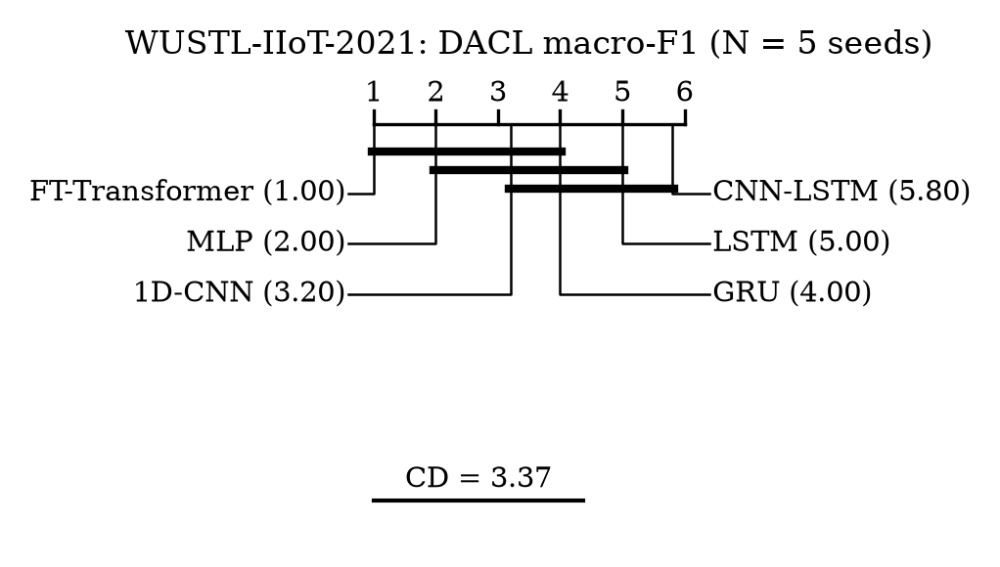

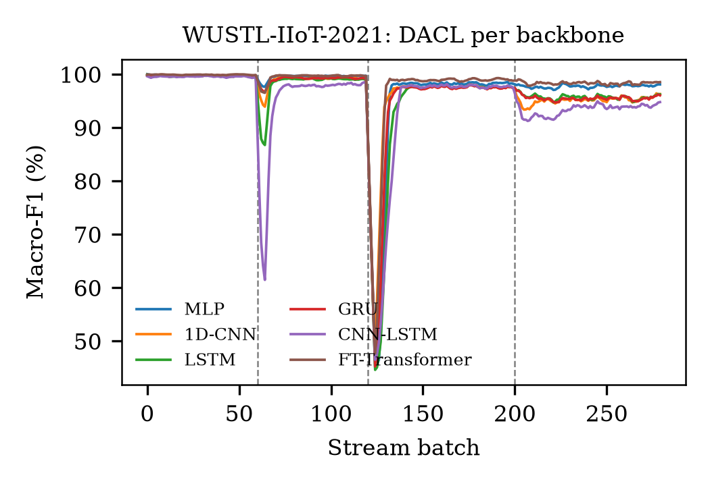

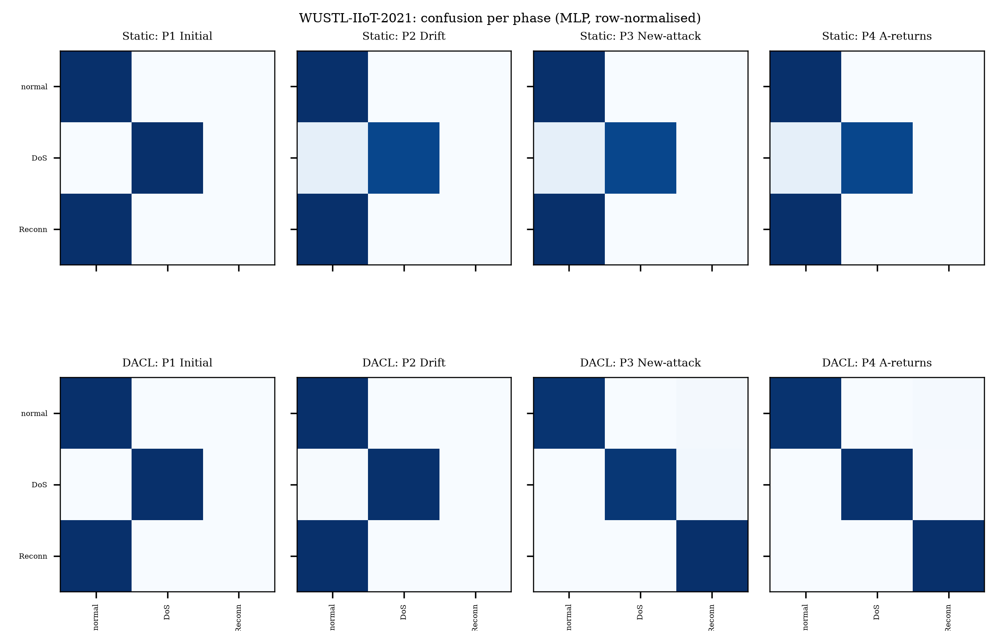

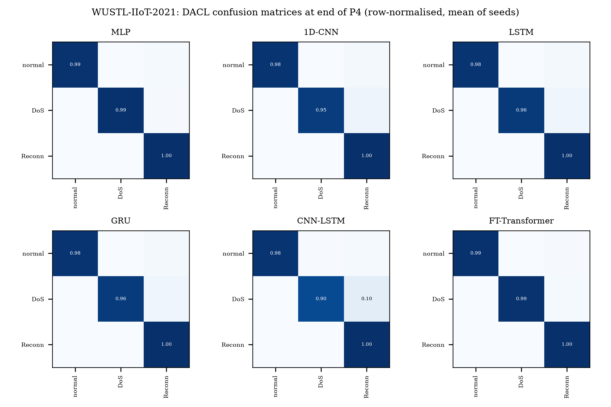

#### Layer 5: PureChain update gate on this dataset (MLP; balanced net-security-benefit policy, hard floor 30%, escalation at 10%; dual serving = alarm from the verified model, attack type from an advisory model)

| Setting                                | Method         | Macro-F1 (%)   | Detection (%)   | FPR (%)     | MAE (flows)   | Known-attack detectability (%)   | Rejected   | Escalated   | Poisoned updates accepted   |
|:---------------------------------------|:---------------|:---------------|:----------------|:------------|:--------------|:---------------------------------|:-----------|:------------|:----------------------------|
| Clean (cost of security)               | DACL           | 96.93 ± 0.56   | 97.16 ± 0.93    | 0.82 ± 0.09 | 378.8 ± 141.8 | 99.98 ± 0.04                     | --         | --          | --                          |
| Clean (cost of security)               | DACL+Gate      | 96.48 ± 0.42   | 96.25 ± 0.68    | 0.82 ± 0.07 | 515.6 ± 108.5 | 100.0                            | 0.0%       | 0.0%        | --                          |
| Clean (cost of security)               | DACL+Gate-dual | 96.67 ± 0.53   | 96.25 ± 0.70    | 0.80 ± 0.09 | 511.6 ± 110.2 | 100.0                            | 0.0%       | 0.0%        | --                          |
| Poisoning during drift (P2)            | DACL           | 85.24 ± 0.95   | 75.85 ± 1.30    | 0.72 ± 0.06 | 1,725 ± 2,235 | 98.42 ± 3.09                     | --         | --          | --                          |
| Poisoning during drift (P2)            | DACL+Gate      | 89.19 ± 4.29   | 84.42 ± 7.20    | 0.67 ± 0.18 | 2,217 ± 1,274 | 99.96 ± 0.09                     | 40.7%      | 0.0%        | --                          |
| Poisoning during drift (P2)            | DACL+Gate-dual | 90.75 ± 3.32   | 84.32 ± 7.17    | 0.67 ± 0.18 | 2,151 ± 1,161 | 99.86 ± 0.31                     | 40.7%      | 0.0%        | --                          |
| Unlearning attack on known attack (P4) | DACL           | 96.68 ± 0.52   | 96.20 ± 0.94    | 0.70 ± 0.10 | 378.8 ± 141.8 | 87.22 ± 7.15                     | --         | --          | 100%                        |
| Unlearning attack on known attack (P4) | DACL+Gate      | 96.23 ± 0.43   | 95.96 ± 0.76    | 0.80 ± 0.20 | 515.6 ± 108.5 | 96.98 ± 3.15                     | 27.9%      | 0.0%        | 50.0%                       |
| Unlearning attack on known attack (P4) | DACL+Gate-dual | 96.57 ± 0.52   | 96.07 ± 0.78    | 0.81 ± 0.20 | 511.6 ± 110.2 | 96.98 ± 4.11                     | 24.6%      | 0.0%        | 57.9%                       |

#### Label scarcity (MLP): only the given share of flows is labelled

|   Labels (%) | Method      | Macro-F1 (%)   |   Detection (%) |   FPR (%) |   MAE (flows) |   Forgetting (%) | Det. delay   | Missed drifts   |
|-------------:|:------------|:---------------|----------------:|----------:|--------------:|-----------------:|:-------------|:----------------|
|            1 | Static      | 72.62 ± 1.45   |            54   |      0.22 |          4402 |              8.7 | --           | --              |
|            1 | ER          | 92.94 ± 0.70   |            93.7 |      1.05 |           846 |             17.9 | --           | --              |
|            1 | DER++       | 89.62 ± 1.93   |            85.9 |      0.8  |          1829 |              0.7 | --           | --              |
|            1 | FullRetrain | 84.98 ± 5.04   |            75.1 |      0.83 |          3085 |              0.7 | 5.9          | 0.4             |
|            1 | DACL        | 94.98 ± 0.90   |            94.7 |      1.12 |           722 |              2.8 | 5.9          | 0.4             |
|            5 | Static      | 72.62 ± 1.45   |            54   |      0.22 |          4402 |              8.7 | --           | --              |
|            5 | ER          | 94.49 ± 0.46   |            95.2 |      0.91 |           661 |             13.7 | --           | --              |
|            5 | DER++       | 93.06 ± 1.51   |            90.9 |      0.75 |          1236 |              0.3 | --           | --              |
|            5 | FullRetrain | 95.34 ± 0.23   |            93.2 |      0.64 |           929 |              0.5 | 4.1          | 0.4             |
|            5 | DACL        | 95.98 ± 0.62   |            96.7 |      1.19 |           436 |              5.6 | 3.9          | 0.8             |
|           10 | Static      | 72.62 ± 1.45   |            54   |      0.22 |          4402 |              8.7 | --           | --              |
|           10 | ER          | 94.94 ± 0.80   |            95.6 |      0.86 |           601 |              7.3 | --           | --              |
|           10 | DER++       | 93.72 ± 1.31   |            91.7 |      0.75 |          1135 |              0.2 | --           | --              |
|           10 | FullRetrain | 96.59 ± 1.36   |            94.2 |      0.66 |           595 |              0.1 | 3.8          | 0.8             |
|           10 | DACL        | 96.89 ± 0.60   |            97.9 |      1.08 |           275 |              3.4 | 1.6          | 0.6             |
|          100 | Static      | 72.62 ± 1.45   |            54   |      0.22 |          4402 |              8.7 | --           | --              |
|          100 | ER          | 95.07 ± 1.09   |            95.5 |      0.68 |           627 |              0.8 | --           | --              |
|          100 | DER++       | 95.02 ± 0.73   |            93.9 |      0.56 |           850 |             -0   | --           | --              |
|          100 | FullRetrain | 98.52 ± 0.08   |            97.4 |      0.15 |           327 |              0.3 | 2.1          | 0.8             |
|          100 | DACL        | 97.24 ± 0.25   |            97.7 |      0.81 |           299 |              2.6 | 4.3          | 0.6             |

### B. Sensitivity analysis (MLP; one parameter varied at a time)

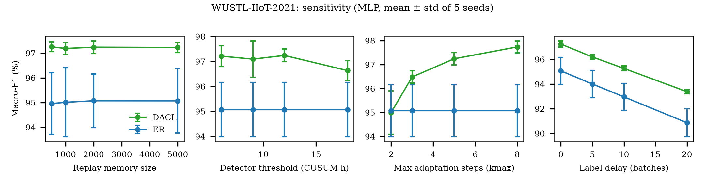

| method   |   value | parameter                    |   Macro-F1 (%) |   Forgetting (%) |    MAE |   Grad steps |
|:---------|--------:|:-----------------------------|---------------:|-----------------:|-------:|-------------:|
| DACL     |     500 | Replay memory size           |           97.2 |              2.9 |  300.8 |        115   |
| DACL     |    1000 | Replay memory size           |           97.2 |              2.7 |  308.6 |        103.2 |
| DACL     |    2000 | Replay memory size           |           97.2 |              2.6 |  299   |        114   |
| DACL     |    5000 | Replay memory size           |           97.2 |              2.4 |  307.6 |        115   |
| ER       |     500 | Replay memory size           |           95   |              0.8 |  653   |        280   |
| ER       |    1000 | Replay memory size           |           95   |              0.7 |  652   |        280   |
| ER       |    2000 | Replay memory size           |           95.1 |              0.8 |  626.6 |        280   |
| ER       |    5000 | Replay memory size           |           95.1 |              0.7 |  650.6 |        280   |
| DACL     |       6 | Detector threshold (CUSUM h) |           97.2 |              2.2 |  304   |        127   |
| DACL     |       9 | Detector threshold (CUSUM h) |           97.1 |              2   |  280.2 |        115.8 |
| DACL     |      12 | Detector threshold (CUSUM h) |           97.2 |              2.6 |  299   |        114   |
| DACL     |      18 | Detector threshold (CUSUM h) |           96.6 |              1.7 |  399   |         93.6 |
| ER       |       6 | Detector threshold (CUSUM h) |           95.1 |              0.8 |  626.6 |        280   |
| ER       |       9 | Detector threshold (CUSUM h) |           95.1 |              0.8 |  626.6 |        280   |
| ER       |      12 | Detector threshold (CUSUM h) |           95.1 |              0.8 |  626.6 |        280   |
| ER       |      18 | Detector threshold (CUSUM h) |           95.1 |              0.8 |  626.6 |        280   |
| DACL     |       2 | Max adaptation steps (kmax)  |           95   |              1.8 |  695.8 |         75.2 |
| DACL     |       3 | Max adaptation steps (kmax)  |           96.5 |              2   |  431.4 |         79.6 |
| DACL     |       5 | Max adaptation steps (kmax)  |           97.2 |              2.6 |  299   |        114   |
| DACL     |       8 | Max adaptation steps (kmax)  |           97.7 |              1.9 |  239.2 |        193.6 |
| ER       |       2 | Max adaptation steps (kmax)  |           95.1 |              0.8 |  626.6 |        280   |
| ER       |       3 | Max adaptation steps (kmax)  |           95.1 |              0.8 |  626.6 |        280   |
| ER       |       5 | Max adaptation steps (kmax)  |           95.1 |              0.8 |  626.6 |        280   |
| ER       |       8 | Max adaptation steps (kmax)  |           95.1 |              0.8 |  626.6 |        280   |
| DACL     |       0 | Label delay (batches)        |           97.2 |              2.6 |  299   |        114   |
| DACL     |       5 | Label delay (batches)        |           96.2 |              2.2 |  574.8 |        131   |
| DACL     |      10 | Label delay (batches)        |           95.3 |              1.6 |  862.4 |        144.8 |
| DACL     |      20 | Label delay (batches)        |           93.4 |              1.1 | 1423.8 |        180.8 |
| ER       |       0 | Label delay (batches)        |           95.1 |              0.8 |  626.6 |        280   |
| ER       |       5 | Label delay (batches)        |           94   |              0.9 |  908.2 |        275   |
| ER       |      10 | Label delay (batches)        |           93   |              0.9 | 1178   |        270   |
| ER       |      20 | Label delay (batches)        |           90.9 |              1.2 | 1726.2 |        260   |

### C. Natural drift (traffic replayed in recording order)

Classes: normal, Reconn, DoS, CommInj, Backdoor; 41 features.

#### L1 Detection (DACL, per backbone) -- natural drift

| Backbone       | Accuracy         | Precision        | Recall (DR)      | Macro-F1         | FPR             | FNR             | MCC (stream)      | MCC (test)        | PR-AUC (bin.)     | PR-AUC (macro)    |
|:---------------|:-----------------|:-----------------|:-----------------|:-----------------|:----------------|:----------------|:------------------|:------------------|:------------------|:------------------|
| MLP            | 96.56 ± 0.55     | 91.83 ± 1.38     | 74.45 ± 3.32     | 89.76 ± 1.45     | 6.08 ± 0.48     | 25.55 ± 3.32    | 0.112 ± 0.018     | 0.971 ± 0.006     | 0.997 ± 0.001     | 0.870 ± 0.071     |
| 1D-CNN         | 96.91 ± 0.29     | 92.09 ± 0.43     | 90.46 ± 1.91     | **90.95 ± 0.57** | 8.12 ± 0.70     | 9.54 ± 1.91     | 0.132 ± 0.009     | 0.917 ± 0.037     | 0.992 ± 0.005     | 0.918 ± 0.012     |
| LSTM           | 95.97 ± 0.45     | 90.58 ± 0.77     | 75.83 ± 2.73     | 89.05 ± 0.82     | **5.68 ± 0.81** | 24.17 ± 2.73    | 0.106 ± 0.011     | 0.973 ± 0.008     | 0.999 ± 0.001     | 0.955 ± 0.005     |
| GRU            | 96.57 ± 0.25     | **92.32 ± 0.67** | 78.24 ± 1.89     | 90.31 ± 0.39     | 6.18 ± 0.46     | 21.76 ± 1.89    | 0.121 ± 0.006     | 0.973 ± 0.008     | 0.999 ± 0.001     | 0.949 ± 0.034     |
| CNN-LSTM       | 96.43 ± 0.22     | 89.78 ± 1.22     | 88.05 ± 1.64     | 88.71 ± 1.00     | 8.15 ± 0.14     | 11.95 ± 1.64    | 0.102 ± 0.010     | 0.966 ± 0.009     | 0.996 ± 0.003     | 0.903 ± 0.030     |
| FT-Transformer | **97.49 ± 0.31** | 91.39 ± 0.97     | **91.73 ± 3.20** | 90.71 ± 0.92     | 6.01 ± 0.78     | **8.27 ± 3.20** | **0.132 ± 0.011** | **0.980 ± 0.010** | **0.999 ± 0.001** | **0.963 ± 0.034** |

#### L2 Continual (DACL, per backbone) -- natural drift

| Backbone       | Avg. acc.        | Forgetting   |   BWT (A) | Intransigence   | H-score           |
|:---------------|:-----------------|:-------------|----------:|:----------------|:------------------|
| MLP            | 96.56 ± 0.55     | 0.09 ± 0.20  |         0 | 1.55 ± 0.98     | 0.986 ± 0.003     |
| 1D-CNN         | 96.91 ± 0.29     | 0.09 ± 0.20  |         0 | 9.02 ± 6.79     | 0.942 ± 0.038     |
| LSTM           | 95.97 ± 0.45     | **0.000**    |         0 | 0.73 ± 1.02     | 0.988 ± 0.005     |
| GRU            | 96.57 ± 0.25     | 0.000        |         0 | 0.77 ± 1.04     | 0.990 ± 0.005     |
| CNN-LSTM       | 96.43 ± 0.22     | 0.000        |         0 | 0.92 ± 1.13     | 0.987 ± 0.006     |
| FT-Transformer | **97.49 ± 0.31** | 0.18 ± 0.18  |         0 | **0.64 ± 1.38** | **0.990 ± 0.007** |

#### L3 Lifecycle (DACL, per backbone) -- natural drift

| Backbone       | EW (batches)      | MAE (flows)       | Lifecycle F1     | Det. delay        | False alarms      | FA / 100 batches   |   Missed drifts | dF1 / CPU-s       | dF1 / J           |
|:---------------|:------------------|:------------------|:-----------------|:------------------|:------------------|:-------------------|----------------:|:------------------|:------------------|
| MLP            | 16.27 ± 10.13     | 2,059 ± 888       | 89.76 ± 1.45     | 6.533 ± 0.298     | 4.000             | 0.734              |               0 | **0.126 ± 0.021** | **0.042 ± 0.007** |
| 1D-CNN         | 11.67 ± 9.95      | 884.6 ± 329.6     | **90.95 ± 0.57** | 6.400 ± 0.149     | 4.000             | 0.734              |               0 | 0.006 ± 0.001     | 0.002 ± 0.000     |
| LSTM           | 8.733 ± 8.361     | 1,709 ± 840       | 89.05 ± 0.82     | **6.333 ± 0.408** | 4.400 ± 0.548     | 0.807 ± 0.100      |               0 | 0.016 ± 0.001     | 0.005 ± 0.000     |
| GRU            | 4.400 ± 0.435     | 980.4 ± 50.4      | 90.31 ± 0.39     | 6.600 ± 0.149     | 4.000             | 0.734              |               0 | 0.021 ± 0.001     | 0.007 ± 0.000     |
| CNN-LSTM       | 4.800 ± 0.183     | 1,311 ± 70        | 88.71 ± 1.00     | 7.533 ± 2.512     | 4.200 ± 0.447     | 0.771 ± 0.082      |               0 | 0.003 ± 0.000     | 0.001 ± 0.000     |
| FT-Transformer | **3.667 ± 0.624** | **827.4 ± 208.0** | 90.71 ± 0.92     | 6.800 ± 2.588     | **3.600 ± 0.548** | **0.661 ± 0.100**  |               0 | 0.001 ± 0.000     | 0.000 ± 0.000     |

#### L4 Edge (DACL, per backbone) -- natural drift

| Backbone       | Lat. mean (ms)   | Lat. p95 (ms)   | Lat. p99 (ms)   | Throughput (flows/s)   | Deadline miss (%)   | Upd. lat. mean (ms)   | Upd. lat. max (ms)   | Params     | Model (MB)   | FLOPs/flow   | Peak mem. (MB)    | Energy/update (J)   |
|:---------------|:-----------------|:----------------|:----------------|:-----------------------|:--------------------|:----------------------|:---------------------|:-----------|:-------------|:-------------|:------------------|:--------------------|
| MLP            | **0.044**        | **0.054**       | **0.120**       | **1,482,356**          | **0.000**           | **7.911 ± 0.458**     | **10.774**           | **13,957** | **0.053**    | **27,520**   | **1.084 ± 0.078** | **0.259 ± 0.006**   |
| 1D-CNN         | 0.123            | 0.198           | 0.319           | 25,938                 | 5.14 ± 1.26         | 197.2 ± 12.4          | 270.4                | 39,493     | 0.151        | 577,856      | 1.343 ± 0.171     | 6.308 ± 0.444       |
| LSTM           | 0.123            | 0.171           | 0.332           | 210,752                | 0.000               | 53.39 ± 4.12          | 73.718               | 19,269     | 0.074        | 221,824      | 1.140 ± 0.113     | 1.738 ± 0.154       |
| GRU            | 0.168            | 0.281           | 0.419 ± 0.000   | 241,724 ± 0            | 0.000               | 52.05 ± 0.88          | 70.901               | 14,533     | 0.055        | 166,528      | 1.113 ± 0.090     | 1.659 ± 0.120       |
| CNN-LSTM       | 0.288            | 0.567           | 1.266           | 42,540                 | 6.57 ± 1.17         | 257.8 ± 11.5          | 345.8                | 25,541     | 0.097        | 598,336      | 1.294 ± 0.148     | 9.628 ± 0.348       |
| FT-Transformer | 0.821            | 1.708 ± 0.000   | 3.294           | 3,631 ± 0              | 13.58 ± 2.31        | 1,489 ± 173           | 2,139                | 19,973     | 0.076        | 1,376,576    | 1.346 ± 0.223     | 51.50 ± 6.33        |

#### Macro-F1 (%) of every method on every backbone -- natural drift

|               | MLP              | 1D-CNN           | LSTM             | GRU              | CNN-LSTM         | FT-Transformer   |
|:--------------|:-----------------|:-----------------|:-----------------|:-----------------|:-----------------|:-----------------|
| Static        | 82.14 ± 0.06     | 82.19 ± 0.08     | 82.16 ± 0.10     | 82.14 ± 0.07     | 82.15 ± 0.09     | 82.23 ± 0.17     |
| FineTune      | 85.19 ± 0.91     | 86.38 ± 1.74     | 83.72 ± 0.27     | 84.26 ± 1.75     | 84.69 ± 0.31     | 84.58 ± 1.21     |
| EWC           | 84.07 ± 0.34     | 88.19 ± 0.93     | 83.24 ± 0.94     | 84.87 ± 1.11     | 84.69 ± 0.18     | 85.12 ± 1.23     |
| LwF           | 84.79 ± 1.01     | 89.26 ± 0.48     | 82.42 ± 0.85     | 84.36 ± 0.47     | 84.00 ± 0.36     | 84.57 ± 1.17     |
| ER            | 85.38 ± 0.89     | 87.86 ± 1.80     | 85.75 ± 0.51     | 87.66 ± 1.01     | 84.34 ± 0.30     | 87.89 ± 0.61     |
| DER++         | 84.56 ± 0.31     | 88.15 ± 1.87     | 84.04 ± 0.34     | 85.30 ± 0.43     | 84.86 ± 0.17     | 86.49 ± 1.02     |
| PeriodicER    | 81.53 ± 0.57     | 79.75 ± 3.69     | 81.75 ± 0.41     | 82.14 ± 0.48     | 81.62 ± 0.25     | 83.67 ± 0.56     |
| WindowRetrain | **92.43 ± 0.41** | nan              | nan              | nan              | nan              | **91.26 ± 2.13** |
| FullRetrain   | 93.06 ± 0.59     | 92.66 ± 0.35     | 92.64 ± 0.28     | 92.66 ± 0.12     | 91.55 ± 0.77     | 94.29 ± 0.47     |
| DACL          | 89.76 ± 1.45     | **90.95 ± 0.57** | **89.05 ± 0.82** | **90.31 ± 0.39** | **88.71 ± 1.00** | 90.71 ± 0.92     |

**Best baseline: WindowRetrain.** DACL - WindowRetrain macro-F1: median -1.61 pts, mean -1.61 pts; DACL better in 2/10 backbone x seed pairs; Wilcoxon p = 0.02.

#### Per-class recall (%) at the end of the stream (DACL)

|                |   normal |   Reconn |   DoS |   CommInj |   Backdoor |
|:---------------|---------:|---------:|------:|----------:|-----------:|
| MLP            |    98.04 |    99.91 | 99.56 |     91.05 |      32.9  |
| 1D-CNN         |    96.78 |    99.91 | 89.74 |     86.84 |      76.77 |
| LSTM           |    98.24 |    99.74 | 99.84 |     90    |      34.19 |
| GRU            |    97.78 |    99.87 | 99.82 |     93.68 |      43.23 |
| CNN-LSTM       |    97.22 |    99.87 | 99.66 |     87.37 |      37.42 |
| FT-Transformer |    98.58 |    99.78 | 99.78 |     70    |      85.16 |

#### Per-class recall (%) after each phase: Static (MLP)

|               |   normal |   Reconn |   DoS |   CommInj |   Backdoor |
|:--------------|---------:|---------:|------:|----------:|-----------:|
| P0 Deployment |      100 |      100 |     0 |         0 |          0 |
| S1            |      100 |      100 |     0 |         0 |          0 |
| S2            |      100 |      100 |     0 |         0 |          0 |
| S3            |      100 |      100 |     0 |         0 |          0 |
| S4            |      100 |      100 |     0 |         0 |          0 |

#### Per-class recall (%) after each phase: DACL (MLP)

|               |   normal |   Reconn |   DoS |   CommInj |   Backdoor |
|:--------------|---------:|---------:|------:|----------:|-----------:|
| P0 Deployment |   100    |   100    |  0    |      0    |        0   |
| S1            |    98.62 |    99.91 | 98.96 |      0    |        0   |
| S2            |    98.1  |    99.91 | 99.62 |     90.53 |        0   |
| S3            |    98.04 |    99.91 | 99.56 |     91.05 |       32.9 |
| S4            |    98.04 |    99.91 | 99.56 |     91.05 |       32.9 |

#### Statistics

- Friedman test across backbones (DACL macro-F1, blocks = 5 seeds): chi2 = 15.40, p = 0.00878. Average ranks: 1D-CNN 1.40, GRU 2.80, FT-Transformer 2.80, MLP 3.80, LSTM 4.80, CNN-LSTM 5.40
- DACL vs Static (macro-F1, N = 30 backbone x seed pairs): median diff +8.12 pts, Wilcoxon p = 1.9e-09
- DACL vs FineTune (macro-F1, N = 30 backbone x seed pairs): median diff +5.07 pts, Wilcoxon p = 1.9e-09
- DACL vs EWC (macro-F1, N = 30 backbone x seed pairs): median diff +5.09 pts, Wilcoxon p = 1.9e-09
- DACL vs LwF (macro-F1, N = 30 backbone x seed pairs): median diff +5.45 pts, Wilcoxon p = 1.9e-09
- DACL vs ER (macro-F1, N = 30 backbone x seed pairs): median diff +3.39 pts, Wilcoxon p = 1.9e-09
- DACL vs DER++ (macro-F1, N = 30 backbone x seed pairs): median diff +4.48 pts, Wilcoxon p = 1.9e-09
- DACL vs PeriodicER (macro-F1, N = 30 backbone x seed pairs): median diff +7.80 pts, Wilcoxon p = 1.9e-09
- DACL vs WindowRetrain (macro-F1, N = 10 backbone x seed pairs): median diff -1.61 pts, Wilcoxon p = 0.02
- DACL vs FullRetrain (macro-F1, N = 30 backbone x seed pairs): median diff -2.75 pts, Wilcoxon p = 1.9e-09

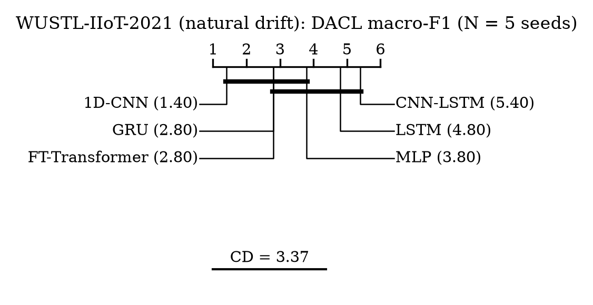

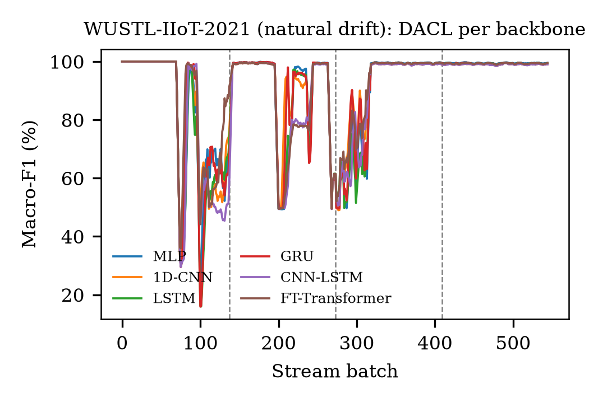

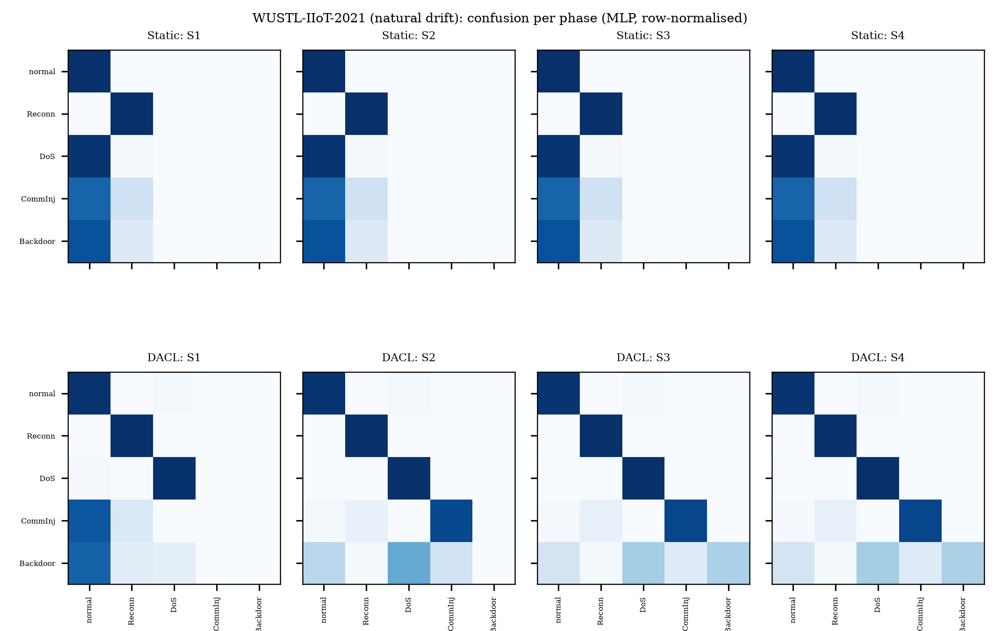

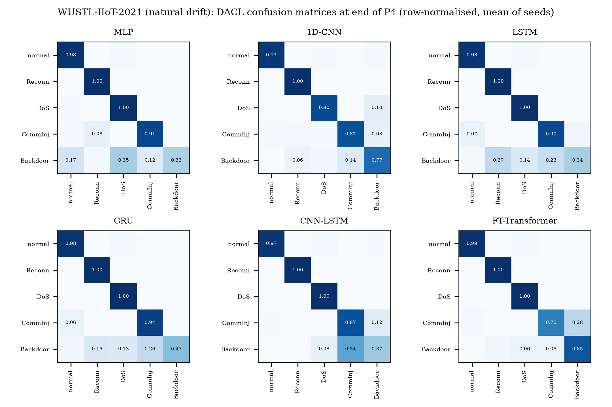

## X-IIoTID

### A. Injected drift (P1 initial, P2 drift, P3 new attack, P4 known attack returns)

Classes: Normal, RDOS, Reconnaissance, Weaponization; 62 features.

#### L1 Detection (DACL, per backbone)

| Backbone       | Accuracy         | Precision        | Recall (DR)      | Macro-F1         | FPR             | FNR             | MCC (stream)      | MCC (test)        | PR-AUC (bin.)     | PR-AUC (macro)    |
|:---------------|:-----------------|:-----------------|:-----------------|:-----------------|:----------------|:----------------|:------------------|:------------------|:------------------|:------------------|
| MLP            | 96.57 ± 0.73     | **94.14 ± 1.59** | **93.16 ± 1.72** | **93.47 ± 1.50** | 1.01 ± 0.34     | **6.84 ± 1.72** | **0.918 ± 0.019** | 0.937 ± 0.005     | **0.997 ± 0.000** | **0.981 ± 0.001** |
| 1D-CNN         | 93.96 ± 0.77     | 90.40 ± 1.22     | 89.31 ± 1.76     | 89.55 ± 1.38     | 2.87 ± 0.43     | 10.69 ± 1.76    | 0.867 ± 0.017     | 0.914 ± 0.009     | 0.993 ± 0.001     | 0.957 ± 0.015     |
| LSTM           | 92.31 ± 0.21     | 86.99 ± 0.52     | 85.16 ± 1.93     | 85.48 ± 0.50     | 3.02 ± 0.66     | 14.84 ± 1.93    | 0.822 ± 0.007     | 0.880 ± 0.015     | 0.993 ± 0.001     | 0.947 ± 0.009     |
| GRU            | 93.68 ± 0.32     | 89.77 ± 0.58     | 88.81 ± 2.12     | 88.54 ± 0.83     | 2.76 ± 0.69     | 11.19 ± 2.12    | 0.856 ± 0.010     | 0.908 ± 0.005     | 0.994 ± 0.001     | 0.957 ± 0.007     |
| CNN-LSTM       | 92.83 ± 0.68     | 87.43 ± 1.59     | 86.54 ± 1.98     | 86.54 ± 1.54     | 2.74 ± 0.42     | 13.46 ± 1.98    | 0.829 ± 0.022     | 0.894 ± 0.019     | 0.994 ± 0.002     | 0.938 ± 0.028     |
| FT-Transformer | **96.63 ± 0.64** | 93.70 ± 1.44     | 92.15 ± 1.30     | 93.21 ± 1.37     | **0.72 ± 0.29** | 7.85 ± 1.30     | 0.913 ± 0.017     | **0.941 ± 0.007** | 0.997 ± 0.001     | 0.978 ± 0.007     |

#### L2 Continual (DACL, per backbone)

| Backbone       | Avg. acc.        | Forgetting      | BWT (A)          | Intransigence    | H-score           |
|:---------------|:-----------------|:----------------|:-----------------|:-----------------|:------------------|
| MLP            | 96.57 ± 0.73     | **0.10 ± 0.08** | **-0.05 ± 0.04** | **-0.76 ± 1.49** | 0.950 ± 0.002     |
| 1D-CNN         | 93.96 ± 0.77     | 0.28 ± 0.16     | -0.24 ± 0.16     | 4.35 ± 2.79      | 0.921 ± 0.017     |
| LSTM           | 92.31 ± 0.21     | 0.32 ± 0.20     | -0.25 ± 0.17     | 7.84 ± 3.59      | 0.884 ± 0.009     |
| GRU            | 93.68 ± 0.32     | 0.28 ± 0.26     | -0.12 ± 0.10     | 3.73 ± 5.13      | 0.917 ± 0.020     |
| CNN-LSTM       | 92.83 ± 0.68     | 0.54 ± 0.23     | -0.31 ± 0.44     | 4.50 ± 5.61      | 0.894 ± 0.028     |
| FT-Transformer | **96.63 ± 0.64** | 0.12 ± 0.22     | -0.08 ± 0.13     | 0.15 ± 2.55      | **0.952 ± 0.007** |

#### L3 Lifecycle (DACL, per backbone)

| Backbone       | EW (batches)     | MAE (flows)     | Lifecycle F1     | Det. delay        | False alarms      | FA / 100 batches   | Missed drifts     | dF1 / CPU-s       | dF1 / J           |
|:---------------|:-----------------|:----------------|:-----------------|:------------------|:------------------|:-------------------|:------------------|:------------------|:------------------|
| MLP            | 24.67 ± 5.66     | **1,219 ± 413** | **93.47 ± 1.50** | 7.533 ± 12.854    | 1.200 ± 0.837     | 0.429 ± 0.299      | 1.000 ± 0.707     | **0.539 ± 0.100** | **0.180 ± 0.033** |
| 1D-CNN         | 27.60 ± 1.28     | 2,005 ± 325     | 89.55 ± 1.38     | 12.83 ± 8.15      | 2.600 ± 1.140     | 0.929 ± 0.407      | **0.200 ± 0.447** | 0.008 ± 0.002     | 0.003 ± 0.001     |
| LSTM           | 28.40 ± 1.01     | 2,901 ± 385     | 85.48 ± 0.50     | **5.567 ± 9.382** | 1.800 ± 0.837     | 0.643 ± 0.299      | 0.400 ± 0.548     | 0.049 ± 0.012     | 0.016 ± 0.004     |
| GRU            | 27.40 ± 0.80     | 2,142 ± 449     | 88.54 ± 0.83     | 13.90 ± 13.48     | 2.000 ± 0.707     | 0.714 ± 0.253      | 0.200 ± 0.447     | 0.060 ± 0.005     | 0.020 ± 0.002     |
| CNN-LSTM       | 28.07 ± 1.16     | 2,593 ± 377     | 86.54 ± 1.54     | 10.87 ± 11.81     | 2.200 ± 0.837     | 0.786 ± 0.299      | 0.400 ± 0.548     | 0.015 ± 0.004     | 0.005 ± 0.001     |
| FT-Transformer | **24.53 ± 4.77** | 1,453 ± 285     | 93.21 ± 1.37     | 5.900 ± 8.652     | **0.600 ± 0.548** | **0.214 ± 0.196**  | 0.800 ± 0.837     | 0.003 ± 0.001     | 0.001 ± 0.000     |

#### L4 Edge (DACL, per backbone)

| Backbone       | Lat. mean (ms)   | Lat. p95 (ms)   | Lat. p99 (ms)   | Throughput (flows/s)   | Deadline miss (%)   | Upd. lat. mean (ms)   | Upd. lat. max (ms)   | Params     | Model (MB)   | FLOPs/flow   | Peak mem. (MB)    | Energy/update (J)   |
|:---------------|:-----------------|:----------------|:----------------|:-----------------------|:--------------------|:----------------------|:---------------------|:-----------|:-------------|:-------------|:------------------|:--------------------|
| MLP            | **0.046**        | **0.064**       | **0.081**       | **1,258,789**          | **0.000**           | **8.749 ± 1.720**     | **11.228**           | 16,580     | 0.063        | **32,768**   | 3.021             | **0.684 ± 0.376**   |
| 1D-CNN         | 0.094            | 0.124 ± 0.000   | 0.184           | 11,535                 | 38.36 ± 3.33        | 328.9 ± 6.6           | 482.6 ± 57.5         | 39,428     | 0.150        | 839,808      | 3.196             | 22.36 ± 2.12        |
| LSTM           | 0.126            | 0.148           | 0.170           | 167,084                | 0.000               | 59.51 ± 0.72          | 93.406               | 19,204     | 0.073        | 295,424      | 3.041             | 4.067 ± 0.387       |
| GRU            | 0.201            | 0.309           | 0.487           | 177,969                | 0.000               | 47.48 ± 1.37          | 69.91 ± 8.32         | **14,468** | **0.055**    | 221,696      | 2.957 ± 0.066     | 3.205 ± 0.695       |
| CNN-LSTM       | 0.184            | 0.219           | 0.311           | 37,085                 | 2.64 ± 1.67         | 193.9 ± 3.2           | 292.7 ± 27.3         | 25,476     | 0.097        | 602,240      | **2.883 ± 0.460** | 13.05 ± 2.99        |
| FT-Transformer | 0.519            | 0.751           | 0.873 ± 0.000   | 4,923                  | 18.93 ± 3.45        | 1,946 ± 378           | 2,417 ± 225          | 21,284     | 0.081        | 2,064,640    | 2.960 ± 0.139     | 143.2 ± 89.2        |

#### Macro-F1 (%) of every method on every backbone

|               | MLP              | 1D-CNN           | LSTM             | GRU              | CNN-LSTM         | FT-Transformer   |
|:--------------|:-----------------|:-----------------|:-----------------|:-----------------|:-----------------|:-----------------|
| Static        | 63.55 ± 0.74     | 60.90 ± 4.44     | 57.78 ± 6.43     | 62.67 ± 1.15     | 59.63 ± 5.28     | 63.87 ± 0.04     |
| FineTune      | 87.76 ± 0.47     | 76.45 ± 6.72     | 77.06 ± 2.90     | 80.72 ± 1.61     | 71.20 ± 2.22     | 83.15 ± 1.69     |
| EWC           | 87.73 ± 0.51     | 77.11 ± 4.26     | 77.03 ± 2.90     | 80.63 ± 1.62     | 70.81 ± 1.84     | 83.15 ± 0.56     |
| LwF           | 86.00 ± 0.52     | 77.45 ± 1.70     | 75.24 ± 2.23     | 79.26 ± 1.72     | 74.01 ± 2.83     | 81.83 ± 1.27     |
| ER            | 88.46 ± 0.92     | 84.63 ± 1.36     | 78.52 ± 2.57     | 82.21 ± 1.74     | 78.28 ± 1.46     | 84.05 ± 1.50     |
| DER++         | 89.06 ± 0.71     | 83.42 ± 1.42     | 79.00 ± 2.28     | 84.26 ± 0.45     | 78.28 ± 2.51     | 88.53 ± 1.81     |
| PeriodicER    | 79.83 ± 1.09     | 76.82 ± 2.47     | 69.57 ± 3.75     | 73.42 ± 2.29     | 68.22 ± 1.22     | 76.01 ± 1.96     |
| WindowRetrain | **94.34 ± 0.56** | nan              | nan              | nan              | nan              | **94.92 ± 0.76** |
| FullRetrain   | 96.01 ± 0.46     | 95.70 ± 0.37     | 94.35 ± 0.43     | 94.98 ± 0.39     | 93.14 ± 0.52     | 95.86 ± 0.24     |
| DACL          | 93.47 ± 1.50     | **89.55 ± 1.38** | **85.48 ± 0.50** | **88.54 ± 0.83** | **86.54 ± 1.54** | 93.21 ± 1.37     |

**Best baseline: WindowRetrain.** DACL - WindowRetrain macro-F1: median -1.51 pts, mean -1.29 pts; DACL better in 1/10 backbone x seed pairs; Wilcoxon p = 0.02.

#### Per-class recall (%) at the end of the stream (DACL)

|                |   Normal |   RDOS |   Reconnaissance |   Weaponization |
|:---------------|---------:|-------:|-----------------:|----------------:|
| MLP            |    98.93 |  99.75 |            82.48 |           99.32 |
| 1D-CNN         |    96.48 |  99.64 |            78.44 |           98.97 |
| LSTM           |    93.53 |  99.58 |            70.44 |           99.2  |
| GRU            |    96.27 |  99.67 |            76.94 |           98.82 |
| CNN-LSTM       |    97.2  |  99.35 |            72.59 |           97.99 |
| FT-Transformer |    99.11 |  99.77 |            83.97 |           99.12 |

#### Per-class recall (%) after each phase: Static (MLP)

|               |   Normal |   RDOS |   Reconnaissance |   Weaponization |
|:--------------|---------:|-------:|-----------------:|----------------:|
| P0 Deployment |    99.95 |  99.83 |                0 |               0 |
| P1 Initial    |    99.95 |  99.83 |                0 |               0 |
| P2 Drift      |    99.95 |  97.22 |                0 |               0 |
| P3 New-attack |    99.95 |  97.22 |                0 |               0 |
| P4 A-returns  |    99.95 |  97.22 |                0 |               0 |

#### Per-class recall (%) after each phase: DACL (MLP)

|               |   Normal |   RDOS |   Reconnaissance |   Weaponization |
|:--------------|---------:|-------:|-----------------:|----------------:|
| P0 Deployment |    99.95 |  99.83 |             0    |            0    |
| P1 Initial    |    99.95 |  99.83 |             0    |            0    |
| P2 Drift      |    99.94 |  99.78 |             0    |            0    |
| P3 New-attack |    98.7  |  99.73 |            81.94 |           99.12 |
| P4 A-returns  |    98.93 |  99.75 |            82.48 |           99.32 |

#### Statistics

- Friedman test across backbones (DACL macro-F1, blocks = 5 seeds): chi2 = 22.71, p = 0.000383. Average ranks: MLP 1.40, FT-Transformer 1.60, 1D-CNN 3.20, GRU 4.00, CNN-LSTM 5.00, LSTM 5.80
- DACL vs Static (macro-F1, N = 30 backbone x seed pairs): median diff +27.79 pts, Wilcoxon p = 1.9e-09
- DACL vs FineTune (macro-F1, N = 30 backbone x seed pairs): median diff +9.05 pts, Wilcoxon p = 1.9e-09
- DACL vs EWC (macro-F1, N = 30 backbone x seed pairs): median diff +9.02 pts, Wilcoxon p = 1.9e-09
- DACL vs LwF (macro-F1, N = 30 backbone x seed pairs): median diff +10.51 pts, Wilcoxon p = 1.9e-09
- DACL vs ER (macro-F1, N = 30 backbone x seed pairs): median diff +6.39 pts, Wilcoxon p = 1.9e-09
- DACL vs DER++ (macro-F1, N = 30 backbone x seed pairs): median diff +5.07 pts, Wilcoxon p = 1.9e-09
- DACL vs PeriodicER (macro-F1, N = 30 backbone x seed pairs): median diff +15.69 pts, Wilcoxon p = 1.9e-09
- DACL vs WindowRetrain (macro-F1, N = 10 backbone x seed pairs): median diff -1.51 pts, Wilcoxon p = 0.02
- DACL vs FullRetrain (macro-F1, N = 30 backbone x seed pairs): median diff -5.77 pts, Wilcoxon p = 1.9e-09

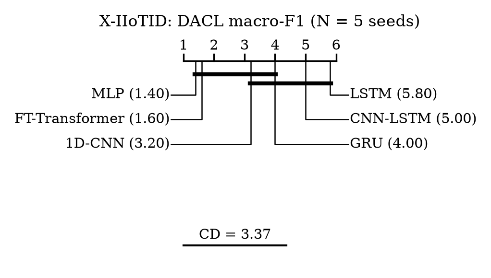

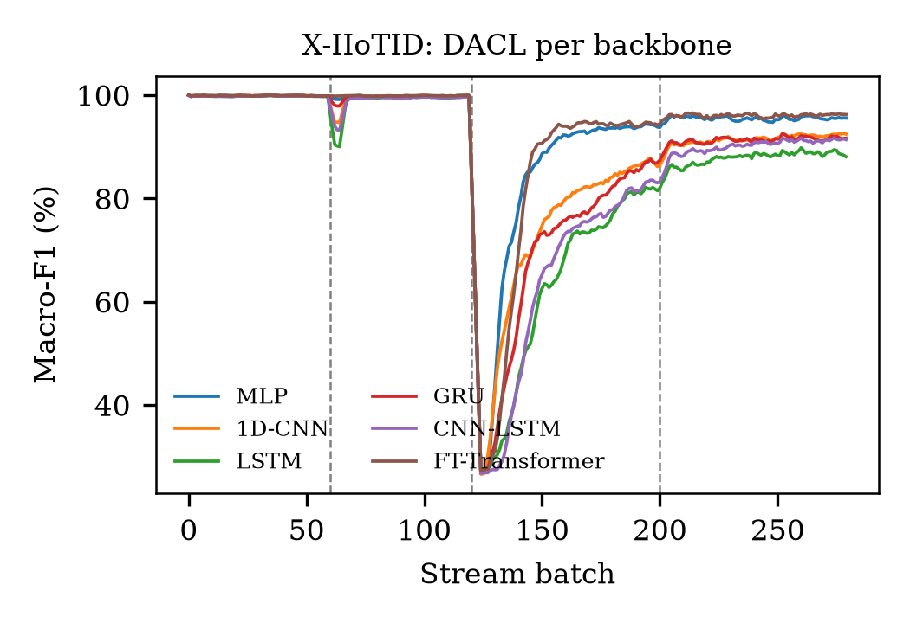

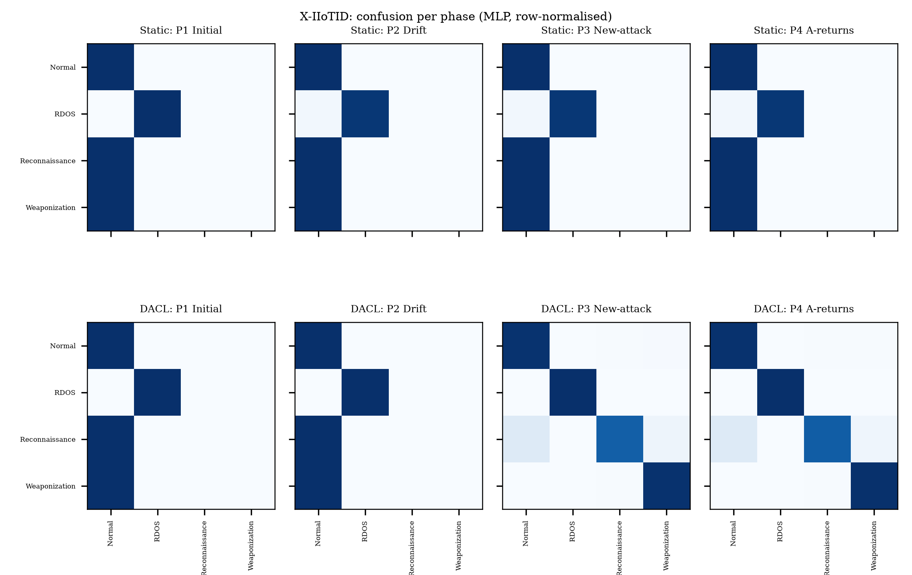

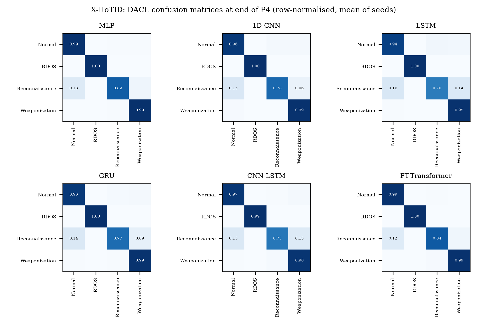

#### Layer 5: PureChain update gate on this dataset (MLP; balanced net-security-benefit policy, hard floor 30%, escalation at 10%; dual serving = alarm from the verified model, attack type from an advisory model)

| Setting                                | Method         | Macro-F1 (%)   | Detection (%)   | FPR (%)     | MAE (flows)   | Known-attack detectability (%)   | Rejected   | Escalated   | Poisoned updates accepted   |
|:---------------------------------------|:---------------|:---------------|:----------------|:------------|:--------------|:---------------------------------|:-----------|:------------|:----------------------------|
| Clean (cost of security)               | DACL           | 92.73 ± 0.84   | 92.50 ± 1.02    | 1.12 ± 0.33 | 1,380 ± 211   | 99.75 ± 0.09                     | --         | --          | --                          |
| Clean (cost of security)               | DACL+Gate      | 92.72 ± 0.91   | 92.24 ± 1.15    | 0.99 ± 0.24 | 1,442 ± 244   | 99.81 ± 0.13                     | 0.0%       | 0.0%        | --                          |
| Clean (cost of security)               | DACL+Gate-dual | 92.80 ± 0.88   | 92.20 ± 1.14    | 0.92 ± 0.22 | 1,450 ± 243   | 99.78 ± 0.17                     | 0.0%       | 0.0%        | --                          |
| Poisoning during drift (P2)            | DACL           | 82.27 ± 0.63   | 74.08 ± 1.57    | 0.81 ± 0.16 | 1,140 ± 1,846 | 99.50 ± 0.13                     | --         | --          | --                          |
| Poisoning during drift (P2)            | DACL+Gate      | 87.93 ± 1.15   | 85.79 ± 2.18    | 0.98 ± 0.10 | 2,791 ± 461   | 99.66 ± 0.07                     | 18.3%      | 0.0%        | --                          |
| Poisoning during drift (P2)            | DACL+Gate-dual | 89.18 ± 0.92   | 85.94 ± 2.19    | 0.95 ± 0.22 | 2,762 ± 449   | 99.49 ± 0.31                     | 18.9%      | 0.0%        | --                          |
| Unlearning attack on known attack (P4) | DACL           | 91.24 ± 1.20   | 88.37 ± 2.24    | 0.84 ± 0.25 | 1,380 ± 211   | 66.22 ± 26.66                    | --         | --          | 100%                        |
| Unlearning attack on known attack (P4) | DACL+Gate      | 92.56 ± 0.85   | 92.15 ± 1.23    | 1.09 ± 0.24 | 1,442 ± 244   | 99.54 ± 0.45                     | 21.7%      | 0.0%        | 10.0%                       |
| Unlearning attack on known attack (P4) | DACL+Gate-dual | 92.63 ± 0.79   | 92.01 ± 1.13    | 1.03 ± 0.25 | 1,450 ± 243   | 99.01 ± 1.31                     | 18.8%      | 0.0%        | 11.8%                       |

#### Label scarcity (MLP): only the given share of flows is labelled

|   Labels (%) | Method      | Macro-F1 (%)   |   Detection (%) |   FPR (%) |   MAE (flows) |   Forgetting (%) | Det. delay   | Missed drifts   |
|-------------:|:------------|:---------------|----------------:|----------:|--------------:|-----------------:|:-------------|:----------------|
|            1 | Static      | 63.55 ± 0.74   |            56.1 |      0.07 |          6383 |              2.6 | --           | --              |
|            1 | ER          | 82.02 ± 1.92   |            82.4 |      3.25 |          3295 |              0.1 | --           | --              |
|            1 | DER++       | 78.59 ± 1.88   |            74.4 |      0.75 |          4549 |             -0   | --           | --              |
|            1 | FullRetrain | 75.90 ± 6.50   |            69.9 |      0.31 |          5115 |             -0   | 6.7          | 0.6             |
|            1 | DACL        | 85.55 ± 2.15   |            85.9 |      2.87 |          2569 |              0   | 14.2         | 0.4             |
|            5 | Static      | 63.55 ± 0.74   |            56.1 |      0.07 |          6383 |              2.6 | --           | --              |
|            5 | ER          | 86.25 ± 0.96   |            86.9 |      2.17 |          2531 |              0.6 | --           | --              |
|            5 | DER++       | 84.26 ± 0.36   |            81.4 |      0.56 |          3432 |             -0   | --           | --              |
|            5 | FullRetrain | 89.46 ± 0.57   |            85.9 |      0.29 |          2603 |              0   | 5.3          | 0.8             |
|            5 | DACL        | 90.91 ± 1.96   |            91.3 |      2.15 |          1603 |              0.2 | 9.1          | 0.6             |
|           10 | Static      | 63.55 ± 0.74   |            56.1 |      0.07 |          6383 |              2.6 | --           | --              |
|           10 | ER          | 87.34 ± 0.96   |            89.6 |      2.9  |          1968 |              0.2 | --           | --              |
|           10 | DER++       | 85.69 ± 1.32   |            83   |      0.55 |          3182 |              0   | --           | --              |
|           10 | FullRetrain | 93.03 ± 0.47   |            90.9 |      0.25 |          1678 |              0.1 | 5.2          | 0.8             |
|           10 | DACL        | 91.57 ± 1.61   |            92   |      1.79 |          1470 |              0.2 | 10.9         | 0.8             |
|          100 | Static      | 63.55 ± 0.74   |            56.1 |      0.07 |          6383 |              2.6 | --           | --              |
|          100 | ER          | 88.46 ± 0.92   |            90.4 |      2.42 |          1825 |              0.2 | --           | --              |
|          100 | DER++       | 89.06 ± 0.71   |            87   |      0.36 |          2529 |              0.1 | --           | --              |
|          100 | FullRetrain | 96.01 ± 0.46   |            94.7 |      0.1  |           871 |              0   | 12.9         | 0.6             |
|          100 | DACL        | 93.47 ± 1.50   |            93.2 |      1.01 |          1219 |              0.1 | 7.5          | 1.0             |

### B. Sensitivity analysis (MLP; one parameter varied at a time)

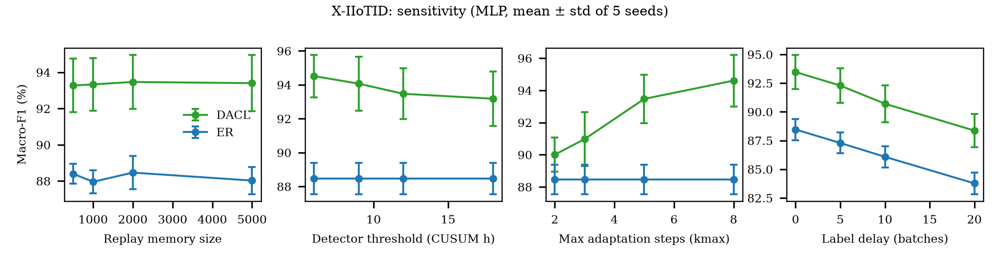

| method   |   value | parameter                    |   Macro-F1 (%) |   Forgetting (%) |    MAE |   Grad steps |
|:---------|--------:|:-----------------------------|---------------:|-----------------:|-------:|-------------:|
| DACL     |     500 | Replay memory size           |           93.3 |              0.2 | 1270.6 |        262.6 |
| DACL     |    1000 | Replay memory size           |           93.3 |              0.2 | 1219.4 |        256.4 |
| DACL     |    2000 | Replay memory size           |           93.5 |              0.1 | 1219.4 |        253   |
| DACL     |    5000 | Replay memory size           |           93.4 |              0.2 | 1229.4 |        234   |
| ER       |     500 | Replay memory size           |           88.4 |              0.2 | 1844.8 |        280   |
| ER       |    1000 | Replay memory size           |           88   |              0.2 | 1778   |        280   |
| ER       |    2000 | Replay memory size           |           88.5 |              0.2 | 1824.8 |        280   |
| ER       |    5000 | Replay memory size           |           88   |              0.2 | 1815.6 |        280   |
| DACL     |       6 | Detector threshold (CUSUM h) |           94.5 |              0.2 |  983.6 |        302.8 |
| DACL     |       9 | Detector threshold (CUSUM h) |           94.1 |              0.1 | 1091.2 |        264.4 |
| DACL     |      12 | Detector threshold (CUSUM h) |           93.5 |              0.1 | 1219.4 |        253   |
| DACL     |      18 | Detector threshold (CUSUM h) |           93.2 |              0.1 | 1280.2 |        258.2 |
| ER       |       6 | Detector threshold (CUSUM h) |           88.5 |              0.2 | 1824.8 |        280   |
| ER       |       9 | Detector threshold (CUSUM h) |           88.5 |              0.2 | 1824.8 |        280   |
| ER       |      12 | Detector threshold (CUSUM h) |           88.5 |              0.2 | 1824.8 |        280   |
| ER       |      18 | Detector threshold (CUSUM h) |           88.5 |              0.2 | 1824.8 |        280   |
| DACL     |       2 | Max adaptation steps (kmax)  |           90   |              0.1 | 1957.6 |        174.2 |
| DACL     |       3 | Max adaptation steps (kmax)  |           91   |              0.1 | 1729.8 |        196.4 |
| DACL     |       5 | Max adaptation steps (kmax)  |           93.5 |              0.1 | 1219.4 |        253   |
| DACL     |       8 | Max adaptation steps (kmax)  |           94.6 |              0.1 | 1007.4 |        316.8 |
| ER       |       2 | Max adaptation steps (kmax)  |           88.5 |              0.2 | 1824.8 |        280   |
| ER       |       3 | Max adaptation steps (kmax)  |           88.5 |              0.2 | 1824.8 |        280   |
| ER       |       5 | Max adaptation steps (kmax)  |           88.5 |              0.2 | 1824.8 |        280   |
| ER       |       8 | Max adaptation steps (kmax)  |           88.5 |              0.2 | 1824.8 |        280   |
| DACL     |       0 | Label delay (batches)        |           93.5 |              0.1 | 1219.4 |        253   |
| DACL     |       5 | Label delay (batches)        |           92.3 |              0.1 | 1582.4 |        270.8 |
| DACL     |      10 | Label delay (batches)        |           90.7 |              0.2 | 1999.6 |        220.4 |
| DACL     |      20 | Label delay (batches)        |           88.4 |              0.1 | 2737   |        249.8 |
| ER       |       0 | Label delay (batches)        |           88.5 |              0.2 | 1824.8 |        280   |
| ER       |       5 | Label delay (batches)        |           87.3 |              0.2 | 2176.2 |        275   |
| ER       |      10 | Label delay (batches)        |           86.1 |              0.2 | 2542.6 |        270   |
| ER       |      20 | Label delay (batches)        |           83.8 |              0.2 | 3264   |        260   |

### C. Natural drift (traffic replayed in recording order)

Classes: Normal, Exploitation, Reconnaissance, Tampering, Weaponization, Lateral _movement, C&C, RDOS, Exfiltration; 64 features.

#### L1 Detection (DACL, per backbone) -- natural drift

| Backbone       | Accuracy         | Precision        | Recall (DR)      | Macro-F1         | FPR             | FNR              | MCC (stream)      | MCC (test)        | PR-AUC (bin.)     | PR-AUC (macro)    |
|:---------------|:-----------------|:-----------------|:-----------------|:-----------------|:----------------|:-----------------|:------------------|:------------------|:------------------|:------------------|
| MLP            | 84.65 ± 3.75     | 75.06 ± 2.86     | 83.33 ± 1.10     | 71.69 ± 3.03     | 18.36 ± 1.42    | 16.67 ± 1.10     | 0.567 ± 0.021     | 0.850 ± 0.066     | 0.998 ± 0.000     | 0.930 ± 0.032     |
| 1D-CNN         | 89.73 ± 1.60     | 78.66 ± 1.43     | 84.22 ± 2.25     | 74.54 ± 1.57     | 22.80 ± 1.12    | 15.78 ± 2.25     | 0.563 ± 0.017     | 0.899 ± 0.011     | 0.997 ± 0.001     | 0.944 ± 0.006     |
| LSTM           | 88.48 ± 1.26     | 76.94 ± 3.29     | 79.67 ± 2.96     | 73.39 ± 2.60     | 16.83 ± 1.92    | 20.33 ± 2.96     | 0.561 ± 0.037     | 0.866 ± 0.030     | 0.998 ± 0.000     | 0.947 ± 0.010     |
| GRU            | 89.08 ± 0.87     | 77.01 ± 1.19     | 80.35 ± 0.99     | 73.37 ± 1.02     | 20.05 ± 0.70    | 19.65 ± 0.99     | 0.537 ± 0.026     | 0.858 ± 0.024     | 0.998 ± 0.000     | 0.950 ± 0.007     |
| CNN-LSTM       | 85.55 ± 2.84     | 72.24 ± 3.73     | 78.83 ± 3.58     | 69.21 ± 3.15     | 22.81 ± 2.66    | 21.17 ± 3.58     | 0.500 ± 0.043     | 0.848 ± 0.021     | 0.997 ± 0.001     | 0.918 ± 0.019     |
| FT-Transformer | **92.85 ± 1.24** | **86.52 ± 1.92** | **86.87 ± 2.97** | **84.06 ± 2.11** | **7.85 ± 2.36** | **13.13 ± 2.97** | **0.729 ± 0.035** | **0.920 ± 0.016** | **0.998 ± 0.000** | **0.966 ± 0.012** |

#### L2 Continual (DACL, per backbone) -- natural drift

| Backbone       | Avg. acc.        | Forgetting        | BWT (A)          | Intransigence   | H-score           |
|:---------------|:-----------------|:------------------|:-----------------|:----------------|:------------------|
| MLP            | 84.65 ± 3.75     | **-26.14 ± 1.51** | 26.27 ± 1.76     | 14.51 ± 10.06   | 1.001 ± 0.077     |
| 1D-CNN         | 89.73 ± 1.60     | -25.69 ± 1.14     | **31.12 ± 5.05** | 6.07 ± 1.41     | 1.061 ± 0.011     |
| LSTM           | 88.48 ± 1.26     | -25.01 ± 1.25     | 25.01 ± 1.25     | 10.90 ± 4.56    | 1.026 ± 0.033     |
| GRU            | 89.08 ± 0.87     | -25.91 ± 1.89     | 25.91 ± 1.89     | 12.09 ± 3.24    | 1.021 ± 0.025     |
| CNN-LSTM       | 85.55 ± 2.84     | -22.61 ± 1.66     | 26.71 ± 5.23     | 9.19 ± 1.70     | 1.022 ± 0.017     |
| FT-Transformer | **92.85 ± 1.24** | -24.40 ± 2.55     | 26.15 ± 3.48     | **3.78 ± 2.10** | **1.073 ± 0.014** |

#### L3 Lifecycle (DACL, per backbone) -- natural drift

| Backbone       | EW (batches)      | MAE (flows)     | Lifecycle F1     | Det. delay       | False alarms     | FA / 100 batches   |   Missed drifts | dF1 / CPU-s       | dF1 / J           |
|:---------------|:------------------|:----------------|:-----------------|:-----------------|:-----------------|:-------------------|----------------:|:------------------|:------------------|
| MLP            | 18.80 ± 5.40      | 3,148 ± 1,681   | 71.69 ± 3.03     | **11.04 ± 3.16** | 11.80 ± 0.84     | 2.463 ± 0.175      |               0 | **0.145 ± 0.009** | **0.048 ± 0.003** |
| 1D-CNN         | 11.12 ± 1.99      | 1,542 ± 660     | 74.54 ± 1.57     | 13.72 ± 4.86     | 12.20 ± 0.45     | 2.547 ± 0.093      |               0 | 0.005 ± 0.001     | 0.002 ± 0.000     |
| LSTM           | 10.64 ± 2.94      | 1,198 ± 784     | 73.39 ± 2.60     | 15.32 ± 2.85     | 12.40 ± 0.89     | 2.589 ± 0.187      |               0 | 0.025 ± 0.003     | 0.008 ± 0.001     |
| GRU            | **9.720 ± 1.814** | **1,054 ± 239** | 73.37 ± 1.02     | 16.40 ± 4.04     | 12.40 ± 1.52     | 2.589 ± 0.317      |               0 | 0.030 ± 0.002     | 0.010 ± 0.001     |
| CNN-LSTM       | 13.60 ± 6.10      | 1,662 ± 1,224   | 69.21 ± 3.15     | 13.12 ± 4.60     | 12.60 ± 1.52     | 2.630 ± 0.317      |               0 | 0.007 ± 0.001     | 0.002 ± 0.000     |
| FT-Transformer | 11.00 ± 2.43      | 1,161 ± 574     | **84.06 ± 2.11** | 12.44 ± 2.45     | **11.40 ± 1.95** | **2.380 ± 0.407**  |               0 | 0.001 ± 0.000     | 0.000 ± 0.000     |

#### L4 Edge (DACL, per backbone) -- natural drift

| Backbone       | Lat. mean (ms)   | Lat. p95 (ms)     | Lat. p99 (ms)   | Throughput (flows/s)   | Deadline miss (%)   | Upd. lat. mean (ms)   | Upd. lat. max (ms)   | Params     | Model (MB)   | FLOPs/flow   | Peak mem. (MB)    | Energy/update (J)   |
|:---------------|:-----------------|:------------------|:----------------|:-----------------------|:--------------------|:----------------------|:---------------------|:-----------|:-------------|:-------------|:------------------|:--------------------|
| MLP            | **0.034**        | **0.050 ± 0.000** | **0.072**       | **1,846,935**          | **0.000**           | **11.01 ± 0.93**      | **15.50 ± 1.44**     | 17,226     | 0.066        | **34,048**   | 2.370 ± 0.410     | **0.417 ± 0.041**   |
| 1D-CNN         | 0.127            | 0.207             | 0.268           | 13,824                 | 40.54 ± 4.75        | 347.3 ± 12.3          | 471.6                | 39,818     | 0.152        | 865,536      | 2.511 ± 0.590     | 13.41 ± 0.86        |
| LSTM           | 0.213 ± 0.000    | 0.458 ± 0.000     | 1.475           | 145,040                | 0.000               | 66.62 ± 4.42          | 97.622               | 19,594     | 0.075        | 296,192      | 2.658 ± 0.241     | 2.720 ± 0.379       |
| GRU            | 0.210 ± 0.000    | 0.373             | 0.642           | 173,168                | 0.000               | 54.50 ± 2.23          | 80.946               | **14,858** | **0.057**    | 222,464      | 2.755 ± 0.034     | 2.475 ± 0.199       |
| CNN-LSTM       | 0.183            | 0.232             | 0.320           | 35,425                 | 5.93 ± 3.80         | 199.7 ± 13.4          | 300.8                | 25,866     | 0.099        | 603,392      | 2.279 ± 0.314     | 8.143 ± 1.046       |
| FT-Transformer | 0.454            | 0.772             | 0.899 ± 0.000   | 4,980                  | 34.66 ± 2.68        | 2,239 ± 164           | 2,846                | 21,610     | 0.082        | 2,130,560    | **1.878 ± 0.276** | 75.88 ± 9.97        |

#### Macro-F1 (%) of every method on every backbone -- natural drift

|               | MLP              | 1D-CNN           | LSTM             | GRU              | CNN-LSTM         | FT-Transformer   |
|:--------------|:-----------------|:-----------------|:-----------------|:-----------------|:-----------------|:-----------------|
| Static        | 39.44 ± 0.65     | 38.09 ± 0.96     | 38.87 ± 0.59     | 36.40 ± 0.89     | 39.00 ± 0.94     | 38.24 ± 1.09     |
| FineTune      | 58.88 ± 5.12     | 61.80 ± 2.51     | 57.46 ± 0.68     | 58.89 ± 0.31     | 42.72 ± 2.45     | 57.66 ± 6.99     |
| EWC           | 56.70 ± 5.30     | 61.55 ± 2.63     | 58.60 ± 1.60     | 59.69 ± 0.52     | 45.08 ± 4.26     | 59.53 ± 5.82     |
| LwF           | 60.24 ± 1.72     | 61.50 ± 1.62     | 55.87 ± 1.66     | 57.43 ± 1.15     | 46.43 ± 3.92     | 57.46 ± 2.40     |
| ER            | 60.09 ± 3.99     | 65.48 ± 1.55     | 62.23 ± 0.51     | 62.33 ± 1.09     | 55.48 ± 2.31     | 70.95 ± 3.14     |
| DER++         | 63.21 ± 4.09     | 62.69 ± 6.92     | 55.55 ± 2.18     | 58.46 ± 1.36     | 52.21 ± 2.27     | 71.15 ± 3.12     |
| PeriodicER    | 47.61 ± 2.06     | 52.49 ± 3.00     | 45.91 ± 1.35     | 46.92 ± 1.26     | 42.21 ± 1.93     | 57.33 ± 2.74     |
| WindowRetrain | **75.44 ± 1.13** | nan              | nan              | nan              | nan              | 76.88 ± 3.36     |
| FullRetrain   | 82.64 ± 0.95     | 80.40 ± 1.45     | 80.23 ± 0.46     | 81.19 ± 0.95     | 73.91 ± 0.36     | 82.62 ± 2.19     |
| DACL          | 71.69 ± 3.03     | **74.54 ± 1.57** | **73.39 ± 2.60** | **73.37 ± 1.02** | **69.21 ± 3.15** | **84.06 ± 2.11** |

**Best baseline: WindowRetrain.** DACL - WindowRetrain macro-F1: median +2.32 pts, mean +1.72 pts; DACL better in 6/10 backbone x seed pairs; Wilcoxon p = 0.62.

#### Per-class recall (%) at the end of the stream (DACL)

|                |   Normal |   Exploitation |   Reconnaissance |   Tampering |   Weaponization |   Lateral _movement |   C&C |   RDOS |   Exfiltration |
|:---------------|---------:|---------------:|-----------------:|------------:|----------------:|--------------------:|------:|-------:|---------------:|
| MLP            |    97.14 |          84.97 |            82.72 |       99.27 |           85.96 |               67.28 | 85.22 |  99.62 |          79.03 |
| 1D-CNN         |    97.22 |          80.83 |            79.6  |       99.32 |           94.66 |               79.38 | 80.65 |  99.68 |          99.68 |
| LSTM           |    95.74 |          85.44 |            79.1  |       99.68 |           92.14 |               60    | 85.03 |  99.4  |          99.63 |
| GRU            |    95.56 |          84.73 |            80.28 |       98.91 |           84    |               69.8  | 69.79 |  99.76 |          99.03 |
| CNN-LSTM       |    94.88 |          77.04 |            70.28 |       96.51 |           81.46 |               75.4  | 82.38 |  99.08 |          98.71 |
| FT-Transformer |    97.16 |          91.48 |            80.08 |       98    |           96.58 |               84.72 | 90.72 |  99.26 |          99.56 |

#### Per-class recall (%) after each phase: Static (MLP)

|               |   Normal |   Exploitation |   Reconnaissance |   Tampering |   Weaponization |   Lateral _movement |   C&C |   RDOS |   Exfiltration |
|:--------------|---------:|---------------:|-----------------:|------------:|----------------:|--------------------:|------:|-------:|---------------:|
| P0 Deployment |    95.58 |           9.47 |            93.82 |        0.41 |               0 |                   0 |     0 |      0 |              0 |
| S1            |    95.58 |           9.47 |            93.82 |        0.41 |               0 |                   0 |     0 |      0 |              0 |
| S2            |    95.58 |           9.47 |            93.82 |        0.41 |               0 |                   0 |     0 |      0 |              0 |
| S3            |    95.58 |           9.47 |            93.82 |        0.41 |               0 |                   0 |     0 |      0 |              0 |
| S4            |    95.58 |           9.47 |            93.82 |        0.41 |               0 |                   0 |     0 |      0 |              0 |

#### Per-class recall (%) after each phase: DACL (MLP)

|               |   Normal |   Exploitation |   Reconnaissance |   Tampering |   Weaponization |   Lateral _movement |   C&C |   RDOS |   Exfiltration |
|:--------------|---------:|---------------:|-----------------:|------------:|----------------:|--------------------:|------:|-------:|---------------:|
| P0 Deployment |    95.58 |           9.47 |            93.82 |        0.41 |            0    |                0    |  0    |   0    |           0    |
| S1            |    96.22 |           9.47 |            82.1  |        0.41 |           93.3  |                0    |  0    |   0    |           0    |
| S2            |    97.64 |          82.72 |            82.98 |        0.41 |           99.76 |               88.86 |  0    |   0    |           0    |
| S3            |    84.46 |          84.5  |            83.9  |        0.86 |           99.28 |               96.88 | 96.69 |  39.4  |           0    |
| S4            |    97.14 |          84.97 |            82.72 |       99.27 |           85.96 |               67.28 | 85.22 |  99.62 |          79.03 |

#### Statistics

- Friedman test across backbones (DACL macro-F1, blocks = 5 seeds): chi2 = 18.49, p = 0.0024. Average ranks: FT-Transformer 1.00, 1D-CNN 2.80, LSTM 3.20, GRU 3.60, MLP 4.80, CNN-LSTM 5.60
- DACL vs Static (macro-F1, N = 30 backbone x seed pairs): median diff +35.36 pts, Wilcoxon p = 1.9e-09
- DACL vs FineTune (macro-F1, N = 30 backbone x seed pairs): median diff +16.83 pts, Wilcoxon p = 1.9e-09
- DACL vs EWC (macro-F1, N = 30 backbone x seed pairs): median diff +16.02 pts, Wilcoxon p = 1.9e-09
- DACL vs LwF (macro-F1, N = 30 backbone x seed pairs): median diff +16.35 pts, Wilcoxon p = 1.9e-09
- DACL vs ER (macro-F1, N = 30 backbone x seed pairs): median diff +11.56 pts, Wilcoxon p = 1.9e-09
- DACL vs DER++ (macro-F1, N = 30 backbone x seed pairs): median diff +14.09 pts, Wilcoxon p = 1.9e-09
- DACL vs PeriodicER (macro-F1, N = 30 backbone x seed pairs): median diff +26.68 pts, Wilcoxon p = 1.9e-09
- DACL vs WindowRetrain (macro-F1, N = 10 backbone x seed pairs): median diff +2.32 pts, Wilcoxon p = 0.62
- DACL vs FullRetrain (macro-F1, N = 30 backbone x seed pairs): median diff -6.32 pts, Wilcoxon p = 6.9e-07

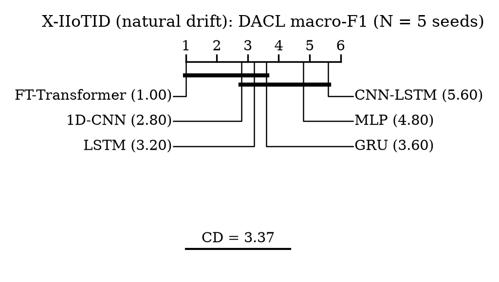

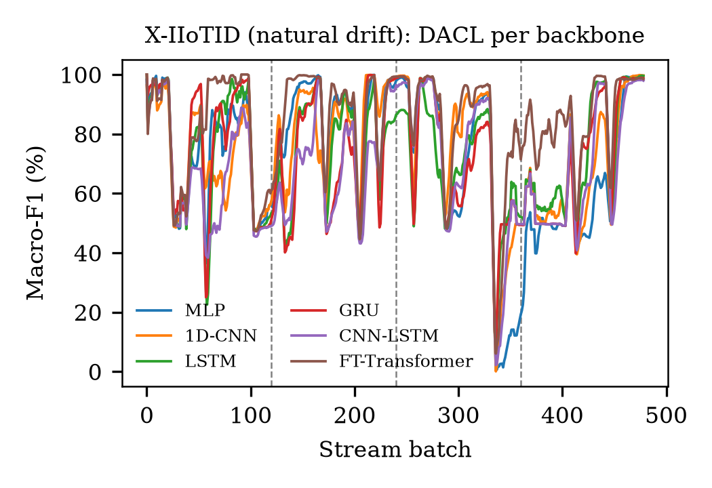

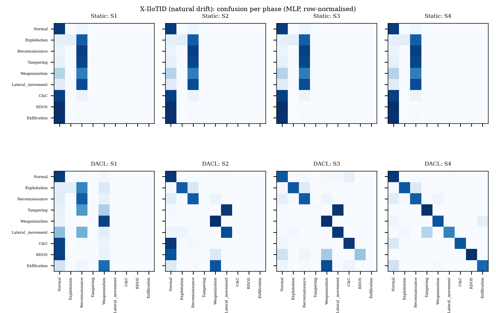

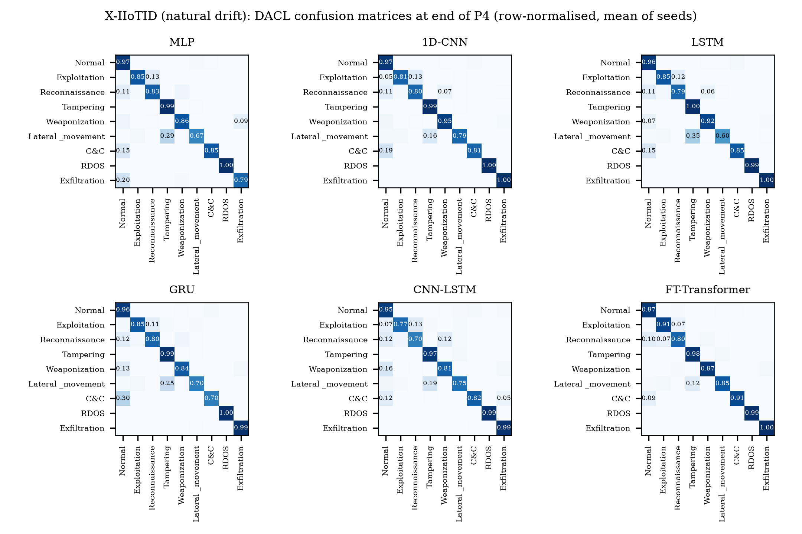

## Edge-IIoTset

### A. Injected drift (P1 initial, P2 drift, P3 new attack, P4 known attack returns)

Classes: Normal, DDoS_UDP, DDoS_ICMP, DDoS_TCP, DDoS_HTTP, Password, SQL_injection, XSS, Vulnerability_scanner; 36 features.

#### L1 Detection (DACL, per backbone)

| Backbone       | Accuracy         | Precision        | Recall (DR)      | Macro-F1         | FPR             | FNR              | MCC (stream)      | MCC (test)        | PR-AUC (bin.)     | PR-AUC (macro)    |
|:---------------|:-----------------|:-----------------|:-----------------|:-----------------|:----------------|:-----------------|:------------------|:------------------|:------------------|:------------------|
| MLP            | 83.77 ± 0.80     | **70.69 ± 2.25** | 59.09 ± 2.22     | 62.35 ± 1.65     | 1.47 ± 0.89     | 40.91 ± 2.22     | 0.659 ± 0.013     | 0.571 ± 0.016     | 0.986 ± 0.001     | 0.645 ± 0.013     |
| 1D-CNN         | 83.84 ± 0.14     | 70.21 ± 1.42     | 56.76 ± 1.89     | 61.43 ± 0.91     | **0.87 ± 0.50** | 43.24 ± 1.89     | 0.659 ± 0.004     | 0.573 ± 0.010     | 0.985 ± 0.001     | 0.629 ± 0.009     |
| LSTM           | 82.39 ± 1.06     | 59.94 ± 2.18     | 54.15 ± 3.05     | 57.26 ± 1.86     | 1.54 ± 1.21     | 45.85 ± 3.05     | 0.612 ± 0.029     | 0.547 ± 0.011     | 0.984 ± 0.001     | 0.596 ± 0.018     |
| GRU            | 82.63 ± 0.34     | 61.85 ± 1.51     | 56.55 ± 3.91     | 59.14 ± 1.37     | 2.09 ± 1.44     | 43.45 ± 3.91     | 0.634 ± 0.010     | 0.561 ± 0.010     | 0.984 ± 0.002     | 0.615 ± 0.014     |
| CNN-LSTM       | 82.62 ± 0.35     | 60.99 ± 4.51     | 54.80 ± 4.33     | 57.77 ± 2.86     | 1.43 ± 1.40     | 45.20 ± 4.33     | 0.620 ± 0.018     | 0.556 ± 0.017     | 0.983 ± 0.001     | 0.605 ± 0.022     |
| FT-Transformer | **84.37 ± 0.41** | 69.02 ± 4.28     | **60.75 ± 1.56** | **62.81 ± 1.76** | 1.29 ± 0.82     | **39.25 ± 1.56** | **0.672 ± 0.010** | **0.589 ± 0.016** | **0.986 ± 0.001** | **0.670 ± 0.015** |

#### L2 Continual (DACL, per backbone)

| Backbone       | Avg. acc.        | Forgetting      | BWT (A)          | Intransigence    | H-score           |
|:---------------|:-----------------|:----------------|:-----------------|:-----------------|:------------------|
| MLP            | 83.77 ± 0.80     | 8.72 ± 2.09     | -4.03 ± 2.38     | -0.99 ± 1.58     | 0.373 ± 0.024     |
| 1D-CNN         | 83.84 ± 0.14     | 11.05 ± 1.84    | **-1.56 ± 1.21** | -0.87 ± 0.63     | 0.360 ± 0.015     |
| LSTM           | 82.39 ± 1.06     | **6.74 ± 2.85** | -3.08 ± 3.01     | 1.34 ± 1.76      | 0.326 ± 0.018     |
| GRU            | 82.63 ± 0.34     | 9.33 ± 1.29     | -3.69 ± 5.87     | 2.04 ± 1.28      | 0.323 ± 0.010     |
| CNN-LSTM       | 82.62 ± 0.35     | 7.93 ± 7.10     | -2.06 ± 4.49     | **-1.26 ± 3.20** | 0.339 ± 0.046     |
| FT-Transformer | **84.37 ± 0.41** | 8.58 ± 0.60     | -4.01 ± 4.73     | -0.19 ± 4.81     | **0.396 ± 0.044** |

#### L3 Lifecycle (DACL, per backbone)

| Backbone       | EW (batches)     | MAE (flows)     | Lifecycle F1     | Det. delay        | False alarms      | FA / 100 batches   | Missed drifts   | dF1 / CPU-s       | dF1 / J           |
|:---------------|:-----------------|:----------------|:-----------------|:------------------|:------------------|:-------------------|:----------------|:------------------|:------------------|
| MLP            | **32.27 ± 2.07** | 4,814 ± 294     | 62.35 ± 1.65     | 10.90 ± 10.70     | 3.200 ± 0.837     | 1.143 ± 0.299      | 0.400 ± 0.548   | **0.235 ± 0.125** | **0.078 ± 0.042** |
| 1D-CNN         | 33.67 ± 7.39     | 5,086 ± 528     | 61.43 ± 0.91     | 11.43 ± 9.86      | 3.400 ± 0.894     | 1.214 ± 0.319      | 0.200 ± 0.447   | 0.013 ± 0.007     | 0.004 ± 0.002     |
| LSTM           | 33.93 ± 7.75     | 5,524 ± 991     | 57.26 ± 1.86     | 6.167 ± 9.385     | **2.400 ± 1.140** | **0.857 ± 0.407**  | 0.400 ± 0.548   | 0.032 ± 0.016     | 0.011 ± 0.005     |
| GRU            | 33.67 ± 5.43     | 5,181 ± 725     | 59.14 ± 1.37     | 11.03 ± 10.18     | 3.400 ± 0.894     | 1.214 ± 0.319      | 0.200 ± 0.447   | 0.044 ± 0.019     | 0.015 ± 0.006     |
| CNN-LSTM       | 33.13 ± 7.81     | 5,411 ± 707     | 57.77 ± 2.86     | **4.533 ± 2.912** | 3.000 ± 0.707     | 1.071 ± 0.253      | **0.000**       | 0.013 ± 0.004     | 0.004 ± 0.001     |
| FT-Transformer | 33.47 ± 4.17     | **4,648 ± 311** | **62.81 ± 1.76** | 7.100 ± 7.234     | 3.200 ± 0.837     | 1.143 ± 0.299      | 0.200 ± 0.447   | 0.002 ± 0.001     | 0.001 ± 0.000     |

#### L4 Edge (DACL, per backbone)

| Backbone       | Lat. mean (ms)   | Lat. p95 (ms)   | Lat. p99 (ms)   | Throughput (flows/s)   | Deadline miss (%)   | Upd. lat. mean (ms)   | Upd. lat. max (ms)   | Params     | Model (MB)   | FLOPs/flow   | Peak mem. (MB)    | Energy/update (J)   |
|:---------------|:-----------------|:----------------|:----------------|:-----------------------|:--------------------|:----------------------|:---------------------|:-----------|:-------------|:-------------|:------------------|:--------------------|
| MLP            | **0.033**        | **0.047**       | **0.071**       | **2,189,344**          | **0.000**           | **7.930 ± 0.886**     | **11.09 ± 2.16**     | **13,577** | **0.052**    | **26,752**   | **1.419 ± 0.343** | **0.441 ± 0.078**   |
| 1D-CNN         | 0.079            | 0.089           | 0.100           | 34,605                 | 3.93 ± 1.47         | 155.5 ± 6.7           | 251.6                | 39,753     | 0.152        | 515,968      | 1.682 ± 0.268     | 8.400 ± 1.355       |
| LSTM           | 0.123 ± 0.000    | 0.147           | 0.315           | 259,375                | 0.000               | 46.41 ± 4.51          | 63.51 ± 12.35        | 19,529     | 0.074        | 185,472      | 1.654 ± 0.205     | 2.729 ± 0.402       |
| GRU            | 0.157            | 0.245           | 0.370           | 280,159                | 0.000               | 43.57 ± 3.99          | 59.31 ± 11.53        | 14,793     | 0.056        | 139,392      | 1.554 ± 0.331     | 2.525 ± 0.376       |
| CNN-LSTM       | 0.216            | 0.330           | 0.559           | 40,110                 | 0.000               | 169.0 ± 24.1          | 241.8                | 25,801     | 0.098        | 597,888      | 1.716 ± 0.230     | 9.113 ± 0.946       |
| FT-Transformer | 0.294            | 0.427           | 0.685           | 10,910                 | 37.93 ± 6.06        | 863.8 ± 101.3         | 1,179 ± 229          | 19,785     | 0.075        | 1,212,992    | 1.578 ± 0.213     | 50.09 ± 10.66       |

#### Macro-F1 (%) of every method on every backbone

|               | MLP              | 1D-CNN           | LSTM             | GRU              | CNN-LSTM         | FT-Transformer   |
|:--------------|:-----------------|:-----------------|:-----------------|:-----------------|:-----------------|:-----------------|
| Static        | 45.68 ± 6.43     | 42.60 ± 8.63     | 42.22 ± 12.00    | 38.97 ± 9.03     | 35.80 ± 8.31     | 48.46 ± 4.19     |
| FineTune      | 58.60 ± 1.46     | 57.94 ± 0.94     | 54.84 ± 2.31     | 56.08 ± 1.61     | 52.01 ± 1.98     | 56.44 ± 1.20     |
| EWC           | 58.47 ± 1.53     | 57.92 ± 1.00     | 54.88 ± 2.47     | 56.10 ± 1.61     | 52.12 ± 1.90     | 57.12 ± 1.26     |
| LwF           | 56.95 ± 2.01     | 55.08 ± 3.13     | 53.90 ± 4.33     | 53.82 ± 2.96     | 50.97 ± 2.82     | 57.87 ± 1.08     |
| ER            | 59.70 ± 1.16     | 59.87 ± 1.39     | 55.78 ± 2.84     | 57.71 ± 1.79     | 55.23 ± 2.46     | 60.24 ± 0.24     |
| DER++         | 59.41 ± 2.07     | 59.73 ± 2.99     | 55.88 ± 3.35     | 56.41 ± 1.92     | 54.18 ± 2.43     | 59.77 ± 1.32     |
| PeriodicER    | 54.87 ± 2.46     | 55.94 ± 2.05     | 51.66 ± 5.23     | 53.16 ± 3.15     | 49.23 ± 3.78     | 56.45 ± 0.67     |
| WindowRetrain | 59.01 ± 0.53     | nan              | nan              | nan              | nan              | 55.95 ± 0.53     |
| FullRetrain   | 64.33 ± 0.33     | 62.77 ± 1.17     | 60.25 ± 1.45     | 61.43 ± 0.83     | 58.14 ± 1.73     | 64.76 ± 0.52     |
| DACL          | **62.35 ± 1.65** | **61.43 ± 0.91** | **57.26 ± 1.86** | **59.14 ± 1.37** | **57.77 ± 2.86** | **62.81 ± 1.76** |

**Best baseline: ER.** DACL - ER macro-F1: median +1.96 pts, mean +2.04 pts; DACL better in 28/30 backbone x seed pairs; Wilcoxon p = 2.6e-08.

#### Per-class recall (%) at the end of the stream (DACL)

|                |   Normal |   DDoS_UDP |   DDoS_ICMP |   DDoS_TCP |   DDoS_HTTP |   Password |   SQL_injection |   XSS |   Vulnerability_scanner |
|:---------------|---------:|-----------:|------------:|-----------:|------------:|-----------:|----------------:|------:|------------------------:|
| MLP            |    99.08 |      99.87 |       99.11 |      98.95 |       12.3  |       7.11 |           10.42 |  0.42 |                   78.02 |
| 1D-CNN         |    99.68 |      99.57 |       99.11 |      98.64 |       14.44 |       5.09 |            8.48 |  0    |                   76.31 |
| LSTM           |    98.47 |      99.74 |       98.82 |      97.14 |        3.51 |       3.74 |            2.34 |  0    |                   77.63 |
| GRU            |    99.02 |      99.74 |       98.84 |      98.2  |        9.23 |       3.44 |            7.54 |  0.52 |                   76.37 |
| CNN-LSTM       |    96.26 |      99.69 |       99.48 |      99.03 |       13.23 |       5.96 |            7.43 |  0.24 |                   75.2  |
| FT-Transformer |    97.6  |      99.99 |       99.83 |      99.95 |       21.46 |       3.17 |           17.53 |  8.37 |                   80.95 |

#### Per-class recall (%) after each phase: Static (MLP)

|               |   Normal |   DDoS_UDP |   DDoS_ICMP |   DDoS_TCP |   DDoS_HTTP |   Password |   SQL_injection |   XSS |   Vulnerability_scanner |
|:--------------|---------:|-----------:|------------:|-----------:|------------:|-----------:|----------------:|------:|------------------------:|
| P0 Deployment |    99.58 |      99.96 |       99.75 |      99.63 |       34.99 |          0 |               0 |     0 |                       0 |
| P1 Initial    |    99.58 |      99.96 |       99.75 |      99.63 |       34.99 |          0 |               0 |     0 |                       0 |
| P2 Drift      |    67.48 |      74.53 |       82.26 |      64.57 |       48.35 |          0 |               0 |     0 |                       0 |
| P3 New-attack |    67.48 |      74.53 |       82.26 |      64.57 |       48.35 |          0 |               0 |     0 |                       0 |
| P4 A-returns  |    67.48 |      74.53 |       82.26 |      64.57 |       48.35 |          0 |               0 |     0 |                       0 |

#### Per-class recall (%) after each phase: DACL (MLP)

|               |   Normal |   DDoS_UDP |   DDoS_ICMP |   DDoS_TCP |   DDoS_HTTP |   Password |   SQL_injection |   XSS |   Vulnerability_scanner |
|:--------------|---------:|-----------:|------------:|-----------:|------------:|-----------:|----------------:|------:|------------------------:|
| P0 Deployment |    99.58 |      99.96 |       99.75 |      99.63 |       34.99 |       0    |            0    |  0    |                    0    |
| P1 Initial    |    99.58 |      99.96 |       99.75 |      99.63 |       34.99 |       0    |            0    |  0    |                    0    |
| P2 Drift      |    99.25 |      99.31 |       96.17 |      97.67 |       22.43 |       0    |            0    |  0    |                    0    |
| P3 New-attack |    99.42 |      99.18 |       99.01 |      97.36 |        3.9  |       7.4  |            9.9  |  0.41 |                   76.05 |
| P4 A-returns  |    99.08 |      99.87 |       99.11 |      98.95 |       12.3  |       7.11 |           10.42 |  0.42 |                   78.02 |

#### Statistics

- Friedman test across backbones (DACL macro-F1, blocks = 5 seeds): chi2 = 21.23, p = 0.000733. Average ranks: FT-Transformer 1.60, MLP 2.00, 1D-CNN 2.40, GRU 4.20, CNN-LSTM 5.20, LSTM 5.60
- DACL vs Static (macro-F1, N = 30 backbone x seed pairs): median diff +17.46 pts, Wilcoxon p = 1.9e-09
- DACL vs FineTune (macro-F1, N = 30 backbone x seed pairs): median diff +3.80 pts, Wilcoxon p = 1.9e-09
- DACL vs EWC (macro-F1, N = 30 backbone x seed pairs): median diff +3.85 pts, Wilcoxon p = 1.9e-09
- DACL vs LwF (macro-F1, N = 30 backbone x seed pairs): median diff +5.36 pts, Wilcoxon p = 1.9e-09
- DACL vs ER (macro-F1, N = 30 backbone x seed pairs): median diff +1.96 pts, Wilcoxon p = 2.6e-08
- DACL vs DER++ (macro-F1, N = 30 backbone x seed pairs): median diff +2.57 pts, Wilcoxon p = 2.6e-08
- DACL vs PeriodicER (macro-F1, N = 30 backbone x seed pairs): median diff +5.96 pts, Wilcoxon p = 1.9e-09
- DACL vs WindowRetrain (macro-F1, N = 10 backbone x seed pairs): median diff +5.22 pts, Wilcoxon p = 0.002
- DACL vs FullRetrain (macro-F1, N = 30 backbone x seed pairs): median diff -1.56 pts, Wilcoxon p = 2e-06

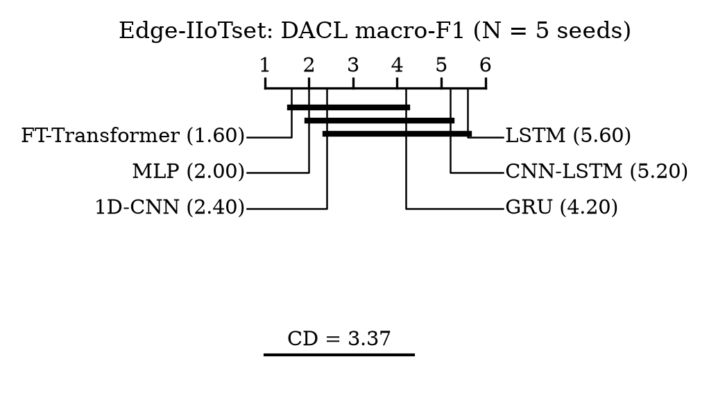

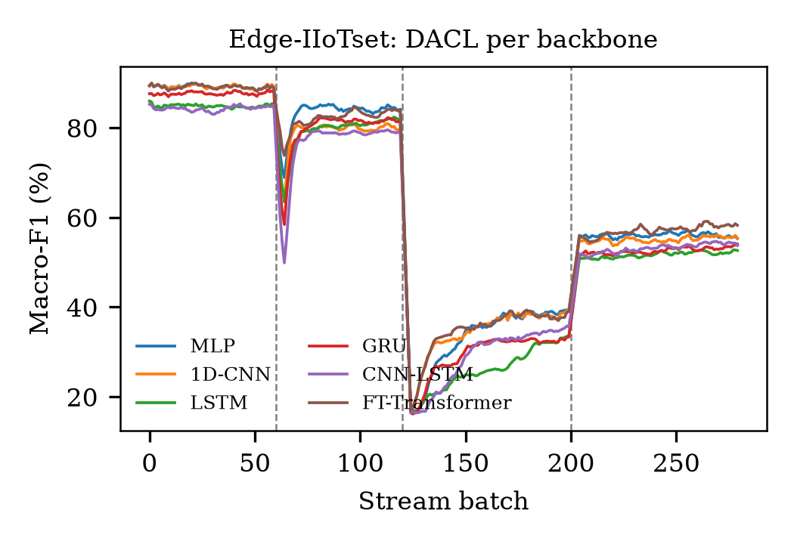

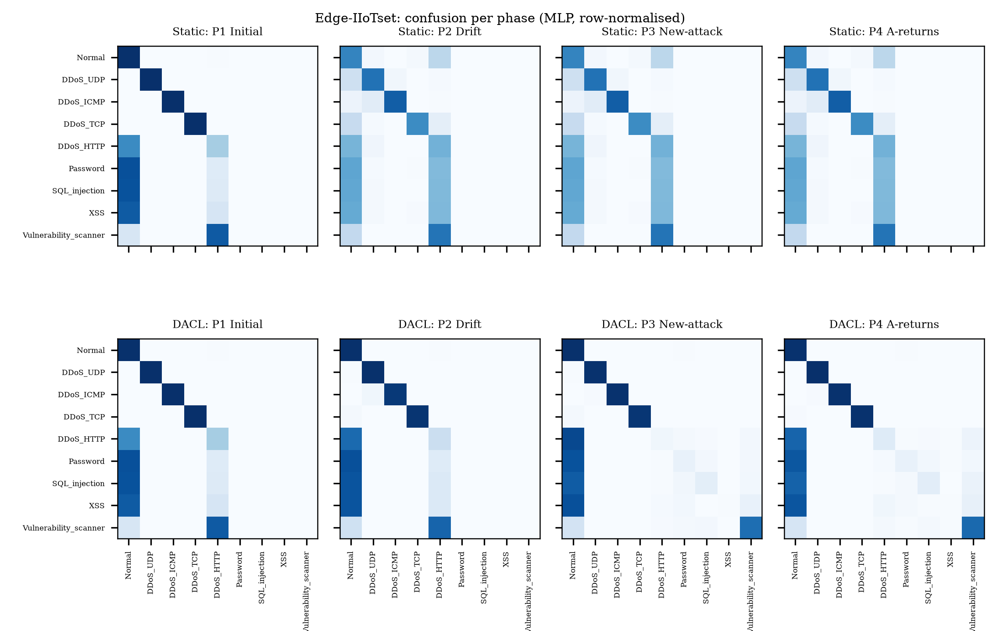

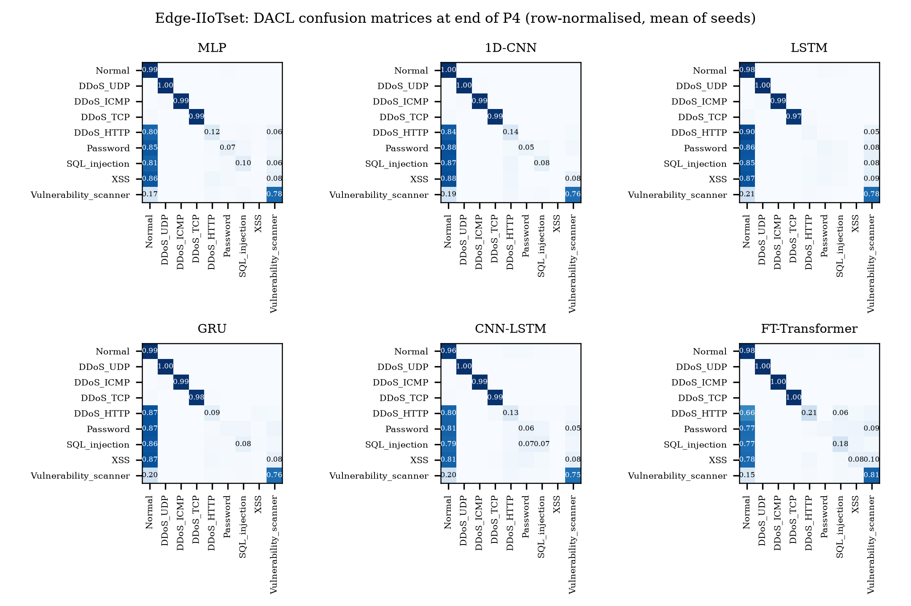

#### Layer 5: PureChain update gate on this dataset (MLP; balanced net-security-benefit policy, hard floor 30%, escalation at 10%; dual serving = alarm from the verified model, attack type from an advisory model)

| Setting                                | Method         | Macro-F1 (%)   | Detection (%)   | FPR (%)       | MAE (flows)   | Known-attack detectability (%)   | Rejected   | Escalated   | Poisoned updates accepted   |
|:---------------------------------------|:---------------|:---------------|:----------------|:--------------|:--------------|:---------------------------------|:-----------|:------------|:----------------------------|
| Clean (cost of security)               | DACL           | 62.70 ± 1.58   | 60.41 ± 2.29    | 2.05 ± 1.02   | 4,685 ± 327   | 82.57 ± 5.42                     | --         | --          | --                          |
| Clean (cost of security)               | DACL+Gate      | 49.60 ± 7.41   | 74.97 ± 19.58   | 24.43 ± 30.94 | 2,749 ± 2,502 | 89.26 ± 10.33                    | 69.2%      | 4.6%        | --                          |
| Clean (cost of security)               | DACL+Gate-dual | 61.01 ± 3.30   | 75.33 ± 19.17   | 24.88 ± 30.35 | 2,771 ± 2,531 | 90.34 ± 9.09                     | 74.6%      | 4.8%        | --                          |
| Poisoning during drift (P2)            | DACL           | 52.58 ± 3.09   | 45.43 ± 4.15    | 0.95 ± 0.75   | 3,939 ± 650   | 80.13 ± 4.22                     | --         | --          | --                          |
| Poisoning during drift (P2)            | DACL+Gate      | 48.05 ± 7.19   | 70.97 ± 21.19   | 22.83 ± 27.52 | 3,780 ± 3,529 | 87.29 ± 8.96                     | 70.7%      | 4.0%        | --                          |
| Poisoning during drift (P2)            | DACL+Gate-dual | 57.41 ± 3.12   | 70.49 ± 21.64   | 22.51 ± 27.81 | 3,396 ± 3,062 | 86.88 ± 9.05                     | 69.7%      | 3.9%        | --                          |
| Unlearning attack on known attack (P4) | DACL           | 61.53 ± 1.19   | 57.56 ± 1.53    | 1.36 ± 0.76   | 4,685 ± 327   | 69.51 ± 3.85                     | --         | --          | 100%                        |
| Unlearning attack on known attack (P4) | DACL+Gate      | 49.20 ± 6.94   | 74.97 ± 19.58   | 24.48 ± 30.90 | 2,749 ± 2,502 | 89.03 ± 10.41                    | 73.8%      | 4.9%        | 0.0%                        |
| Unlearning attack on known attack (P4) | DACL+Gate-dual | 60.65 ± 3.28   | 75.26 ± 19.25   | 24.94 ± 30.31 | 2,771 ± 2,531 | 89.63 ± 9.54                     | 78.7%      | 4.9%        | 4.5%                        |

#### Label scarcity (MLP): only the given share of flows is labelled

|   Labels (%) | Method      | Macro-F1 (%)   |   Detection (%) |   FPR (%) |   MAE (flows) |   Forgetting (%) | Det. delay   | Missed drifts   |
|-------------:|:------------|:---------------|----------------:|----------:|--------------:|-----------------:|:-------------|:----------------|
|            1 | Static      | 45.68 ± 6.43   |            67.8 |     25.17 |          4706 |             18.9 | --           | --              |
|            1 | ER          | 55.74 ± 2.00   |            59.1 |      6.15 |          5098 |             12.2 | --           | --              |
|            1 | DER++       | 55.54 ± 2.28   |            56.3 |      3.02 |          5484 |             10.8 | --           | --              |
|            1 | FullRetrain | 55.09 ± 0.89   |            57.5 |      3.89 |          5374 |              7.4 | 5.7          | 0.0             |
|            1 | DACL        | 55.40 ± 4.55   |            61.8 |      5.92 |          4729 |             11.7 | 10.0         | 0.2             |
|            5 | Static      | 45.68 ± 6.43   |            67.8 |     25.17 |          4706 |             18.9 | --           | --              |
|            5 | ER          | 57.89 ± 1.59   |            58.6 |      4.43 |          5032 |             18   | --           | --              |
|            5 | DER++       | 57.49 ± 1.63   |            57.1 |      2.05 |          5235 |              9.1 | --           | --              |
|            5 | FullRetrain | 59.79 ± 0.49   |            57.8 |      1.77 |          5106 |              7.5 | 3.6          | 0.2             |
|            5 | DACL        | 59.91 ± 1.62   |            58.5 |      3.12 |          5123 |             11.4 | 6.7          | 0.0             |
|           10 | Static      | 45.68 ± 6.43   |            67.8 |     25.17 |          4706 |             18.9 | --           | --              |
|           10 | ER          | 58.40 ± 1.39   |            58.5 |      4.34 |          5088 |             15.6 | --           | --              |
|           10 | DER++       | 58.70 ± 1.46   |            57.2 |      1.84 |          5164 |              8.7 | --           | --              |
|           10 | FullRetrain | 61.72 ± 0.59   |            58.9 |      1.47 |          4934 |              6.5 | 2.8          | 0.0             |
|           10 | DACL        | 61.13 ± 1.94   |            59.5 |      2.57 |          4906 |              9.8 | 6.1          | 0.0             |
|          100 | Static      | 45.68 ± 6.43   |            67.8 |     25.17 |          4706 |             18.9 | --           | --              |
|          100 | ER          | 59.70 ± 1.16   |            59.9 |      4.35 |          4903 |             16.3 | --           | --              |
|          100 | DER++       | 59.41 ± 2.07   |            57.7 |      1.5  |          5144 |              9   | --           | --              |
|          100 | FullRetrain | 64.33 ± 0.33   |            60.9 |      0.88 |          4455 |              2.7 | 3.6          | 0.0             |
|          100 | DACL        | 62.35 ± 1.65   |            59.1 |      1.47 |          4814 |              8.7 | 10.9         | 0.4             |

### B. Sensitivity analysis (MLP; one parameter varied at a time)

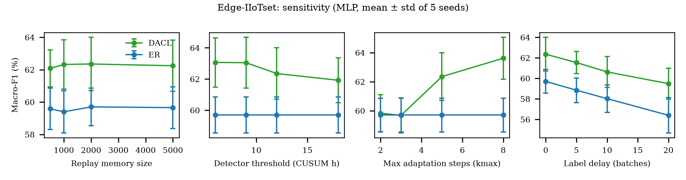

| method   |   value | parameter                    |   Macro-F1 (%) |   Forgetting (%) |    MAE |   Grad steps |
|:---------|--------:|:-----------------------------|---------------:|-----------------:|-------:|-------------:|
| DACL     |     500 | Replay memory size           |           62.1 |              9.6 | 4851   |        309.2 |
| DACL     |    1000 | Replay memory size           |           62.3 |              8.9 | 4824   |        299.2 |
| DACL     |    2000 | Replay memory size           |           62.4 |              8.7 | 4814.2 |        313.4 |
| DACL     |    5000 | Replay memory size           |           62.2 |              8.9 | 4781.2 |        305.4 |
| ER       |     500 | Replay memory size           |           59.6 |             16.2 | 4971   |        280   |
| ER       |    1000 | Replay memory size           |           59.4 |             16.2 | 4984.4 |        280   |
| ER       |    2000 | Replay memory size           |           59.7 |             16.3 | 4903.4 |        280   |
| ER       |    5000 | Replay memory size           |           59.7 |             16.5 | 4981.6 |        280   |
| DACL     |       6 | Detector threshold (CUSUM h) |           63.1 |             11.6 | 4674.4 |        422.2 |
| DACL     |       9 | Detector threshold (CUSUM h) |           63   |              9.9 | 4616   |        378.8 |
| DACL     |      12 | Detector threshold (CUSUM h) |           62.4 |              8.7 | 4814.2 |        313.4 |
| DACL     |      18 | Detector threshold (CUSUM h) |           61.9 |              8.8 | 4966.6 |        303.4 |
| ER       |       6 | Detector threshold (CUSUM h) |           59.7 |             16.3 | 4903.4 |        280   |
| ER       |       9 | Detector threshold (CUSUM h) |           59.7 |             16.3 | 4903.4 |        280   |
| ER       |      12 | Detector threshold (CUSUM h) |           59.7 |             16.3 | 4903.4 |        280   |
| ER       |      18 | Detector threshold (CUSUM h) |           59.7 |             16.3 | 4903.4 |        280   |
| DACL     |       2 | Max adaptation steps (kmax)  |           59.8 |              8.2 | 5036.8 |        210.8 |
| DACL     |       3 | Max adaptation steps (kmax)  |           59.7 |              9   | 4988.6 |        178.8 |
| DACL     |       5 | Max adaptation steps (kmax)  |           62.4 |              8.7 | 4814.2 |        313.4 |
| DACL     |       8 | Max adaptation steps (kmax)  |           63.6 |              7.9 | 4614   |        497.4 |
| ER       |       2 | Max adaptation steps (kmax)  |           59.7 |             16.3 | 4903.4 |        280   |
| ER       |       3 | Max adaptation steps (kmax)  |           59.7 |             16.3 | 4903.4 |        280   |
| ER       |       5 | Max adaptation steps (kmax)  |           59.7 |             16.3 | 4903.4 |        280   |
| ER       |       8 | Max adaptation steps (kmax)  |           59.7 |             16.3 | 4903.4 |        280   |
| DACL     |       0 | Label delay (batches)        |           62.4 |              8.7 | 4814.2 |        313.4 |
| DACL     |       5 | Label delay (batches)        |           61.5 |              8.9 | 4930.6 |        348.8 |
| DACL     |      10 | Label delay (batches)        |           60.6 |              7.8 | 5031   |        344.8 |
| DACL     |      20 | Label delay (batches)        |           59.5 |              8.6 | 5151.2 |        343   |
| ER       |       0 | Label delay (batches)        |           59.7 |             16.3 | 4903.4 |        280   |
| ER       |       5 | Label delay (batches)        |           58.8 |             16.4 | 4983.4 |        275   |
| ER       |      10 | Label delay (batches)        |           58   |             16.4 | 4969.6 |        270   |
| ER       |      20 | Label delay (batches)        |           56.4 |             16.1 | 5101   |        260   |

### C. Natural drift: not applicable

Edge-IIoTset's frame.time has no date component, so the recording order cannot be recovered.

## ForgeIIOT (IoTForge Pro)

### A. Injected drift (P1 initial, P2 drift, P3 new attack, P4 known attack returns)

Classes: normal, ddos_tcp, dos_icmp, dos_udp, port_scan, vuln_scan, os_finger; 79 features.

#### L1 Detection (DACL, per backbone)

| Backbone       | Accuracy         | Precision        | Recall (DR)      | Macro-F1         | FPR             | FNR             | MCC (stream)      | MCC (test)        | PR-AUC (bin.)     | PR-AUC (macro)    |
|:---------------|:-----------------|:-----------------|:-----------------|:-----------------|:----------------|:----------------|:------------------|:------------------|:------------------|:------------------|
| MLP            | 91.47 ± 0.73     | 77.19 ± 2.48     | 99.24 ± 0.45     | 76.97 ± 2.15     | 0.11 ± 0.04     | 0.76 ± 0.45     | 0.843 ± 0.012     | **0.736 ± 0.034** | 1.000 ± 0.000     | **0.801 ± 0.012** |
| 1D-CNN         | 90.75 ± 1.04     | 77.07 ± 1.91     | 99.14 ± 0.34     | 75.70 ± 2.51     | 0.36 ± 0.33     | 0.86 ± 0.34     | 0.831 ± 0.016     | 0.699 ± 0.034     | 0.999 ± 0.001     | 0.786 ± 0.016     |
| LSTM           | 90.49 ± 0.34     | 74.39 ± 1.02     | 99.05 ± 0.48     | 74.54 ± 0.95     | **0.05 ± 0.03** | 0.95 ± 0.48     | 0.826 ± 0.005     | 0.684 ± 0.027     | **1.000 ± 0.000** | 0.766 ± 0.016     |
| GRU            | 90.93 ± 0.82     | 76.05 ± 2.73     | **99.45 ± 0.25** | 75.71 ± 2.30     | 0.08 ± 0.02     | **0.55 ± 0.25** | 0.834 ± 0.013     | 0.715 ± 0.044     | 1.000 ± 0.000     | 0.775 ± 0.042     |
| CNN-LSTM       | 89.93 ± 0.45     | 73.43 ± 2.14     | 99.27 ± 0.24     | 73.52 ± 1.95     | 0.33 ± 0.37     | 0.73 ± 0.24     | 0.820 ± 0.009     | 0.685 ± 0.031     | 1.000 ± 0.000     | 0.779 ± 0.018     |
| FT-Transformer | **91.83 ± 1.41** | **77.85 ± 4.24** | 98.55 ± 0.67     | **77.50 ± 3.84** | 0.06 ± 0.03     | 1.45 ± 0.67     | **0.848 ± 0.024** | 0.729 ± 0.047     | 1.000 ± 0.000     | 0.799 ± 0.022     |

#### L2 Continual (DACL, per backbone)

| Backbone       | Avg. acc.        | Forgetting      | BWT (A)          | Intransigence   | H-score           |
|:---------------|:-----------------|:----------------|:-----------------|:----------------|:------------------|
| MLP            | 91.47 ± 0.73     | 0.43 ± 0.12     | -0.41 ± 0.11     | 10.74 ± 7.80    | 0.564 ± 0.076     |
| 1D-CNN         | 90.75 ± 1.04     | 1.21 ± 1.17     | -1.19 ± 1.18     | **3.86 ± 6.80** | 0.569 ± 0.076     |
| LSTM           | 90.49 ± 0.34     | 0.40 ± 0.11     | -0.40 ± 0.11     | 12.18 ± 5.72    | 0.547 ± 0.055     |
| GRU            | 90.93 ± 0.82     | 0.99 ± 1.22     | -0.99 ± 1.22     | 11.76 ± 8.40    | 0.557 ± 0.079     |
| CNN-LSTM       | 89.93 ± 0.45     | 1.08 ± 0.65     | -1.08 ± 0.65     | 4.32 ± 8.61     | 0.545 ± 0.071     |
| FT-Transformer | **91.83 ± 1.41** | **0.20 ± 0.26** | **-0.19 ± 0.27** | 6.22 ± 11.12    | **0.632 ± 0.112** |

#### L3 Lifecycle (DACL, per backbone)

| Backbone       | EW (batches)   | MAE (flows)       | Lifecycle F1     | Det. delay        | False alarms      | FA / 100 batches   | Missed drifts     | dF1 / CPU-s       | dF1 / J           |
|:---------------|:---------------|:------------------|:-----------------|:------------------|:------------------|:-------------------|:------------------|:------------------|:------------------|
| MLP            | **26.667**     | 132.6 ± 88.6      | 76.97 ± 2.15     | 10.90 ± 8.73      | 3.400 ± 0.548     | 1.214 ± 0.196      | 1.000 ± 0.707     | **0.196 ± 0.021** | **0.065 ± 0.007** |
| 1D-CNN         | 27.13 ± 1.04   | 160.8 ± 84.8      | 75.70 ± 2.51     | **6.067 ± 3.601** | **2.800 ± 1.483** | **1.000 ± 0.530**  | **0.200 ± 0.447** | 0.005 ± 0.001     | 0.002 ± 0.000     |
| LSTM           | 27.47 ± 1.12   | 165.8 ± 101.6     | 74.54 ± 0.95     | 7.400 ± 7.941     | 3.000 ± 0.707     | 1.071 ± 0.253      | 0.400 ± 0.548     | 0.019 ± 0.007     | 0.006 ± 0.002     |
| GRU            | 27.27 ± 0.89   | **83.80 ± 46.68** | 75.71 ± 2.30     | 10.90 ± 9.09      | 3.000             | 1.071              | 1.000             | 0.026 ± 0.008     | 0.009 ± 0.003     |
| CNN-LSTM       | 28.80 ± 0.18   | 107.6 ± 56.7      | 73.52 ± 1.95     | 12.30 ± 10.11     | 3.600 ± 0.894     | 1.286 ± 0.319      | 0.200 ± 0.447     | 0.011 ± 0.004     | 0.004 ± 0.001     |
| FT-Transformer | 27.13 ± 1.04   | 281.4 ± 147.6     | **77.50 ± 3.84** | 9.167 ± 8.719     | 3.000 ± 0.707     | 1.071 ± 0.253      | 0.600 ± 0.548     | 0.001 ± 0.000     | 0.000 ± 0.000     |

#### L4 Edge (DACL, per backbone)

| Backbone       | Lat. mean (ms)   | Lat. p95 (ms)   | Lat. p99 (ms)   | Throughput (flows/s)   | Deadline miss (%)   | Upd. lat. mean (ms)   | Upd. lat. max (ms)   | Params     | Model (MB)   | FLOPs/flow   | Peak mem. (MB)    | Energy/update (J)   |
|:---------------|:-----------------|:----------------|:----------------|:-----------------------|:--------------------|:----------------------|:---------------------|:-----------|:-------------|:-------------|:------------------|:--------------------|
| MLP            | **0.041**        | **0.049**       | **0.063**       | **1,311,005**          | **0.000**           | **6.877 ± 0.797**     | **9.766 ± 1.899**    | 18,951     | 0.072        | **37,504**   | 3.492 ± 0.432     | **0.429 ± 0.080**   |
| 1D-CNN         | 0.118            | 0.173           | 0.285           | 18,051                 | 30.14 ± 5.85        | 299.4 ± 4.5           | 460.7 ± 42.9         | 39,623     | 0.151        | 1,052,352    | 3.203 ± 0.632     | 15.38 ± 3.58        |
| LSTM           | 0.167            | 0.301           | 0.436           | 117,703 ± 0            | 0.000               | 82.92 ± 8.44          | 119.4 ± 11.1         | 19,399     | 0.074        | 369,536      | **2.956 ± 0.150** | 4.299 ± 0.726       |
| GRU            | 0.230            | 0.268           | 0.375           | 148,881                | 0.000               | 62.55 ± 5.37          | 84.23 ± 21.97        | **14,663** | **0.056**    | 277,376      | 3.521 ± 0.384     | 3.807 ± 1.242       |
| CNN-LSTM       | 0.210            | 0.299           | 0.399           | 30,090                 | 4.71 ± 2.84         | 206.1 ± 5.8           | 318.9                | 25,671     | 0.098        | 605,888      | 3.405 ± 0.594     | 10.89 ± 2.17        |
| FT-Transformer | 0.441            | 0.663           | 0.813 ± 0.000   | 4,363                  | 35.93 ± 3.08        | 2,637 ± 222           | 3,977                | 22,471     | 0.086        | 2,621,888    | 3.612 ± 0.296     | 170.3 ± 39.6        |

#### Macro-F1 (%) of every method on every backbone

|               | MLP              | 1D-CNN           | LSTM             | GRU              | CNN-LSTM         | FT-Transformer   |
|:--------------|:-----------------|:-----------------|:-----------------|:-----------------|:-----------------|:-----------------|
| Static        | 63.74 ± 0.08     | 61.56 ± 4.75     | 60.72 ± 3.73     | 62.05 ± 2.83     | 52.46 ± 5.13     | 61.07 ± 6.14     |
| FineTune      | 73.38 ± 0.83     | 69.05 ± 1.11     | 72.24 ± 0.53     | 72.71 ± 0.27     | 67.41 ± 1.67     | 68.49 ± 0.90     |
| EWC           | 73.34 ± 1.14     | 69.18 ± 1.67     | 72.19 ± 0.58     | 72.76 ± 0.33     | 67.37 ± 1.75     | 68.61 ± 1.35     |
| LwF           | 72.75 ± 0.84     | 68.56 ± 1.74     | 71.01 ± 1.58     | 72.01 ± 0.89     | 68.82 ± 1.74     | 68.42 ± 2.04     |
| ER            | 74.02 ± 1.23     | 73.18 ± 0.96     | 72.81 ± 0.35     | 73.60 ± 0.57     | 71.85 ± 1.74     | 73.98 ± 1.98     |
| DER++         | 73.86 ± 0.84     | 71.73 ± 2.55     | 72.66 ± 0.44     | 72.96 ± 0.49     | 71.73 ± 1.95     | 73.74 ± 1.81     |
| PeriodicER    | 70.88 ± 0.86     | 69.98 ± 1.57     | 69.71 ± 0.73     | 71.52 ± 0.51     | 66.28 ± 2.20     | 71.21 ± 1.68     |
| WindowRetrain | 74.31 ± 2.53     | nan              | nan              | nan              | nan              | 73.41 ± 3.25     |
| FullRetrain   | 79.66 ± 1.54     | 77.96 ± 1.64     | 77.72 ± 2.34     | 78.86 ± 1.21     | 76.13 ± 2.46     | 78.45 ± 2.55     |
| DACL          | **76.97 ± 2.15** | **75.70 ± 2.51** | **74.54 ± 0.95** | **75.71 ± 2.30** | **73.52 ± 1.95** | **77.50 ± 3.84** |

**Best baseline: WindowRetrain.** DACL - WindowRetrain macro-F1: median +2.69 pts, mean +3.38 pts; DACL better in 10/10 backbone x seed pairs; Wilcoxon p = 0.002.

#### Per-class recall (%) at the end of the stream (DACL)

|                |   normal |   ddos_tcp |   dos_icmp |   dos_udp |   port_scan |   vuln_scan |   os_finger |
|:---------------|---------:|-----------:|-----------:|----------:|------------:|------------:|------------:|
| MLP            |    99.82 |      98.89 |      99.92 |     99.72 |       14.51 |       59.88 |       76.56 |
| 1D-CNN         |    99.65 |      98.92 |      99.92 |     99.69 |       32.8  |       57.9  |       34.15 |
| LSTM           |    99.94 |      99.11 |      99.92 |     99.69 |       16.46 |       65.33 |       33.55 |
| GRU            |    99.91 |      98.89 |      99.92 |     99.69 |       37.41 |       32.86 |       66.97 |
| CNN-LSTM       |    99.89 |      99.03 |      99.92 |     99.69 |       20.82 |       70.06 |       26.69 |
| FT-Transformer |    99.87 |      99.87 |      99.92 |     99.69 |       46.46 |       30.54 |       66.21 |

#### Per-class recall (%) after each phase: Static (MLP)

|               |   normal |   ddos_tcp |   dos_icmp |   dos_udp |   port_scan |   vuln_scan |   os_finger |
|:--------------|---------:|-----------:|-----------:|----------:|------------:|------------:|------------:|
| P0 Deployment |    99.98 |      99.89 |      99.92 |     99.69 |           0 |           0 |           0 |
| P1 Initial    |    99.98 |      99.89 |      99.92 |     99.69 |           0 |           0 |           0 |
| P2 Drift      |    99.97 |      99.86 |      99.92 |     99.69 |           0 |           0 |           0 |
| P3 New-attack |    99.97 |      99.86 |      99.92 |     99.69 |           0 |           0 |           0 |
| P4 A-returns  |    99.97 |      99.86 |      99.92 |     99.69 |           0 |           0 |           0 |

#### Per-class recall (%) after each phase: DACL (MLP)

|               |   normal |   ddos_tcp |   dos_icmp |   dos_udp |   port_scan |   vuln_scan |   os_finger |
|:--------------|---------:|-----------:|-----------:|----------:|------------:|------------:|------------:|
| P0 Deployment |    99.98 |      99.89 |      99.92 |     99.69 |        0    |        0    |        0    |
| P1 Initial    |    99.98 |      99.89 |      99.92 |     99.69 |        0    |        0    |        0    |
| P2 Drift      |    99.92 |      99.86 |      99.92 |     99.72 |        0    |        0    |        0    |
| P3 New-attack |    99.78 |      98.89 |      99.92 |     99.72 |       45.95 |       40.52 |       32.7  |
| P4 A-returns  |    99.82 |      98.89 |      99.92 |     99.72 |       14.51 |       59.88 |       76.56 |

#### Statistics

- Friedman test across backbones (DACL macro-F1, blocks = 5 seeds): chi2 = 13.80, p = 0.0169. Average ranks: MLP 1.80, 1D-CNN 2.80, FT-Transformer 2.80, GRU 3.60, LSTM 4.20, CNN-LSTM 5.80
- DACL vs Static (macro-F1, N = 30 backbone x seed pairs): median diff +14.68 pts, Wilcoxon p = 1.9e-09
- DACL vs FineTune (macro-F1, N = 30 backbone x seed pairs): median diff +4.13 pts, Wilcoxon p = 1.9e-09
- DACL vs EWC (macro-F1, N = 30 backbone x seed pairs): median diff +4.59 pts, Wilcoxon p = 1.9e-09
- DACL vs LwF (macro-F1, N = 30 backbone x seed pairs): median diff +5.00 pts, Wilcoxon p = 1.9e-09
- DACL vs ER (macro-F1, N = 30 backbone x seed pairs): median diff +1.84 pts, Wilcoxon p = 3.7e-09
- DACL vs DER++ (macro-F1, N = 30 backbone x seed pairs): median diff +2.74 pts, Wilcoxon p = 1.9e-09
- DACL vs PeriodicER (macro-F1, N = 30 backbone x seed pairs): median diff +5.34 pts, Wilcoxon p = 1.9e-09
- DACL vs WindowRetrain (macro-F1, N = 10 backbone x seed pairs): median diff +2.69 pts, Wilcoxon p = 0.002
- DACL vs FullRetrain (macro-F1, N = 30 backbone x seed pairs): median diff -2.36 pts, Wilcoxon p = 1.9e-08

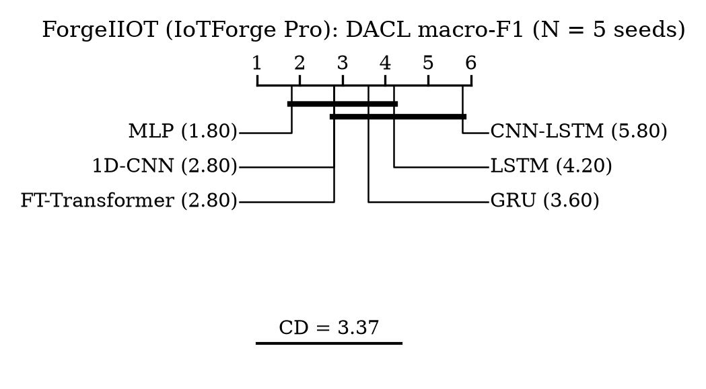

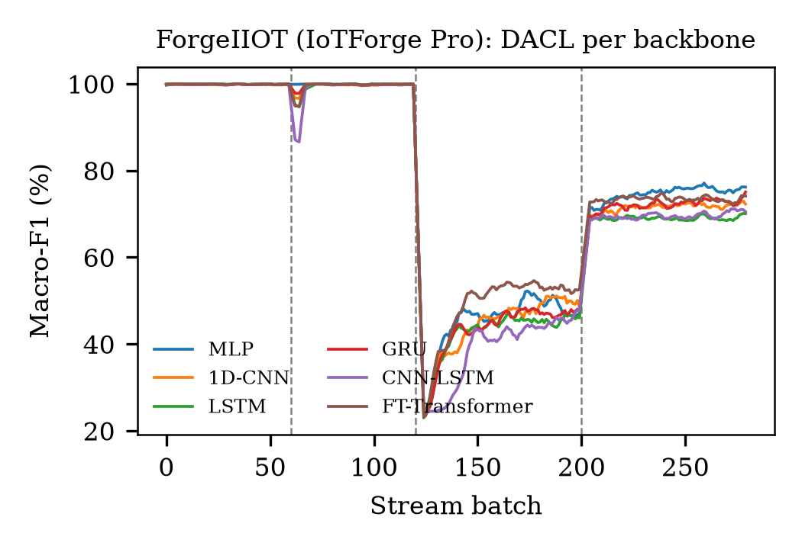

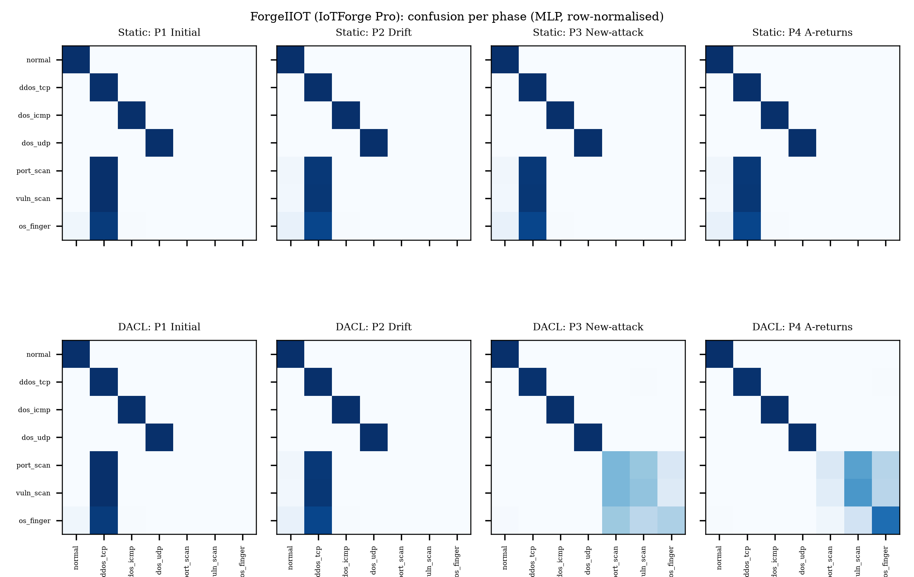

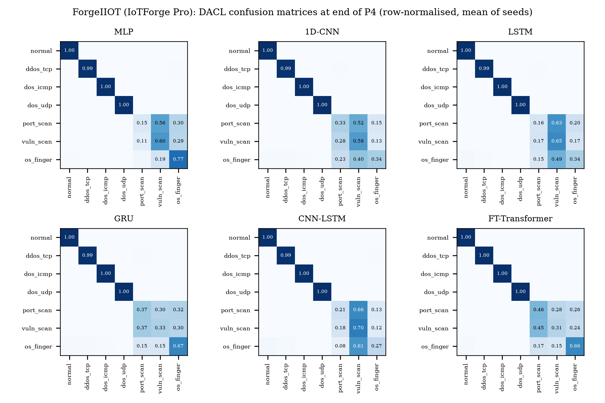

#### Layer 5: PureChain update gate on this dataset (MLP; balanced net-security-benefit policy, hard floor 30%, escalation at 10%; dual serving = alarm from the verified model, attack type from an advisory model)

| Setting                                | Method         | Macro-F1 (%)   | Detection (%)   | FPR (%)     | MAE (flows)    | Known-attack detectability (%)   | Rejected   | Escalated   | Poisoned updates accepted   |
|:---------------------------------------|:---------------|:---------------|:----------------|:------------|:---------------|:---------------------------------|:-----------|:------------|:----------------------------|
| Clean (cost of security)               | DACL           | 76.52 ± 2.04   | 99.14 ± 0.60    | 0.10 ± 0.02 | 148.0 ± 115.2  | 99.89 ± 0.05                     | --         | --          | --                          |
| Clean (cost of security)               | DACL+Gate      | 69.90 ± 6.06   | 98.47 ± 2.44    | 0.06 ± 0.03 | 211.2 ± 342.4  | 99.86 ± 0.05                     | 20.2%      | 0.0%        | --                          |
| Clean (cost of security)               | DACL+Gate-dual | 76.17 ± 1.87   | 98.02 ± 3.56    | 0.08 ± 0.05 | 275.8 ± 503.8  | 99.88 ± 0.04                     | 19.8%      | 0.0%        | --                          |
| Poisoning during drift (P2)            | DACL           | 60.94 ± 1.60   | 79.66 ± 0.76    | 0.07 ± 0.03 | 66.80 ± 24.08  | 99.87 ± 0.06                     | --         | --          | --                          |
| Poisoning during drift (P2)            | DACL+Gate      | 74.81 ± 2.23   | 97.06 ± 5.18    | 0.08 ± 0.02 | 585.6 ± 1077.5 | 99.87 ± 0.07                     | 20.2%      | 0.0%        | --                          |
| Poisoning during drift (P2)            | DACL+Gate-dual | 75.23 ± 1.61   | 98.18 ± 2.70    | 0.06 ± 0.02 | 350.4 ± 559.1  | 99.88 ± 0.04                     | 20.3%      | 0.8%        | --                          |
| Unlearning attack on known attack (P4) | DACL           | 76.51 ± 1.97   | 98.75 ± 0.64    | 0.09 ± 0.03 | 148.0 ± 115.2  | 97.59 ± 3.72                     | --         | --          | 100%                        |
| Unlearning attack on known attack (P4) | DACL+Gate      | 69.62 ± 5.94   | 98.47 ± 2.43    | 0.06 ± 0.03 | 211.2 ± 342.4  | 99.87 ± 0.05                     | 33.8%      | 0.0%        | 5.6%                        |
| Unlearning attack on known attack (P4) | DACL+Gate-dual | 75.51 ± 1.61   | 98.02 ± 3.56    | 0.08 ± 0.05 | 275.8 ± 503.8  | 99.87 ± 0.06                     | 32.1%      | 0.0%        | 6.2%                        |

#### Label scarcity (MLP): only the given share of flows is labelled

|   Labels (%) | Method      | Macro-F1 (%)   |   Detection (%) |   FPR (%) |   MAE (flows) |   Forgetting (%) | Det. delay   | Missed drifts   |
|-------------:|:------------|:---------------|----------------:|----------:|--------------:|-----------------:|:-------------|:----------------|
|            1 | Static      | 63.74 ± 0.08   |            97.8 |      0.03 |           303 |              0   | --           | --              |
|            1 | ER          | 71.79 ± 0.33   |            98.4 |      0.13 |           298 |              1.4 | --           | --              |
|            1 | DER++       | 71.59 ± 0.96   |            97.2 |      0.06 |           528 |              0.4 | --           | --              |
|            1 | FullRetrain | 71.29 ± 0.98   |            98.3 |      0.03 |           228 |              0.4 | 4.5          | 0.4             |
|            1 | DACL        | 72.54 ± 0.98   |            98.7 |      0.23 |           247 |              3.9 | 18.3         | 0.6             |
|            5 | Static      | 63.74 ± 0.08   |            97.8 |      0.03 |           303 |              0   | --           | --              |
|            5 | ER          | 72.64 ± 0.37   |            98.2 |      0.22 |           355 |              1.4 | --           | --              |
|            5 | DER++       | 72.29 ± 0.93   |            97.9 |      0.06 |           419 |              0.4 | --           | --              |
|            5 | FullRetrain | 73.57 ± 2.66   |            98.9 |      0.04 |           187 |              0.4 | 4.3          | 0.4             |
|            5 | DACL        | 73.69 ± 0.44   |            99.1 |      0.16 |           168 |              0.4 | 16.2         | 0.4             |
|           10 | Static      | 63.74 ± 0.08   |            97.8 |      0.03 |           303 |              0   | --           | --              |
|           10 | ER          | 73.31 ± 0.99   |            98.4 |      0.15 |           305 |              0.9 | --           | --              |
|           10 | DER++       | 72.97 ± 0.68   |            97.9 |      0.08 |           423 |              0.4 | --           | --              |
|           10 | FullRetrain | 74.54 ± 2.58   |            99   |      0.04 |           168 |              0.4 | 3.7          | 0.6             |
|           10 | DACL        | 74.65 ± 0.38   |            99.3 |      0.12 |           124 |              0.4 | 11.9         | 0.6             |
|          100 | Static      | 63.74 ± 0.08   |            97.8 |      0.03 |           303 |              0   | --           | --              |
|          100 | ER          | 74.02 ± 1.23   |            98.2 |      0.11 |           363 |              0.4 | --           | --              |
|          100 | DER++       | 73.86 ± 0.84   |            97.7 |      0.05 |           464 |              0.4 | --           | --              |
|          100 | FullRetrain | 79.66 ± 1.54   |            99.6 |      0.04 |            51 |              0   | 3.8          | 0.6             |
|          100 | DACL        | 76.97 ± 2.15   |            99.2 |      0.11 |           133 |              0.4 | 10.9         | 1.0             |

### B. Sensitivity analysis (MLP; one parameter varied at a time)

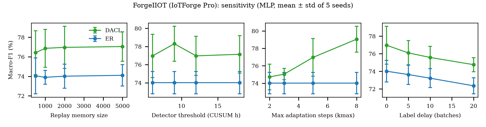

| method   |   value | parameter                    |   Macro-F1 (%) |   Forgetting (%) |   MAE |   Grad steps |
|:---------|--------:|:-----------------------------|---------------:|-----------------:|------:|-------------:|
| DACL     |     500 | Replay memory size           |           76.4 |              0.4 | 142   |        329.4 |
| DACL     |    1000 | Replay memory size           |           76.9 |              0.4 | 135.8 |        313.4 |
| DACL     |    2000 | Replay memory size           |           77   |              0.4 | 132.6 |        317   |
| DACL     |    5000 | Replay memory size           |           77   |              0.4 | 122.8 |        331   |
| ER       |     500 | Replay memory size           |           74   |              0.4 | 260.4 |        280   |
| ER       |    1000 | Replay memory size           |           73.9 |              0.4 | 404.8 |        280   |
| ER       |    2000 | Replay memory size           |           74   |              0.4 | 363.2 |        280   |
| ER       |    5000 | Replay memory size           |           74.1 |              0.4 | 307   |        280   |
| DACL     |       6 | Detector threshold (CUSUM h) |           77   |              0.4 | 170.4 |        337.8 |
| DACL     |       9 | Detector threshold (CUSUM h) |           78.3 |              0.4 |  97.6 |        349.4 |
| DACL     |      12 | Detector threshold (CUSUM h) |           77   |              0.4 | 132.6 |        317   |
| DACL     |      18 | Detector threshold (CUSUM h) |           77.1 |              0.4 | 120.8 |        283.6 |
| ER       |       6 | Detector threshold (CUSUM h) |           74   |              0.4 | 363.2 |        280   |
| ER       |       9 | Detector threshold (CUSUM h) |           74   |              0.4 | 363.2 |        280   |
| ER       |      12 | Detector threshold (CUSUM h) |           74   |              0.4 | 363.2 |        280   |
| ER       |      18 | Detector threshold (CUSUM h) |           74   |              0.4 | 363.2 |        280   |
| DACL     |       2 | Max adaptation steps (kmax)  |           74.7 |              0.4 | 200.2 |        170.8 |
| DACL     |       3 | Max adaptation steps (kmax)  |           75   |              0.4 | 147.4 |        197   |
| DACL     |       5 | Max adaptation steps (kmax)  |           77   |              0.4 | 132.6 |        317   |
| DACL     |       8 | Max adaptation steps (kmax)  |           79   |              0.4 |  96.8 |        453   |
| ER       |       2 | Max adaptation steps (kmax)  |           74   |              0.4 | 363.2 |        280   |
| ER       |       3 | Max adaptation steps (kmax)  |           74   |              0.4 | 363.2 |        280   |
| ER       |       5 | Max adaptation steps (kmax)  |           74   |              0.4 | 363.2 |        280   |
| ER       |       8 | Max adaptation steps (kmax)  |           74   |              0.4 | 363.2 |        280   |
| DACL     |       0 | Label delay (batches)        |           77   |              0.4 | 132.6 |        317   |
| DACL     |       5 | Label delay (batches)        |           76.1 |              0.4 | 144.6 |        326.2 |
| DACL     |      10 | Label delay (batches)        |           75.6 |              0.4 | 159.4 |        308.8 |
| DACL     |      20 | Label delay (batches)        |           74.8 |              0.4 | 196.8 |        284   |
| ER       |       0 | Label delay (batches)        |           74   |              0.4 | 363.2 |        280   |
| ER       |       5 | Label delay (batches)        |           73.6 |              0.4 | 429.4 |        275   |
| ER       |      10 | Label delay (batches)        |           73.2 |              0.4 | 531   |        270   |
| ER       |      20 | Label delay (batches)        |           72.4 |              0.4 | 565   |        260   |

### C. Natural drift (traffic replayed in recording order)

Classes: normal, ddos_tcp, dos_icmp, dos_ipv4, dos_udp, port_scan, os_finger, mitm_arp, mitm_ndp, sybil, dos_land, dos_deauth, vuln_scan, malw_back, ddos_mp, wild_card; 85 features.

#### L1 Detection (DACL, per backbone) -- natural drift

| Backbone       | Accuracy         | Precision        | Recall (DR)      | Macro-F1         | FPR             | FNR             | MCC (stream)      | MCC (test)        | PR-AUC (bin.)     | PR-AUC (macro)    |
|:---------------|:-----------------|:-----------------|:-----------------|:-----------------|:----------------|:----------------|:------------------|:------------------|:------------------|:------------------|
| MLP            | 79.42 ± 1.60     | **81.54 ± 1.26** | **96.72 ± 1.41** | **79.33 ± 1.42** | 3.39 ± 0.47     | **3.28 ± 1.41** | **0.352 ± 0.004** | 0.689 ± 0.024     | 0.999 ± 0.001     | 0.744 ± 0.013     |
| 1D-CNN         | **81.14 ± 3.21** | 81.33 ± 3.55     | 95.10 ± 1.62     | 79.00 ± 3.64     | 9.70 ± 2.98     | 4.90 ± 1.62     | 0.331 ± 0.024     | 0.648 ± 0.076     | 0.997 ± 0.001     | 0.661 ± 0.038     |
| LSTM           | 69.00 ± 1.99     | 70.58 ± 1.42     | 87.20 ± 1.33     | 68.64 ± 1.49     | 2.94 ± 0.79     | 12.80 ± 1.33    | 0.269 ± 0.006     | 0.697 ± 0.027     | 1.000 ± 0.000     | 0.721 ± 0.018     |
| GRU            | 70.72 ± 6.80     | 74.19 ± 6.51     | 89.45 ± 0.89     | 71.11 ± 6.26     | **2.68 ± 0.14** | 10.55 ± 0.89    | 0.279 ± 0.019     | 0.705 ± 0.011     | 1.000 ± 0.000     | **0.748 ± 0.014** |
| CNN-LSTM       | 69.15 ± 2.28     | 70.17 ± 1.17     | 86.47 ± 5.83     | 68.50 ± 1.48     | 3.56 ± 1.28     | 13.53 ± 5.83    | 0.267 ± 0.011     | 0.635 ± 0.053     | 0.999 ± 0.000     | 0.650 ± 0.020     |
| FT-Transformer | 70.30 ± 2.57     | 72.34 ± 2.46     | 91.56 ± 0.83     | 70.57 ± 2.19     | 2.99 ± 0.62     | 8.44 ± 0.83     | 0.297 ± 0.010     | **0.723 ± 0.018** | **1.000 ± 0.000** | 0.744 ± 0.030     |

#### L2 Continual (DACL, per backbone) -- natural drift

| Backbone       | Avg. acc.        | Forgetting      | BWT (A)         | Intransigence   | H-score           |
|:---------------|:-----------------|:----------------|:----------------|:----------------|:------------------|
| MLP            | 79.42 ± 1.60     | 3.29 ± 5.79     | -1.67 ± 5.20    | 4.64 ± 4.62     | 0.663 ± 0.032     |
| 1D-CNN         | **81.14 ± 3.21** | 1.93 ± 1.01     | **1.45 ± 1.79** | 12.28 ± 6.65    | 0.616 ± 0.071     |
| LSTM           | 69.00 ± 1.99     | 0.70 ± 0.58     | -0.44 ± 0.78    | 6.38 ± 4.87     | 0.675 ± 0.029     |
| GRU            | 70.72 ± 6.80     | **0.46 ± 0.32** | 0.06 ± 0.32     | **0.82 ± 3.06** | **0.712 ± 0.010** |
| CNN-LSTM       | 69.15 ± 2.28     | 10.31 ± 6.31    | -6.96 ± 6.76    | 9.29 ± 7.48     | 0.603 ± 0.075     |
| FT-Transformer | 70.30 ± 2.57     | 0.87 ± 1.25     | -0.22 ± 0.31    | 1.51 ± 4.82     | 0.698 ± 0.024     |

#### L3 Lifecycle (DACL, per backbone) -- natural drift

| Backbone       | EW (batches)      | MAE (flows)       | Lifecycle F1     | Det. delay        | False alarms      | FA / 100 batches   | Missed drifts     | dF1 / CPU-s       | dF1 / J           |
|:---------------|:------------------|:------------------|:-----------------|:------------------|:------------------|:-------------------|:------------------|:------------------|:------------------|
| MLP            | **8.800 ± 1.675** | 1,043 ± 557       | **79.33 ± 1.42** | **7.140 ± 1.253** | **8.400 ± 0.548** | **1.564 ± 0.102**  | **1.400 ± 0.894** | **0.312 ± 0.024** | **0.104 ± 0.008** |
| 1D-CNN         | 8.840 ± 1.148     | 2,127 ± 960       | 79.00 ± 3.64     | 7.667 ± 2.288     | 8.600 ± 1.817     | 1.601 ± 0.338      | 1.400 ± 0.548     | 0.007 ± 0.001     | 0.002 ± 0.000     |
| LSTM           | 11.38 ± 1.04      | 2,941 ± 801       | 68.64 ± 1.49     | 12.76 ± 1.09      | 9.800 ± 0.837     | 1.825 ± 0.156      | 1.400 ± 0.548     | 0.016 ± 0.002     | 0.005 ± 0.001     |
| GRU            | 11.24 ± 3.83      | 2,179 ± 900       | 71.11 ± 6.26     | 9.354 ± 3.393     | 9.400 ± 1.140     | 1.750 ± 0.212      | 1.800 ± 0.837     | 0.018 ± 0.004     | 0.006 ± 0.001     |
| CNN-LSTM       | 11.32 ± 0.91      | 4,882 ± 7,423     | 68.50 ± 1.48     | 13.45 ± 1.15      | 9.600 ± 0.548     | 1.788 ± 0.102      | 1.400 ± 0.548     | 0.007 ± 0.001     | 0.002 ± 0.000     |
| FT-Transformer | 12.14 ± 1.42      | **736.4 ± 318.7** | 70.57 ± 2.19     | 14.32 ± 1.55      | 10.60 ± 1.14      | 1.974 ± 0.212      | 2.000 ± 0.707     | 0.001 ± 0.000     | 0.000 ± 0.000     |

#### L4 Edge (DACL, per backbone) -- natural drift

| Backbone       | Lat. mean (ms)   | Lat. p95 (ms)   | Lat. p99 (ms)   | Throughput (flows/s)   | Deadline miss (%)   | Upd. lat. mean (ms)   | Upd. lat. max (ms)   | Params     | Model (MB)   | FLOPs/flow   | Peak mem. (MB)    | Energy/update (J)   |
|:---------------|:-----------------|:----------------|:----------------|:-----------------------|:--------------------|:----------------------|:---------------------|:-----------|:-------------|:-------------|:------------------|:--------------------|
| MLP            | **0.030**        | **0.037**       | **0.049**       | **1,835,757**          | **0.000**           | **6.555 ± 0.317**     | **9.918**            | 20,304     | 0.077        | **40,192**   | 3.183 ± 0.842     | **0.255 ± 0.022**   |
| 1D-CNN         | 0.136            | 0.211           | 0.317           | 17,623                 | 29.57 ± 2.18        | 345.5 ± 11.2          | 502.1 ± 0.0          | 40,208     | 0.153        | 1,128,384    | 2.896 ± 0.562     | 11.50 ± 0.91        |
| LSTM           | 0.135            | 0.197           | 0.335           | 127,395 ± 0            | 0.000               | 110.0 ± 2.0           | 160.0                | 19,984     | 0.076        | 407,552      | **2.417 ± 0.371** | 3.740 ± 0.444       |
| GRU            | 0.335            | 0.536           | 0.674           | 108,629 ± 0            | 0.000               | 100.0 ± 5.7           | 146.9                | **15,248** | **0.058**    | 306,176      | 2.505 ± 0.422     | 3.698 ± 0.588       |
| CNN-LSTM       | 0.291            | 0.475           | 0.649           | 25,266                 | 8.68 ± 1.34         | 240.3 ± 9.6           | 349.1                | 26,256     | 0.100        | 608,192      | 2.756 ± 0.470     | 8.662 ± 0.448       |
| FT-Transformer | 0.531            | 0.920           | 1.264           | 3,637                  | 35.01 ± 2.47        | 2,668 ± 151           | 4,038                | 23,152     | 0.088        | 2,819,072    | 2.998 ± 0.591     | 92.07 ± 10.41       |

#### Macro-F1 (%) of every method on every backbone -- natural drift

|               | MLP              | 1D-CNN           | LSTM             | GRU              | CNN-LSTM         | FT-Transformer   |
|:--------------|:-----------------|:-----------------|:-----------------|:-----------------|:-----------------|:-----------------|
| Static        | 37.08 ± 0.18     | 37.12 ± 0.30     | 36.85 ± 0.36     | 36.86 ± 0.19     | 36.77 ± 0.41     | 36.10 ± 0.93     |
| FineTune      | 68.58 ± 1.27     | 58.89 ± 4.26     | 61.12 ± 1.79     | 68.50 ± 1.33     | 56.36 ± 2.26     | 58.19 ± 4.86     |
| EWC           | 61.81 ± 2.55     | 63.28 ± 5.89     | 60.21 ± 2.13     | 68.01 ± 2.73     | 56.86 ± 4.26     | 57.67 ± 6.99     |
| LwF           | 67.87 ± 0.75     | 65.40 ± 3.28     | 62.57 ± 1.38     | 67.07 ± 2.34     | 57.51 ± 3.59     | 62.88 ± 1.74     |
| ER            | 66.78 ± 2.68     | 66.86 ± 3.69     | 65.32 ± 2.45     | 69.56 ± 1.21     | 65.85 ± 1.72     | 70.73 ± 2.25     |
| DER++         | 68.99 ± 2.47     | 63.16 ± 6.38     | 64.80 ± 0.74     | 68.53 ± 0.27     | 64.28 ± 1.46     | **71.63 ± 2.49** |
| PeriodicER    | 45.19 ± 0.51     | 51.45 ± 4.77     | 43.47 ± 3.70     | 50.83 ± 2.23     | 46.58 ± 3.15     | 53.21 ± 2.86     |
| WindowRetrain | 78.91 ± 0.37     | nan              | nan              | nan              | nan              | 59.61 ± 8.32     |
| FullRetrain   | 65.80 ± 1.36     | 65.35 ± 0.57     | 65.61 ± 0.62     | 65.36 ± 0.95     | 62.33 ± 0.94     | 65.69 ± 0.50     |
| DACL          | **79.33 ± 1.42** | **79.00 ± 3.64** | **68.64 ± 1.49** | **71.11 ± 6.26** | **68.50 ± 1.48** | 70.57 ± 2.19     |

**Best baseline: WindowRetrain.** DACL - WindowRetrain macro-F1: median +1.87 pts, mean +5.69 pts; DACL better in 7/10 backbone x seed pairs; Wilcoxon p = 0.13.

#### Per-class recall (%) at the end of the stream (DACL)

|                |   normal |   ddos_tcp |   dos_icmp |   dos_ipv4 |   dos_udp |   port_scan |   os_finger |   mitm_arp |   mitm_ndp |   sybil |   dos_land |   dos_deauth |   vuln_scan |   malw_back |   ddos_mp |   wild_card |
|:---------------|---------:|-----------:|-----------:|-----------:|----------:|------------:|------------:|-----------:|-----------:|--------:|-----------:|-------------:|------------:|------------:|----------:|------------:|
| MLP            |    94.82 |      86.82 |      99.98 |     100    |    100    |         0   |       10.45 |      88.37 |      97.37 |   77.56 |     100    |        35.78 |       89.86 |       82.28 |      4.06 |       32.17 |
| 1D-CNN         |    77.54 |      92.3  |     100    |      99.94 |    100    |         0   |        0.14 |      70.61 |      97.82 |   66.22 |      79.98 |        29.75 |       99.74 |       81.45 |      0    |       19.64 |
| LSTM           |    85.8  |      97.2  |     100    |      99.98 |     99.96 |         0   |        0.14 |      77.76 |      97.28 |   83.85 |     100    |        49.31 |       99.86 |       85.67 |      0    |       33.62 |
| GRU            |    64.74 |      98.12 |     100    |     100    |     99.96 |         0   |        0.25 |      77.51 |      97.15 |   77.69 |     100    |        59.35 |       99.78 |       93.36 |      0.02 |       92.94 |
| CNN-LSTM       |    95.54 |      59.1  |      99.6  |     100    |    100    |         1.1 |       14.12 |      80    |      98.04 |   37.69 |      80    |        22.84 |       85.5  |       85.81 |     12.66 |       19.73 |
| FT-Transformer |    96.54 |      96.5  |     100    |     100    |    100    |         0   |        7.66 |      89.01 |      96.26 |   92.31 |     100    |        65.67 |       98.04 |       94.6  |      0    |       39.91 |

#### Per-class recall (%) after each phase: Static (MLP)

|               |   normal |   ddos_tcp |   dos_icmp |   dos_ipv4 |   dos_udp |   port_scan |   os_finger |   mitm_arp |   mitm_ndp |   sybil |   dos_land |   dos_deauth |   vuln_scan |   malw_back |   ddos_mp |   wild_card |
|:--------------|---------:|-----------:|-----------:|-----------:|----------:|------------:|------------:|-----------:|-----------:|--------:|-----------:|-------------:|------------:|------------:|----------:|------------:|
| P0 Deployment |    99.48 |        100 |      99.98 |        100 |       100 |           0 |           0 |          0 |          0 |       0 |          0 |            0 |           0 |           0 |         0 |           0 |
| S1            |    99.48 |        100 |      99.98 |        100 |       100 |           0 |           0 |          0 |          0 |       0 |          0 |            0 |           0 |           0 |         0 |           0 |
| S2            |    99.48 |        100 |      99.98 |        100 |       100 |           0 |           0 |          0 |          0 |       0 |          0 |            0 |           0 |           0 |         0 |           0 |
| S3            |    99.48 |        100 |      99.98 |        100 |       100 |           0 |           0 |          0 |          0 |       0 |          0 |            0 |           0 |           0 |         0 |           0 |
| S4            |    99.48 |        100 |      99.98 |        100 |       100 |           0 |           0 |          0 |          0 |       0 |          0 |            0 |           0 |           0 |         0 |           0 |

#### Per-class recall (%) after each phase: DACL (MLP)

|               |   normal |   ddos_tcp |   dos_icmp |   dos_ipv4 |   dos_udp |   port_scan |   os_finger |   mitm_arp |   mitm_ndp |   sybil |   dos_land |   dos_deauth |   vuln_scan |   malw_back |   ddos_mp |   wild_card |
|:--------------|---------:|-----------:|-----------:|-----------:|----------:|------------:|------------:|-----------:|-----------:|--------:|-----------:|-------------:|------------:|------------:|----------:|------------:|
| P0 Deployment |    99.48 |     100    |      99.98 |        100 |       100 |        0    |        0    |       0    |       0    |    0    |          0 |         0    |        0    |        0    |      0    |        0    |
| S1            |    99.1  |     100    |      99.98 |        100 |       100 |       99.88 |        0    |       0    |       0    |    0    |          0 |         0    |        0    |        0    |      0    |        0    |
| S2            |    98.64 |      95.52 |      99.96 |        100 |       100 |       99.88 |        0.42 |      72.4  |      98.04 |   80.64 |        100 |         0    |        0    |        0    |      0    |        0    |
| S3            |    98.14 |      93.48 |      99.98 |        100 |       100 |        0    |        0.68 |      90.1  |      97.77 |   96.92 |        100 |        35.2  |       99.82 |        0    |      0    |        0    |
| S4            |    94.82 |      86.82 |      99.98 |        100 |       100 |        0    |       10.45 |      88.37 |      97.37 |   77.56 |        100 |        35.78 |       89.86 |       82.28 |      4.06 |       32.17 |

#### Statistics

- Friedman test across backbones (DACL macro-F1, blocks = 5 seeds): chi2 = 15.63, p = 0.00799. Average ranks: 1D-CNN 1.60, MLP 1.80, GRU 3.60, FT-Transformer 4.20, LSTM 4.80, CNN-LSTM 5.00
- DACL vs Static (macro-F1, N = 30 backbone x seed pairs): median diff +34.15 pts, Wilcoxon p = 1.9e-09
- DACL vs FineTune (macro-F1, N = 30 backbone x seed pairs): median diff +10.51 pts, Wilcoxon p = 1.9e-08
- DACL vs EWC (macro-F1, N = 30 backbone x seed pairs): median diff +11.86 pts, Wilcoxon p = 1.3e-08
- DACL vs LwF (macro-F1, N = 30 backbone x seed pairs): median diff +8.85 pts, Wilcoxon p = 5.6e-09
- DACL vs ER (macro-F1, N = 30 backbone x seed pairs): median diff +3.50 pts, Wilcoxon p = 1.8e-05
- DACL vs DER++ (macro-F1, N = 30 backbone x seed pairs): median diff +4.42 pts, Wilcoxon p = 2.7e-05
- DACL vs PeriodicER (macro-F1, N = 30 backbone x seed pairs): median diff +23.23 pts, Wilcoxon p = 1.9e-09
- DACL vs WindowRetrain (macro-F1, N = 10 backbone x seed pairs): median diff +1.87 pts, Wilcoxon p = 0.13
- DACL vs FullRetrain (macro-F1, N = 30 backbone x seed pairs): median diff +5.98 pts, Wilcoxon p = 5.6e-09

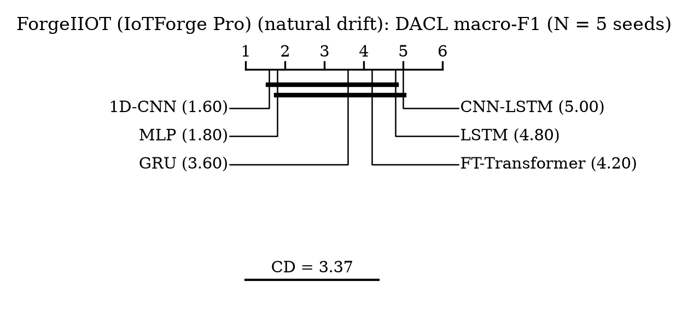

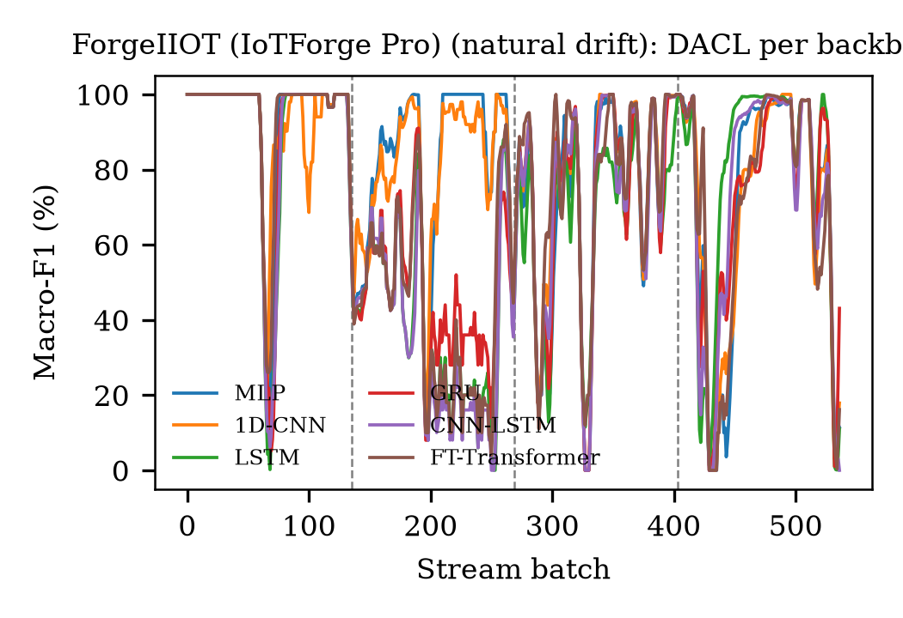

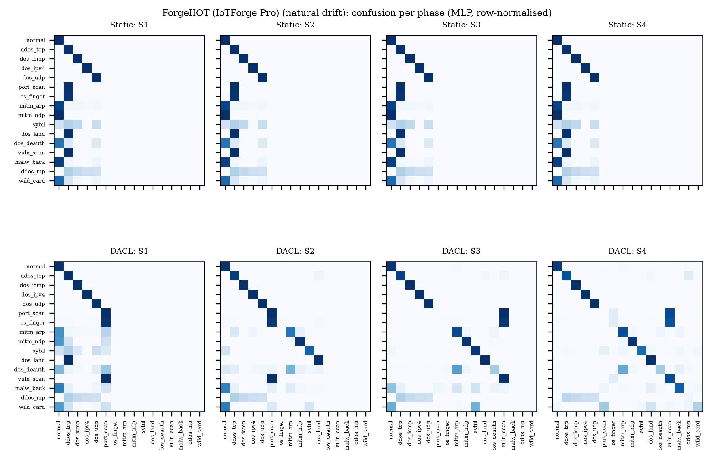

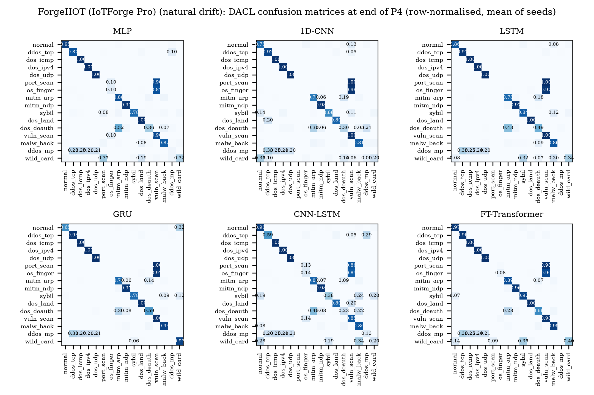

## MU-IoT

### A. Injected drift (P1 initial, P2 drift, P3 new attack, P4 known attack returns)

Classes: normal, TCP_SYN, UDP_flood, ICMP_Flood, HTTP_Flood, sql, XSS, Bruteforce, Dictionary; 101 features.

#### L1 Detection (DACL, per backbone)

| Backbone       | Accuracy         | Precision        | Recall (DR)      | Macro-F1         | FPR             | FNR             | MCC (stream)      | MCC (test)        | PR-AUC (bin.)   | PR-AUC (macro)    |
|:---------------|:-----------------|:-----------------|:-----------------|:-----------------|:----------------|:----------------|:------------------|:------------------|:----------------|:------------------|
| MLP            | 92.94 ± 0.55     | 83.56 ± 1.38     | 98.97 ± 0.77     | 81.76 ± 1.57     | 0.05 ± 0.06     | 1.03 ± 0.77     | 0.868 ± 0.013     | 0.809 ± 0.016     | 1.000 ± 0.000   | 0.881 ± 0.018     |
| 1D-CNN         | 91.32 ± 0.50     | 80.21 ± 1.40     | 98.00 ± 2.06     | 78.28 ± 0.84     | 0.75 ± 0.50     | 2.00 ± 2.06     | 0.840 ± 0.013     | 0.759 ± 0.043     | 1.000 ± 0.000   | 0.833 ± 0.028     |
| LSTM           | 91.37 ± 0.89     | 79.87 ± 2.20     | 99.31 ± 0.69     | 77.93 ± 2.30     | 0.40 ± 0.40     | 0.69 ± 0.69     | 0.844 ± 0.013     | 0.777 ± 0.034     | 1.000 ± 0.000   | 0.845 ± 0.038     |
| GRU            | 92.11 ± 1.01     | 81.31 ± 2.48     | 99.61 ± 0.38     | 79.47 ± 2.41     | 0.38 ± 0.44     | 0.39 ± 0.38     | 0.855 ± 0.017     | 0.808 ± 0.035     | 1.000 ± 0.000   | 0.867 ± 0.026     |
| CNN-LSTM       | 89.63 ± 1.83     | 76.78 ± 4.77     | 95.86 ± 1.84     | 74.76 ± 5.40     | 1.70 ± 0.23     | 4.14 ± 1.84     | 0.810 ± 0.034     | 0.751 ± 0.068     | 1.000 ± 0.000   | 0.811 ± 0.074     |
| FT-Transformer | **94.19 ± 1.71** | **85.26 ± 4.70** | **99.61 ± 0.48** | **84.15 ± 4.65** | **0.01 ± 0.01** | **0.39 ± 0.48** | **0.892 ± 0.029** | **0.883 ± 0.071** | **1.000**       | **0.915 ± 0.058** |

#### L2 Continual (DACL, per backbone)

| Backbone       | Avg. acc.        | Forgetting      | BWT (A)          | Intransigence      | H-score           |
|:---------------|:-----------------|:----------------|:-----------------|:-------------------|:------------------|
| MLP            | 92.94 ± 0.55     | 16.66 ± 3.82    | -16.38 ± 3.67    | 8.62 ± 3.24        | 0.754 ± 0.030     |
| 1D-CNN         | 91.32 ± 0.50     | 27.59 ± 1.53    | -25.77 ± 1.61    | 6.77 ± 5.84        | 0.688 ± 0.021     |
| LSTM           | 91.37 ± 0.89     | 12.89 ± 3.77    | -12.38 ± 3.59    | 12.71 ± 6.79       | 0.697 ± 0.039     |
| GRU            | 92.11 ± 1.01     | 8.00 ± 1.67     | -7.19 ± 1.35     | 13.35 ± 11.98      | 0.731 ± 0.029     |
| CNN-LSTM       | 89.63 ± 1.83     | 25.89 ± 3.17    | -18.29 ± 7.12    | **-25.18 ± 26.79** | 0.681 ± 0.043     |
| FT-Transformer | **94.19 ± 1.71** | **1.38 ± 1.77** | **-1.26 ± 1.75** | 4.29 ± 4.05        | **0.852 ± 0.074** |

#### L3 Lifecycle (DACL, per backbone)

| Backbone       | EW (batches)     | MAE (flows)       | Lifecycle F1     | Det. delay        | False alarms      | FA / 100 batches   | Missed drifts     | dF1 / CPU-s       | dF1 / J           |
|:---------------|:-----------------|:------------------|:-----------------|:------------------|:------------------|:-------------------|:------------------|:------------------|:------------------|
| MLP            | 28.87 ± 0.56     | 198.8 ± 147.5     | 81.76 ± 1.57     | 6.533 ± 9.464     | 2.600 ± 0.548     | 0.929 ± 0.196      | 0.600 ± 0.548     | **0.459 ± 0.078** | **0.153 ± 0.026** |
| 1D-CNN         | 38.33 ± 11.45    | 334.2 ± 356.8     | 78.28 ± 0.84     | 2.833 ± 2.444     | 2.600 ± 1.342     | 0.929 ± 0.479      | **0.400 ± 0.548** | 0.010 ± 0.002     | 0.003 ± 0.001     |
| LSTM           | 29.27 ± 0.64     | 100.4 ± 114.3     | 77.93 ± 2.30     | **2.067 ± 1.267** | 2.400 ± 0.548     | 0.857 ± 0.196      | 0.800 ± 0.447     | 0.035 ± 0.010     | 0.012 ± 0.003     |
| GRU            | 30.20 ± 1.12     | **57.60 ± 71.12** | 79.47 ± 2.41     | 4.933 ± 4.638     | 2.400 ± 0.894     | 0.857 ± 0.319      | 0.400 ± 0.548     | 0.042 ± 0.013     | 0.014 ± 0.004     |
| CNN-LSTM       | 39.67 ± 5.80     | 706.8 ± 413.2     | 74.76 ± 5.40     | 4.533 ± 4.248     | 2.200 ± 0.447     | 0.786 ± 0.160      | 0.600 ± 0.548     | 0.016 ± 0.003     | 0.005 ± 0.001     |
| FT-Transformer | **28.60 ± 1.09** | 81.40 ± 101.56    | **84.15 ± 4.65** | 3.000 ± 2.633     | **1.800 ± 0.837** | **0.643 ± 0.299**  | 0.800 ± 0.837     | 0.001 ± 0.000     | 0.000 ± 0.000     |

#### L4 Edge (DACL, per backbone)

| Backbone       | Lat. mean (ms)   | Lat. p95 (ms)   | Lat. p99 (ms)   | Throughput (flows/s)   | Deadline miss (%)   | Upd. lat. mean (ms)   | Upd. lat. max (ms)   | Params     | Model (MB)   | FLOPs/flow   | Peak mem. (MB)    | Energy/update (J)   |
|:---------------|:-----------------|:----------------|:----------------|:-----------------------|:--------------------|:----------------------|:---------------------|:-----------|:-------------|:-------------|:------------------|:--------------------|
| MLP            | **0.036**        | **0.054**       | **0.091**       | **1,676,424**          | **0.000**           | **7.507 ± 0.507**     | **11.22 ± 1.05**     | 21,897     | 0.084        | **43,392**   | 4.764 ± 0.265     | **0.448 ± 0.069**   |
| 1D-CNN         | 0.119 ± 0.000    | 0.152           | 0.216 ± 0.000   | 14,829 ± 0             | 37.14 ± 7.56        | 410.1 ± 27.1          | 546.7 ± 142.6        | 39,753     | 0.152        | 1,327,168    | 5.018             | 26.22 ± 9.22        |
| LSTM           | 0.137            | 0.217           | 0.314           | 112,106                | 0.000               | 105.9 ± 6.0           | 161.7                | 19,529     | 0.074        | 480,384      | **4.292 ± 0.568** | 5.995 ± 0.949       |
| GRU            | 0.297            | 0.446           | 0.614           | 41,753                 | 0.000               | 86.17 ± 3.54          | 132.8                | **14,793** | **0.056**    | 360,576      | 4.611 ± 0.485     | 5.819 ± 0.292       |
| CNN-LSTM       | 0.234 ± 0.000    | 0.368           | 0.526           | 25,396                 | 7.93 ± 7.29         | 250.7 ± 24.6          | 342.6 ± 66.6         | 25,801     | 0.098        | 610,368      | 4.774 ± 0.309     | 19.67 ± 4.12        |
| FT-Transformer | 0.582            | 0.876           | 1.138           | 2,805                  | 31.64 ± 6.41        | 4,036 ± 107           | 5,911 ± 1,149        | 23,945     | 0.091        | 3,342,912    | 4.898             | 271.2 ± 51.5        |

#### Macro-F1 (%) of every method on every backbone

|               | MLP              | 1D-CNN           | LSTM             | GRU              | CNN-LSTM         | FT-Transformer   |
|:--------------|:-----------------|:-----------------|:-----------------|:-----------------|:-----------------|:-----------------|
| Static        | 49.23 ± 8.39     | 37.07 ± 4.04     | 45.90 ± 9.74     | 42.17 ± 8.18     | 28.64 ± 1.49     | 47.34 ± 10.69    |
| FineTune      | 70.63 ± 2.89     | 61.90 ± 7.73     | 66.65 ± 0.88     | 70.83 ± 1.91     | 52.59 ± 6.55     | 65.64 ± 1.62     |
| EWC           | 70.66 ± 2.95     | 61.43 ± 9.13     | 66.84 ± 0.83     | 71.11 ± 2.23     | 52.62 ± 6.55     | 65.43 ± 2.48     |
| LwF           | 69.67 ± 2.70     | 59.29 ± 5.59     | 65.96 ± 3.08     | 67.06 ± 5.25     | 50.37 ± 4.52     | 64.98 ± 2.34     |
| ER            | 76.02 ± 2.04     | 67.59 ± 8.90     | 69.61 ± 1.33     | 74.47 ± 2.45     | 60.72 ± 7.34     | 76.47 ± 1.36     |
| DER++         | 76.30 ± 1.72     | 68.52 ± 4.49     | 70.55 ± 1.53     | 72.82 ± 2.38     | 59.72 ± 4.68     | 75.25 ± 4.44     |
| PeriodicER    | 64.21 ± 2.51     | 55.44 ± 6.23     | 60.33 ± 4.22     | 62.63 ± 4.38     | 48.39 ± 4.78     | 65.59 ± 4.21     |
| WindowRetrain | 79.71 ± 1.77     | nan              | nan              | nan              | nan              | 73.29 ± 2.44     |
| FullRetrain   | 88.55 ± 1.22     | 84.90 ± 2.75     | 85.21 ± 2.42     | 86.07 ± 2.84     | 71.49 ± 9.06     | 89.30 ± 2.75     |
| DACL          | **81.76 ± 1.57** | **78.28 ± 0.84** | **77.93 ± 2.30** | **79.47 ± 2.41** | **74.76 ± 5.40** | **84.15 ± 4.65** |

**Best baseline: WindowRetrain.** DACL - WindowRetrain macro-F1: median +3.71 pts, mean +6.46 pts; DACL better in 10/10 backbone x seed pairs; Wilcoxon p = 0.002.

#### Per-class recall (%) at the end of the stream (DACL)

|                |   normal |   TCP_SYN |   UDP_flood |   ICMP_Flood |   HTTP_Flood |   sql |   XSS |   Bruteforce |   Dictionary |
|:---------------|---------:|----------:|------------:|-------------:|-------------:|------:|------:|-------------:|-------------:|
| MLP            |    99.95 |     99.62 |       99.65 |        98.16 |        61.12 | 59.02 | 90.13 |        75.06 |        63.22 |
| 1D-CNN         |    99.71 |     97.01 |       99.15 |        97.79 |        37.28 | 55.64 | 90.82 |        63.56 |        63.4  |
| LSTM           |    99.93 |     99.45 |       98.8  |        98.52 |        74.14 | 55.65 | 82.08 |        56.67 |        53.76 |
| GRU            |    99.91 |     98.9  |       98.93 |        98.79 |        80.23 | 58.48 | 89.37 |        58.67 |        60.74 |
| CNN-LSTM       |    99.42 |     91.33 |       97.4  |        95.55 |        53.85 | 50.74 | 88.58 |        55.07 |        65    |
| FT-Transformer |   100    |     99.98 |       99.89 |        99.27 |        92.26 | 84.87 | 92.34 |        80.18 |        56.11 |

#### Per-class recall (%) after each phase: Static (MLP)

|               |   normal |   TCP_SYN |   UDP_flood |   ICMP_Flood |   HTTP_Flood |   sql |   XSS |   Bruteforce |   Dictionary |
|:--------------|---------:|----------:|------------:|-------------:|-------------:|------:|------:|-------------:|-------------:|
| P0 Deployment |    99.98 |     99.9  |       99.8  |        99.23 |        99.69 |     0 |     0 |            0 |            0 |
| P1 Initial    |    99.98 |     99.9  |       99.8  |        99.23 |        99.69 |     0 |     0 |            0 |            0 |
| P2 Drift      |    98.87 |     43.54 |       40.62 |        78.85 |        78.23 |     0 |     0 |            0 |            0 |
| P3 New-attack |    98.87 |     43.54 |       40.62 |        78.85 |        78.23 |     0 |     0 |            0 |            0 |
| P4 A-returns  |    98.87 |     43.54 |       40.62 |        78.85 |        78.23 |     0 |     0 |            0 |            0 |

#### Per-class recall (%) after each phase: DACL (MLP)

|               |   normal |   TCP_SYN |   UDP_flood |   ICMP_Flood |   HTTP_Flood |   sql |   XSS |   Bruteforce |   Dictionary |
|:--------------|---------:|----------:|------------:|-------------:|-------------:|------:|------:|-------------:|-------------:|
| P0 Deployment |    99.98 |     99.9  |       99.8  |        99.23 |        99.69 |  0    |  0    |         0    |         0    |
| P1 Initial    |    99.98 |     99.92 |       99.81 |        99.28 |        99.69 |  0    |  0    |         0    |         0    |
| P2 Drift      |    99.97 |     99.78 |       99.73 |        98.76 |        99.31 |  0    |  0    |         0    |         0    |
| P3 New-attack |    99.95 |     98.48 |       99.19 |        97.77 |        36.62 | 51.28 | 90.24 |        74.18 |        59.97 |
| P4 A-returns  |    99.95 |     99.62 |       99.65 |        98.16 |        61.12 | 59.02 | 90.13 |        75.06 |        63.22 |

#### Statistics

- Friedman test across backbones (DACL macro-F1, blocks = 5 seeds): chi2 = 14.71, p = 0.0117. Average ranks: MLP 1.80, FT-Transformer 1.80, GRU 3.40, 1D-CNN 4.40, LSTM 4.40, CNN-LSTM 5.20
- DACL vs Static (macro-F1, N = 30 backbone x seed pairs): median diff +39.45 pts, Wilcoxon p = 1.9e-09
- DACL vs FineTune (macro-F1, N = 30 backbone x seed pairs): median diff +12.90 pts, Wilcoxon p = 1.9e-09
- DACL vs EWC (macro-F1, N = 30 backbone x seed pairs): median diff +12.92 pts, Wilcoxon p = 1.9e-09
- DACL vs LwF (macro-F1, N = 30 backbone x seed pairs): median diff +16.51 pts, Wilcoxon p = 1.9e-09
- DACL vs ER (macro-F1, N = 30 backbone x seed pairs): median diff +7.73 pts, Wilcoxon p = 1.9e-09
- DACL vs DER++ (macro-F1, N = 30 backbone x seed pairs): median diff +7.65 pts, Wilcoxon p = 1.9e-09
- DACL vs PeriodicER (macro-F1, N = 30 backbone x seed pairs): median diff +18.89 pts, Wilcoxon p = 1.9e-09
- DACL vs WindowRetrain (macro-F1, N = 10 backbone x seed pairs): median diff +3.71 pts, Wilcoxon p = 0.002
- DACL vs FullRetrain (macro-F1, N = 30 backbone x seed pairs): median diff -6.23 pts, Wilcoxon p = 4.4e-05

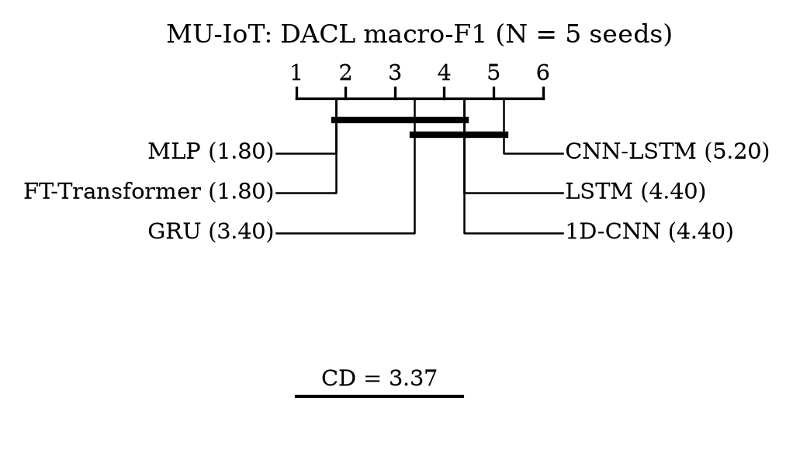

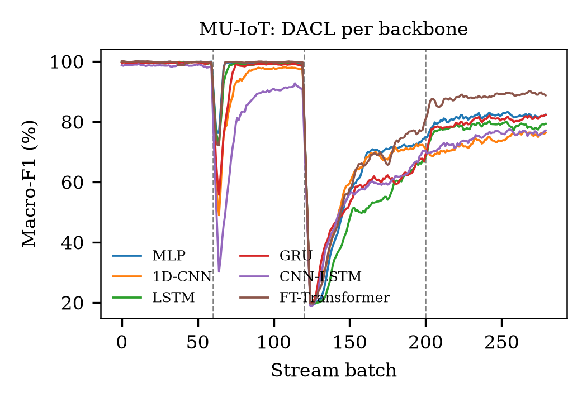

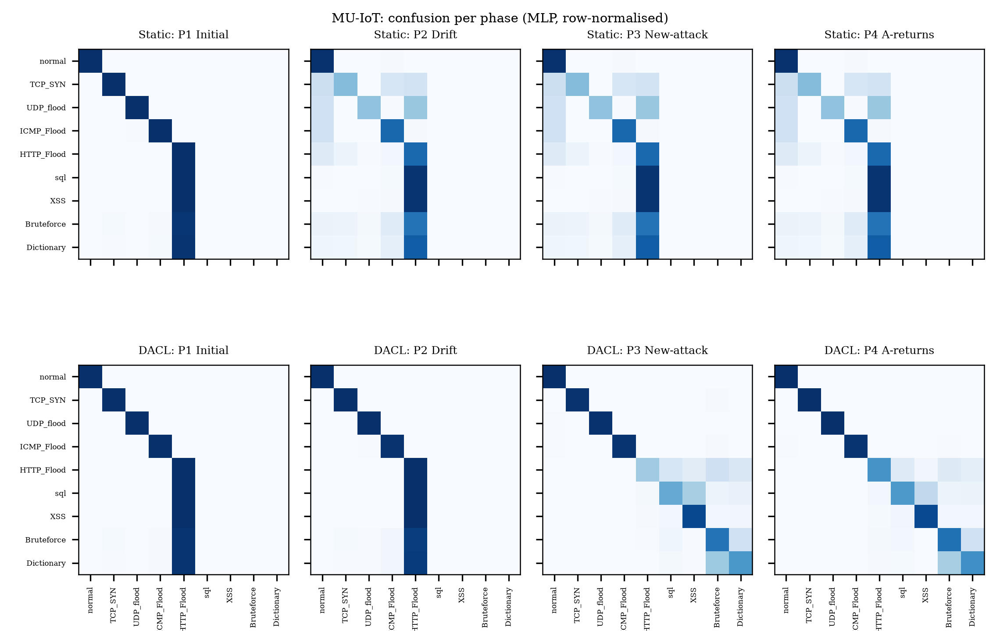

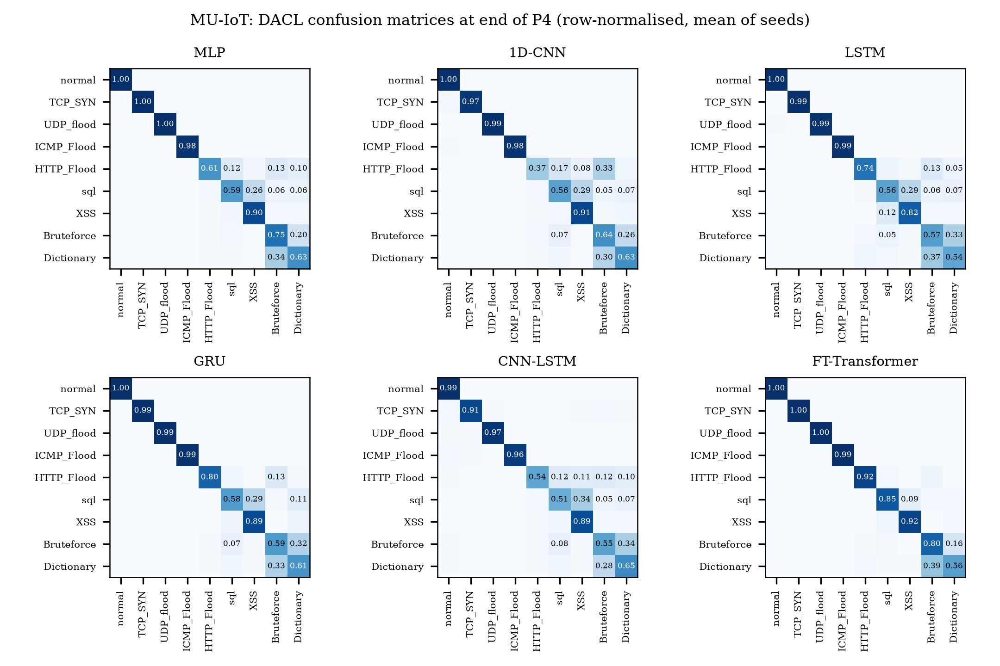

#### Layer 5: PureChain update gate on this dataset (MLP; balanced net-security-benefit policy, hard floor 30%, escalation at 10%; dual serving = alarm from the verified model, attack type from an advisory model)

| Setting                                | Method         | Macro-F1 (%)   | Detection (%)   | FPR (%)     | MAE (flows)    | Known-attack detectability (%)   | Rejected   | Escalated   | Poisoned updates accepted   |
|:---------------------------------------|:---------------|:---------------|:----------------|:------------|:---------------|:---------------------------------|:-----------|:------------|:----------------------------|
| Clean (cost of security)               | DACL           | 81.90 ± 1.01   | 99.03 ± 0.66    | 0.04 ± 0.03 | 182.0 ± 123.5  | 99.72 ± 0.16                     | --         | --          | --                          |
| Clean (cost of security)               | DACL+Gate      | 61.06 ± 0.71   | 99.51 ± 0.86    | 0.04 ± 0.05 | 80.20 ± 171.57 | 99.68 ± 0.22                     | 69.8%      | 0.0%        | --                          |
| Clean (cost of security)               | DACL+Gate-dual | 81.31 ± 1.83   | 99.43 ± 1.04    | 0.04 ± 0.05 | 80.00 ± 171.68 | 99.05 ± 1.23                     | 67.9%      | 0.0%        | --                          |
| Poisoning during drift (P2)            | DACL           | 66.91 ± 1.81   | 79.49 ± 1.95    | 0.02 ± 0.03 | 4,084 ± 162    | 99.61 ± 0.10                     | --         | --          | --                          |
| Poisoning during drift (P2)            | DACL+Gate      | 51.92 ± 5.21   | 94.96 ± 10.10   | 1.00 ± 2.18 | 800.0 ± 1702.3 | 94.81 ± 7.13                     | 85.5%      | 1.4%        | --                          |
| Poisoning during drift (P2)            | DACL+Gate-dual | 75.56 ± 7.73   | 94.93 ± 10.25   | 1.01 ± 2.22 | 1,062 ± 2,351  | 94.89 ± 7.36                     | 85.5%      | 1.4%        | --                          |
| Unlearning attack on known attack (P4) | DACL           | 80.48 ± 1.33   | 97.42 ± 1.12    | 0.03 ± 0.03 | 182.0 ± 123.5  | 87.00 ± 11.14                    | --         | --          | 100%                        |
| Unlearning attack on known attack (P4) | DACL+Gate      | 61.23 ± 0.66   | 99.52 ± 0.86    | 0.04 ± 0.05 | 80.20 ± 171.57 | 99.75 ± 0.11                     | 71.7%      | 0.0%        | 0.0%                        |
| Unlearning attack on known attack (P4) | DACL+Gate-dual | 80.39 ± 1.64   | 99.52 ± 0.86    | 0.04 ± 0.05 | 80.00 ± 171.68 | 99.78 ± 0.09                     | 71.7%      | 0.0%        | 0.0%                        |

#### Label scarcity (MLP): only the given share of flows is labelled

|   Labels (%) | Method      | Macro-F1 (%)   |   Detection (%) |   FPR (%) |   MAE (flows) |   Forgetting (%) | Det. delay   | Missed drifts   |
|-------------:|:------------|:---------------|----------------:|----------:|--------------:|-----------------:|:-------------|:----------------|
|            1 | Static      | 49.23 ± 8.39   |            92.3 |      0.94 |           861 |             39.3 | --           | --              |
|            1 | ER          | 65.12 ± 2.38   |            91.6 |      0.16 |          1852 |             84.4 | --           | --              |
|            1 | DER++       | 61.47 ± 3.29   |            93.6 |      0.1  |          1321 |             71.8 | --           | --              |
|            1 | FullRetrain | 61.95 ± 2.12   |            98.4 |      0.04 |           204 |              4.7 | 3.4          | 0.6             |
|            1 | DACL        | 62.35 ± 1.90   |            90.4 |      0.33 |          2241 |             87.8 | 11.0         | 0.2             |
|            5 | Static      | 49.23 ± 8.39   |            92.3 |      0.94 |           861 |             39.3 | --           | --              |
|            5 | ER          | 69.07 ± 1.76   |            95.8 |      0.13 |           911 |             86.6 | --           | --              |
|            5 | DER++       | 69.57 ± 1.14   |            96.9 |      0.05 |           630 |             39.7 | --           | --              |
|            5 | FullRetrain | 73.52 ± 1.83   |            99.3 |      0.04 |           113 |              6.3 | 6.9          | 0.4             |
|            5 | DACL        | 77.34 ± 1.79   |            97.9 |      0.09 |           416 |             52.7 | 3.7          | 0.0             |
|           10 | Static      | 49.23 ± 8.39   |            92.3 |      0.94 |           861 |             39.3 | --           | --              |
|           10 | ER          | 70.93 ± 2.17   |            95.4 |      0.15 |          1026 |             72.8 | --           | --              |
|           10 | DER++       | 71.27 ± 2.11   |            97.2 |      0.07 |           564 |             23.5 | --           | --              |
|           10 | FullRetrain | 77.29 ± 2.23   |            99.2 |      0.03 |           137 |              6   | 7.0          | 0.6             |
|           10 | DACL        | 76.96 ± 0.31   |            98.2 |      0.07 |           337 |             32.8 | 6.6          | 0.2             |
|          100 | Static      | 49.23 ± 8.39   |            92.3 |      0.94 |           861 |             39.3 | --           | --              |
|          100 | ER          | 76.02 ± 2.04   |            97.6 |      0.1  |           501 |             27   | --           | --              |
|          100 | DER++       | 76.30 ± 1.72   |            98.2 |      0.04 |           371 |             17.7 | --           | --              |
|          100 | FullRetrain | 88.55 ± 1.22   |            99.4 |      0.02 |           123 |              0.4 | 7.0          | 0.6             |
|          100 | DACL        | 81.76 ± 1.57   |            99   |      0.05 |           199 |             16.7 | 6.5          | 0.6             |

### B. Sensitivity analysis (MLP; one parameter varied at a time)

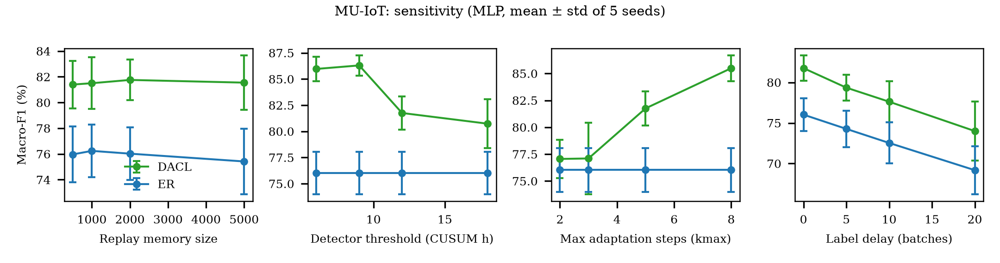

| method   |   value | parameter                    |   Macro-F1 (%) |   Forgetting (%) |   MAE |   Grad steps |
|:---------|--------:|:-----------------------------|---------------:|-----------------:|------:|-------------:|
| DACL     |     500 | Replay memory size           |           81.4 |             20.4 | 177.8 |        280.4 |
| DACL     |    1000 | Replay memory size           |           81.5 |             17.6 | 180   |        290.4 |
| DACL     |    2000 | Replay memory size           |           81.8 |             16.7 | 198.8 |        301.8 |
| DACL     |    5000 | Replay memory size           |           81.6 |             15.8 | 189.2 |        317   |
| ER       |     500 | Replay memory size           |           76   |             27.2 | 500   |        280   |
| ER       |    1000 | Replay memory size           |           76.2 |             26.7 | 501.6 |        280   |
| ER       |    2000 | Replay memory size           |           76   |             27   | 501   |        280   |
| ER       |    5000 | Replay memory size           |           75.4 |             26.2 | 474   |        280   |
| DACL     |       6 | Detector threshold (CUSUM h) |           86   |             12.7 | 108.6 |        461   |
| DACL     |       9 | Detector threshold (CUSUM h) |           86.3 |             11   | 104   |        452.8 |
| DACL     |      12 | Detector threshold (CUSUM h) |           81.8 |             16.7 | 198.8 |        301.8 |
| DACL     |      18 | Detector threshold (CUSUM h) |           80.7 |             18   | 215.8 |        271.4 |
| ER       |       6 | Detector threshold (CUSUM h) |           76   |             27   | 501   |        280   |
| ER       |       9 | Detector threshold (CUSUM h) |           76   |             27   | 501   |        280   |
| ER       |      12 | Detector threshold (CUSUM h) |           76   |             27   | 501   |        280   |
| ER       |      18 | Detector threshold (CUSUM h) |           76   |             27   | 501   |        280   |
| DACL     |       2 | Max adaptation steps (kmax)  |           77   |             22.7 | 385.2 |        190.8 |
| DACL     |       3 | Max adaptation steps (kmax)  |           77.1 |             22.7 | 359.6 |        197.6 |
| DACL     |       5 | Max adaptation steps (kmax)  |           81.8 |             16.7 | 198.8 |        301.8 |
| DACL     |       8 | Max adaptation steps (kmax)  |           85.5 |             10.8 | 128   |        444.8 |
| ER       |       2 | Max adaptation steps (kmax)  |           76   |             27   | 501   |        280   |
| ER       |       3 | Max adaptation steps (kmax)  |           76   |             27   | 501   |        280   |
| ER       |       5 | Max adaptation steps (kmax)  |           76   |             27   | 501   |        280   |
| ER       |       8 | Max adaptation steps (kmax)  |           76   |             27   | 501   |        280   |
| DACL     |       0 | Label delay (batches)        |           81.8 |             16.7 | 198.8 |        301.8 |
| DACL     |       5 | Label delay (batches)        |           79.4 |             17.7 | 251.4 |        266.2 |
| DACL     |      10 | Label delay (batches)        |           77.6 |             19.1 | 363.4 |        303.4 |
| DACL     |      20 | Label delay (batches)        |           74   |             18.3 | 467.8 |        292.4 |
| ER       |       0 | Label delay (batches)        |           76   |             27   | 501   |        280   |
| ER       |       5 | Label delay (batches)        |           74.3 |             27.3 | 583.6 |        275   |
| ER       |      10 | Label delay (batches)        |           72.5 |             27.5 | 657.8 |        270   |
| ER       |      20 | Label delay (batches)        |           69.2 |             28   | 807   |        260   |

### C. Natural drift: not applicable

MU-IoT's normal traffic lies only in the first 1.6% of the timeline (a separate capture session); replaying it in order would leave no benign background traffic.

## PureChain (global, live network)

| Metric | Value | |
|---|---|---|
| Poisoned-update acceptance rate (P4 attack, tau = 10%) | without gate: 100% | with PureChain gate: 39.6% (55/139) |
| Confirmation latency, propose (live PureChain) | mean 1694 ms | p95 1946 ms (n = 27) |
| Confirmation latency, attest (live PureChain) | mean 1892 ms | p95 2090 ms (n = 54) |
| On-chain model versions per run | DACL: 4.4 | continuous methods (FineTune, ER, DER++, ...): 280 |
| Rollback time (restore verified model) | MLP 0.093 ms | FT-Transformer 0.363 ms |

### Scalability: concurrent gateways (3 shared validators; PoA² network with 4 signers)

|   n_gateways |   updates |   accepted |   txs |   wall_s |   throughput_tx_s |   updates_per_min |   tx_lat_mean_s |   tx_lat_p95_s |   tx_lat_p99_s |   decision_mean_s |   decision_p95_s |   blocks_used |   gas_propose |   gas_attest |   log_bytes_per_update |   state_bytes_per_update |
|-------------:|----------:|-----------:|------:|---------:|------------------:|------------------:|----------------:|---------------:|---------------:|------------------:|-----------------:|--------------:|--------------:|-------------:|-----------------------:|-------------------------:|
|            1 |         5 |          5 |    15 |   29.519 |             0.508 |            10.163 |           1.884 |          2.188 |          2.29  |             5.904 |            6.131 |            15 |        127644 |      76320.6 |                    928 |                      192 |
|            5 |        25 |         25 |    75 |   35.887 |             2.09  |            41.798 |           1.812 |          2.142 |          2.435 |             6.621 |            8.768 |            19 |        124226 |      75981   |                    928 |                      192 |
|           10 |        50 |         50 |   150 |   73.043 |             2.054 |            41.072 |           1.954 |          2.586 |          2.872 |            13.424 |           17.644 |            56 |        124226 |      75468   |                    928 |                      192 |
